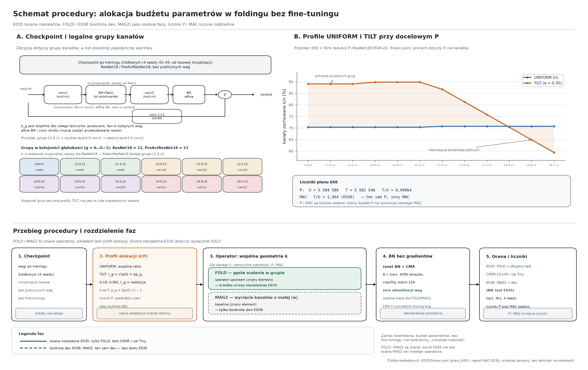
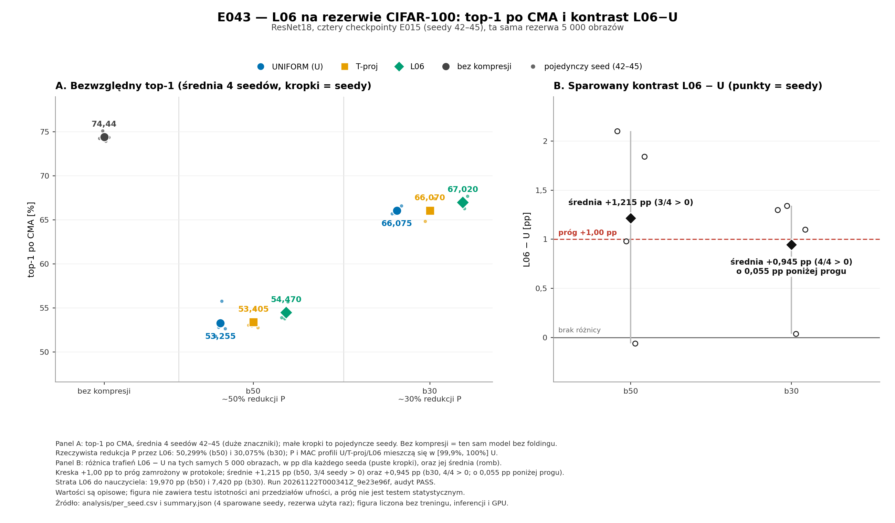
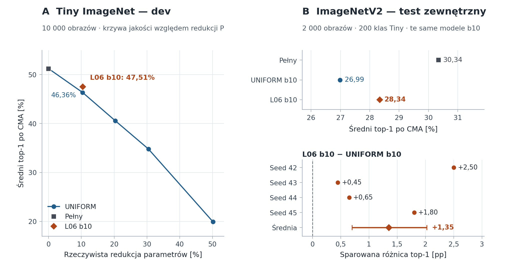

# Alokacja budżetu w foldingu CNN: jakość przy stałej liczbie parametrów i po ograniczeniu MAC

**Szkic 0.9 — do recenzji wewnętrznej.** TILT przy stałej liczbie parametrów,
kontrole kosztu i figura łagodnej kompresji na Tiny dev oraz ImageNetV2.

## Abstrakt

Badamy alokację szerokości kanałów w foldingu CNN bez dostrajania wag,
z rekalibracją Batch Normalization. Przy dopasowanej liczbie parametrów
liniowy TILT poprawia top‑1 względem UNIFORM w 15/15 konfiguracji oceny
niezależnej od doboru profilu (4/4 seedy w każdej), przy 1,105–1,823× MAC
UNIFORM. Na dev przy zbliżonym MAC TILT ustępuje szerszemu UNIFORM
(1,10–1,82× parametrów TILT) w 10/15 konfiguracji.

Przy obu pułapach UNIFORM profil L06, wybrany na CIFAR dev z puli losowych
przesunięć i zamrożony przed potwierdzeniem, daje przy łagodnej kompresji
+1,14 pp na Tiny dev oraz **+1,35 pp (4/4)** na 2 000 obrazach ImageNetV2
tych samych 200 klas, przy tych samych checkpointach (95% sparowany
przedział po obrazach [+0,700; +2,025] pp). Na ImageNetV2 strata do
pełnego modelu maleje z **3,35 do 2,00 pp** przy redukcji 10,41% parametrów
i 10,70% MAC.

## 1. Pytanie badawcze i zakres wkładu

Model folding redukuje szerokości sieci przez grupowanie i scalanie
kanałów. Pierwotna praca wskazuje brak optymalizacji sparsity per warstwa
jako kierunek dalszych badań [1, s. 13]. Główne porównania w *Cut Less,
Fold More* wykorzystują jednolite ratio per warstwa [2, s. 5]. Nie oznacza
to braku wcześniejszych niejednolitych wzorców: pierwotny folding obejmuje
także szczególne konfiguracje bloków CNN i LLaMA [1, s. 11–12].

**Pytanie:** jak nierównomierna alokacja zmienia jakość foldingu bez
fine-tuningu? Ile kosztuje zysk liniowego profilu i czy inny rozdział
szerokości daje zysk także pod jednoczesnymi pułapami P i MAC UNIFORM?

Trzy główne wyniki rozdzielają warunki porównania:

1. **Dopasowana liczba parametrów (E035).** Liniowy TILT daje powtarzalną
   poprawę top‑1 względem UNIFORM w badanych konfiguracjach.
2. **Koszt tej poprawy (E036/E037/E041).** TILT wymaga więcej MAC i ma niższą
   przepustowość batch128. Przy zbliżonym MAC w większości porównań wygrywa
   szerszy UNIFORM. Przy dopasowaniu P i MAC do kosztów TILT jego wynik
   względem innych profili zależy od zbioru.
3. **Zachowanie trafności pod pułapami UNIFORM (E046/E047).** Zamrożony
   L06 zmniejsza stratę przy łagodnym b10 na Tiny dev; zysk odtwarza się na
   ImageNetV2 przy tych samych modelach i klasach. E043/E044 uzupełniają
   ten wynik pomiarami przy większej redukcji.

Wkładem jest kontrolowane badanie tych zależności dla foldingu. Sama liniowa
reguła, nierówna alokacja i rozróżnienie parametrów od kosztu obliczeń mają
precedensy [3–5]. Nie zgłaszamy pierwszeństwa samego nierównego foldingu ani
rozwiązania ogólnego problemu optymalizacji szerokości.

## 2. Prace pokrewne i pochodzenie profilu

### 2.1. Folding i pruning

Wang i in. opisują grupowanie powiązanych wag, scalanie kanałów i naprawę
statystyk, z wariantami wykorzystującymi dane oraz wariantami data-free [1].
*Cut Less, Fold More* porównuje folding i structured magnitude pruning
z perspektywy projekcji oraz empirycznie przy wspólnych szerokościach [2].
Ich gwarancja rekonstrukcji z różnicą rzędu o jeden nie wyznacza najlepszej
alokacji całej sieci po BN [2, s. 4]. Nasze porównanie zmienia profil
szerokości pod globalnym budżetem parametrów.

IFM jest wcześniejszym przykładem iteracyjnego łączenia cech na podstawie
wag bez fine-tuningu. Zależny od progu proces może prowadzić do różnych
poziomów kompresji warstw [6, s. 6–7, 16–17]. Sama nierównomierność
szerokości również nie jest więc wystarczającą deklaracją nowości.

### 2.2. Liniowy profil jest znaną rodziną alokacji

Su i in. badali malejące wraz z głębokością keep-ratio, w tym wariant
*Linear Decay* proporcjonalny do `L − l + 1`, obok alokacji jednolitej,
odwróconej i innych profili. Był to głównie pruning nieustrukturyzowany,
po którym trenowano podsieci [4, dod. C.1–C.2, s. 14].

Jeszcze bliższy precedens stanowi ATP. Huang i in. proponują:

\[
s_i=S-\frac{\beta(L-1)}{2}+\beta(i-1),
\]

czyli ciąg arytmetyczny sparsity rosnącej z głębokością [3, równanie (10),
s. 8]. Badanie obejmuje przede wszystkim LLM, ale także modele wizyjne
oraz integrację ze structured pruning [3, dod. F.4–F.5, s. 24–25].

Nasz profil przed obcięciem wartości jest tą samą rodziną funkcji afinicznych.
Różnice dotyczą zastosowania do grup foldingu, ograniczeń szerokości,
zaokrągleń oraz doboru przesunięcia do rzeczywistej liczby parametrów
przebudowanej sieci. Nie traktujemy tych różnic jako dowodu nowości samej
zasady liniowej alokacji. Nazwa TILT jest lokalnym oznaczeniem badanego wariantu.

### 2.3. Alokacja pod budżetem

BALF wykorzystuje zniekształcenie aktywacji jako proxy do przydziału rang
pod globalnym budżetem FLOP lub parametrów, stosując relaksację Lagrange'a
[5, §4.3 i dod. C]. Praca ta pokazuje, że alokacja bez fine-tuningu pod
jawnym budżetem ma precedensy również poza pruningiem. Nasze wyniki
dotyczą innego operatora i sprzężonych szerokości kanałów.

Relative Repairability używa stosunku resztkowego do początkowego
zniekształcenia po pruningu jednej warstwy i określonej naprawie. Autorzy
traktują sumę lokalnych wyników jako przybliżenie dla całej sieci, a nie
dokładny predyktor trafności. Badają nieustrukturyzowany pruning przy
bardzo dużej sparsity [7, §3 i §6]. GRAIL rekonstruuje natomiast aktywacje
na podstawie danych kalibracyjnych po ustaleniu kompresji. Główne porównanie
CNN/ViT stosuje jednolite ratio [8, §3.1 i §4.1]. W naszych porównaniach
alokacji operator i rekalibracja pozostają stałe, a zmienną jest wektor
szerokości; zmianę operatora sprawdzamy w osobnej kontroli.

## 3. Metoda i protokół

### 3.1. Jednostka alokacji

Decyzja dotyczy legalnej grupy kanałów, a nie dowolnej niezależnej warstwy.
Grupa obejmuje osie wag, które muszą zostać przebudowane wspólnie, m.in.
ze względu na połączenia residualne i konsumentów kanałów. Rozpatrywane
modele mają 12 grup w ResNet18 i 13 w PreActResNet18.

Niech `n_g` będzie oryginalną szerokością grupy, a `k_g` szerokością po
kompresji. Wektor `k` określa architekturę, natomiast operator FOLD lub MAG2
określa sposób wyznaczenia jej wag. Liczymy wszystkie parametry modelu;
bufory BN nie są parametrami. MAC obejmuje warstwy Conv/Linear dla
ustalonego rozmiaru obrazu.



Schemat przedstawia porównanie wspólnych geometrii FOLD/MAG2 oraz odrębne
fazy oceny. [PDF wektorowy i źródło](experiments/2026-11-07_E035_ocena_niezalezna/figures/schemat/README.md).

### 3.2. UNIFORM i TILT

W UNIFORM stosujemy wspólną redukcję kanałów we wszystkich grupach.
TILT ma postać:

\[
p_g=\frac{2g}{G-1}-1,\qquad
r_g=\operatorname{clip}(b+\alpha p_g,\;0{,}10,\;0{,}90),
\]

gdzie `g = 0,…,G−1` indeksuje grupy w przyjętej kolejności, `r_g` oznacza
**redukcję kanałów**, a nie udział kanałów zachowanych. Dodatnie `α` chroni
wczesne grupy i zwiększa kompresję późnych. Badany główny wariant ma
`α = 0,30`; przesunięcie `b` dobieramy do budżetu parametrów. Szerokości
są całkowitoliczbowe, a końcowe korekty służą dopasowaniu budżetu.

W obu architekturach używamy następującego przepisu (`P(k)` liczone z
kształtów wszystkich parametrów po zmianie szerokości):

```text
profile(limit, α):
    k_g(b) = floor(n_g · (1 − clip(b + α p_g, 0.10, 0.90)))
    znajdź b po stronie P(k(b)) ≤ limit przez 60 kroków bisekcji
    k ← k(b)
    jeśli α ≠ 0:
        dopóki jest możliwe +1 kanału w jednej grupie bez naruszenia
        limitu ani k_g ≤ floor(0.90 n_g), wybierz ruch o największym P(k)
        (przy remisie najniższy indeks grupy)
    zwróć k
U ← profile(round((1 − redukcja) · P(n)), 0)
T ← profile(P(U), 0.30)
```

Profile wybierano wcześniej na danych rozwojowych i zamrożono przed oceną
niezależną. Nie dobierano `α` na testach E035. Aktualne profile są zapisane
w zamrożonych planach E035; nie należy zastępować ich starszymi profilami
E014, ponieważ solver i zaokrąglenia dawały różnice między etapami.

ATP i TILT opisują tę samą nieobciętą rodzinę przy `g = i−1`, `G = L`,
`b = S` oraz `α = β(G−1)/2`. Nie są identycznymi procedurami: `S` w ATP
oznacza średnią sparsity warstw, podczas gdy u nas `b` dobieramy do
rzeczywistego kosztu parametrycznego sprzężonych szerokości [3, s. 8].

Nominalne 30/50/70% oznacza **redukcję liczby parametrów**, nie redukcję
kanałów w każdej grupie. W ocenie E035 profile TILT mają nie więcej
parametrów niż odpowiadający UNIFORM i co najmniej 99,9% jego liczby
parametrów. Budżet parametrów nie narzuca równego MAC.

[Faktyczne szerokości U/T, 5 par × 3 budżety](experiments/2026-11-07_E035_ocena_niezalezna/figures/publikacja/fig1_szerokosci_grup.pdf)
pokazują `k/n` dla poszczególnych grup; [dane i generator](experiments/2026-11-07_E035_ocena_niezalezna/figures/publikacja/README.md).

### 3.3. Operator i rekalibracja

Korzystamy z operatora upstream `folding_as_projection`, commit
`694691556e8314a835178a741938dd3d4d80c171`, z jawnym adapterem profilu
szerokości i zachowaniem biasu klasyfikatora. Kontrole E029–E031 sprawdzają
zgodność z wcześniejszymi implementacjami. Tiny wykorzystuje nasz wariant
ResNet18 dla wejścia 64×64; nie jest to reprodukcja pełnego CLFM 1:1.

Po kompresji nie wykonujemy aktualizacji gradientowych. Podstawowa
rekalibracja BN to reset i cumulative moving average (CMA) na 4096
obrazach train z ustalonym crop/flip, batch128. Wtórnie oceniamy oryginalną
funkcję `repair_bn` upstream. Obie procedury startują z osobnych kopii
stanu po kompresji. Kontrolujemy również model oryginalny po samej BN.
Jest to procedura korzystająca z danych, a nie pipeline calibration-free.

### 3.4. Modele, dane i agregacja

Badamy ResNet18 na CIFAR-10, CIFAR-100 i Tiny ImageNet oraz PreActResNet18
na obu CIFAR-ach: pięć par model–zbiór, trzy budżety i cztery seedy
treningu źródłowego (42–45). Checkpointy wytrenowano w tym projekcie od
losowej inicjalizacji; nie używamy publicznych wag.
W każdym biegu bazowym: 200 epok, SGD (lr 0,1, momentum 0,9,
weight decay 5×10⁻⁴, cosine), batch 128 na GPU i 128 na niezależny
trening modelu. Źródła receptur:
[E011](experiments/2026-10-22_E011_cifar10_resnet18_checkpoint/OPIS.md),
[E015](experiments/2026-10-27_E015_cifar100_alokacja/OPIS.md),
[E019](experiments/2026-10-29_E019_tinyimagenet_alokacja/OPIS.md),
[E034](experiments/2026-11-05_E034_preactresnet18/WYNIKI.md).

Ocena niezależna E035 wykorzystała oficjalne testy CIFAR i oficjalny val
Tiny, po 10 000 przykładów. Val Tiny był wcześniej otwierany do kontroli
kształtów danych, bez oceny modeli; nie był zbiorem nigdy nieotwartym.
Kontrole E037–E039, E041 i E042 dotyczą wcześniej użytego dev. E043 użył
innych 5 000 obrazów CIFAR-100, z rezerwy odłożonej z oficjalnego train
przed treningiem checkpointów; zbiór jest rozłączny z A4096 i dev.
E044 ponownie wykorzystał oficjalny val Tiny z E035, aby sprawdzić transfer
na konfigurację nieużytą przy wyborze L06. E045 i E046 używają Tiny dev
wydzielonego z train. E047 ocenia te same modele E046 na zewnętrznej
próbie ImageNetV2. Nie łączymy tych faz w jedną ocenę niezależną.

Wyniki podajemy jako sparowane różnice po czterech seedach, osobno dla
każdej pary model–zbiór i budżetu. SD jest próbne (`ddof=1`). Cztery seedy
nie stają się 60 niezależnymi powtórzeniami przez zestawienie 15 konfiguracji.
Raportowane bramki są opisowe, nie stanowią testów istotności.

Uruchomienia kompresji/oceny podzielono na cztery GPU, jeden seed na
urządzenie, z konfiguracjami wykonywanymi kolejno. E035–E039 i E043–E047 korzystają
z 4×RTX2080Ti, Conda `attention`, Python3.11.15, Torch2.12.0+cu130,
CUDA13.0, FP32 i wyłączonego TF32. Audyt czasu E036 mierzy device-forward
na wejściach syntetycznych, osobno dla batch1 i batch128; nie jest pomiarem
pełnej aplikacji z loaderem i transferami.

### 3.5. Pomiar zapasu pod pułapami UNIFORM

Osobny pilot E042: ResNet18 na CIFAR-100 (główny) i CIFAR-10 (kontrolny),
nominalnie 50% redukcji P. Przyjmujemy tylko profile o P i MAC w 99,9–100%
obu kosztów historycznego UNIFORM. Z geometrii bez wyników jakości zamrożono
na zbiór 24 profile: 8 wymian wewnątrz etapów, 4 między etapami i 12 losowych,
rzutowanych na wspólne pułapy. Referencje to U oraz analogicznie rzutowany
historyczny TILT (T-proj). Wszystkie oceny na dev po tej samej CMA. Z puli
wybieramy jeden profil wg średniej po 4 checkpointach i podajemy sparowane
różnice względem mocniejszej referencji. Kryterium przystąpienia do badania
selekcji to zysk ≥1 pp i ≥3/4 dodatnich różnic na CIFAR-100.
[Zamrożony protokół i tolerancje](experiments/2026-11-21_E042_zapas_pod_uniform/OPIS.md).

### 3.6. Potwierdzenie zamrożonego profilu na rezerwie

W E043 bierzemy jeden profil L06 wskazany w E042. W budżecie b50 odtwarzamy
jego geometrię dokładnie, w b30 dodajemy te same przesunięcia udziałów `k/n`
w tej samej kolejności 12 grup do UNIFORM dla nowego budżetu. Po
zaokrągleniu propozycji do kanałów minimalizujemy kwadrat odległości w `k/n`
przy obu celach kosztu równych 0,9995 kosztu U, a po zaokrągleniu
rozwiązania dopuszczamy deterministyczną korektę najwyżej dwóch grup.
Końcowe P i MAC każdego porównywanego profilu wynoszą 99,9–100% obu kosztów
U. T-proj to analogicznie rzutowany TILT danego budżetu.

Główny kontrast L06−U przy ≈50% i wtórny przy ≈30% redukcji P oceniamy
osobno na tych samych 5 000 odłożonych obrazach i tych samych czterech
checkpointach co w E042. Każdy profil, włącznie z pełnym modelem, przechodzi
tę samą CMA na A4096. Zamrożony próg to +1,00 pp i ≥3/4 dodatnich par w
danym budżecie; to kryterium praktyczne. Cztery modele mają wspólny zbiór
obrazów. [Protokół, szerokości i odtworzenie](experiments/2026-11-21_E043_l06_potwierdzenie_transfer/OPIS.md).

### 3.7. Transfer L06 na Tiny ImageNet

Tiny nie brał udziału w wyborze profilu. Na czterech modelach Tiny64 z E019
przenosimy przesunięcia L06 w kolejności tych samych 12 grup i ponownie
wyznaczamy szerokości pod pułapami U dla innego stema i rozdzielczości.
Na użytym wcześniej val stosujemy tę samą CMA z A4096 (Tiny train, widoki
E030/E035). Główny kontrast to L06−U przy ≈50% redukcji P ze z góry
ustalonym kryterium kierunku: dodatnia średnia i ≥3/4 dodatnich różnic.
Przy ≈30% raportujemy wynik wtórny. Dla głównego kontrastu dodatkowo
podajemy sparowany bootstrap po obrazach (stratyfikacja po klasach,
10 000 losowań, wspólne indeksy dla seedów), warunkowo na tych modelach.
[Zamrożony protokół](experiments/2026-11-22_E044_l06_tiny/OPIS.md).

### 3.8. Zamrożony profil przy łagodnym budżecie

W E046 na tym samym Tiny dev i A4096/CMA co w E045 oceniamy jeden L06 przy
około 10% redukcji P. Te same przesunięcia stosujemy do U/b10, a następnie
rzutujemy na [99,9%, 100%] obu rzeczywistych kosztów U/b10. Jawnie zmieniamy
górną granicę szerokości z `floor(0,9n)` na `n`: stara domena na Tiny
wymuszałaby co najmniej 19,21% redukcji P. Zamrożony profil nie jest
wybierany na Tiny. Sprawdzamy konstrukcje na CPU i przed oceną L06
odtwarzamy dokładnie stany po CMA i trafienia pełnych modeli oraz U/b10
z E045. [Protokół](experiments/2026-11-22_E046_l06_b10_tiny/OPIS.md).

### 3.9. Zewnętrzne potwierdzenie przy b10

E047 wykorzystuje ImageNetV2 MatchedFrequency, rewizję `imagenetv2-b-33`
[9], zawężoną do wszystkich 200 `wnid` Tiny (10 obrazów na klasę).
Weryfikujemy przyporządkowanie etykiet względem manifestu autorów i brak
duplikatów według z góry ustalonego audytu RGB/pHash względem 110 000
obrazów Tiny train/dev/val. Obrazy RGB skalujemy w całości do 64×64
biliniowo i normalizujemy jak w E046. Przed oceną odtwarzamy dokładnie
stany i koszty pełnego, U/b10 i L06/b10 po tej samej A4096/CMA na Tiny train
(12/12 zgodnych). Kryterium to dodatnia średnia, ≥3/4 dodatnich kontrastów
i dolna granica 95% przedziału >0 pp. Bootstrap sparowany wewnątrz klas,
10 000 losowań, wspólne obrazy dla wszystkich modeli, warunkowo na tych
checkpointach. [Protokół](experiments/2026-11-22_E047_l06_b10_imagenetv2/OPIS.md).

## 4. Wyniki

### 4.1. Jakość przy dopasowanych parametrach — ocena niezależna

Tabela przedstawia top1 w procentach oraz sparowaną różnicę w punktach
procentowych po CMA. Każdy wiersz ma dodatnią różnicę na 4/4 seedach.

| Model / zbiór | Redukcja P | UNIFORM | TILT | TILT−U ±SD [pp] |
|---|---:|---:|---:|---:|
| ResNet18 / CIFAR-10 | 30% | 93,0400 | 93,8500 | +0,8100 ±0,0594 |
| ResNet18 / CIFAR-10 | 50% | 89,2800 | 92,6925 | +3,4125 ±0,2564 |
| ResNet18 / CIFAR-10 | 70% | 76,7925 | 87,7800 | +10,9875 ±1,4358 |
| ResNet18 / CIFAR-100 | 30% | 65,7675 | 66,5950 | +0,8275 ±0,2863 |
| ResNet18 / CIFAR-100 | 50% | 53,4275 | 54,7300 | +1,3025 ±0,7834 |
| ResNet18 / CIFAR-100 | 70% | 30,6200 | 32,6800 | +2,0600 ±2,4948 |
| ResNet18 / Tiny | 30% | 34,5575 | 38,0950 | +3,5375 ±1,0847 |
| ResNet18 / Tiny | 50% | 19,6400 | 29,0000 | +9,3600 ±1,0830 |
| ResNet18 / Tiny | 70% | 8,3975 | 15,8800 | +7,4825 ±1,2595 |
| PreActResNet18 / CIFAR-10 | 30% | 93,1275 | 94,0875 | +0,9600 ±0,1944 |
| PreActResNet18 / CIFAR-10 | 50% | 88,5400 | 93,4900 | +4,9500 ±1,5034 |
| PreActResNet18 / CIFAR-10 | 70% | 77,6875 | 91,2650 | +13,5775 ±2,4453 |
| PreActResNet18 / CIFAR-100 | 30% | 66,4975 | 70,9850 | +4,4875 ±2,1362 |
| PreActResNet18 / CIFAR-100 | 50% | 55,9050 | 63,5475 | +7,6425 ±1,2266 |
| PreActResNet18 / CIFAR-100 | 70% | 23,0050 | 45,7425 | +22,7375 ±3,0018 |

Źródło: [E035, primary CMA](experiments/2026-11-07_E035_ocena_niezalezna/WYNIKI.md).
Ilustracje per seed: [top‑1 z modelem wyjściowym](experiments/2026-11-07_E035_ocena_niezalezna/figures/publikacja/fig2_teacher_cma_top1.pdf)
i [strata trafności względem niego](experiments/2026-11-07_E035_ocena_niezalezna/figures/publikacja/fig3_teacher_cma_utrata.pdf).

Kryterium kierunku E035 spełniono w 15/15 konfiguracji. Osobny próg
średniej poprawy ≥2 pp przy 50/70% spełniono w 9/10; wyjątkiem jest
ResNet18/CIFAR-100/50%. Nie należy utożsamiać obu kryteriów.
Przy ResNet18/CIFAR-100/70% średnia przekracza próg tylko o 0,0600 pp,
a dwa seedy mają poprawę +0,20 i +0,36 pp. Nie jest to silny, jednolity
efekt pomimo dodatniego kierunku na wszystkich seedach.

Wtórna procedura `repair_bn` utrzymuje kryterium kierunku w 14/15
konfiguracji; ResNet18/CIFAR-100/70% ma tylko 2/4 dodatnie seedy.
Przy ResNet18/CIFAR-100/50% i 70% średnie NLL po CMA jest gorsze dla TILT.
Po `repair_bn` ResNet18/CIFAR-100 ma gorsze średnie NLL dla TILT przy
wszystkich trzech budżetach. Poprawa top1 nie jest zatem jednolitą poprawą
wszystkich miar jakości.

### 4.2. MAC, przepustowość i pamięć

Przy dopasowanych parametrach iloraz MAC(TILT)/MAC(UNIFORM) wynosi
1,105–1,823, a iloraz przepustowości batch128 wynosi 0,702–0,948.
Średnie ilorazy latencji batch1 są w zakresie 0,965–1,046, przy SD
0,019–0,100. Małe różnice średnich nie dowodzą równoważności opóźnień.
Na Tiny przy 50/70% peak pamięci batch128 jest wyższy dla TILT o około
68–82%. Są to pomiary jednego środowiska sprzętowego.

Źródło: [E036](experiments/2026-11-07_E036_audyt_kosztu/WYNIKI.md).

### 4.3. Kontrole kosztu przy różnych alokacjach — dev

Definiujemy U' jako UNIFORM o szerokości dobranej do MAC profilu TILT.
Różnica MAC nie przekracza 2%; iloraz P(U')/P(TILT) wynosi jednak
1,10–1,82. Po CMA średni TILT−U' jest dodatni w 5/15 konfiguracji,
a ujemny w 10/15. Na CIFAR-100 i Tiny wygrywa U', do 23,69 pp.

Wynik ogranicza zastosowanie TILT pod limitem MAC. Nie wyjaśnia jednak,
jaka część zysku przy stałym P wynika z compute: zmienia się również
pojemność U'. Nie wyznaczamy tu optymalnej granicy jakość–MAC.

Źródło: [E037](experiments/2026-11-08_E037_kontrola_mac/WYNIKI.md).
[Figura jakość–P/MAC dla U/T/U' w tej samej fazie dev](experiments/2026-11-08_E037_kontrola_mac/figures/publikacja/e035_e037_jakosc_p_mac.pdf)
zawiera także punkt kosztu i odniesienia dla modelu nieskompresowanego.

W E041 cztery z góry ustalone przestawienia rzutowano na **oba koszty
TILT** (99,9–100% jego P i MAC). Na dev ResNet18 przy około 50% redukcji
P przewaga TILT nad średnią kontroli wyniosła po CMA **+0,11 pp (2/4)**
na CIFAR-10 i **+2,10 pp (4/4)** na CIFAR-100. Na CIFAR-10 najlepsza
kontrola wygrywa z TILT o 0,39 pp na 4/4 seedach; na CIFAR-100 przewaga
TILT nad najlepszą kontrolą wynosi 0,86 pp. Łączne kryterium nie zostało
spełnione. [Raport E041](experiments/2026-11-15_E041_kontrola_p_mac/WYNIKI.md) ·
[Figura](experiments/2026-11-15_E041_kontrola_p_mac/figures/20261116T040008Z_9e34f1e9/e041_kontrasty.pdf).

### 4.4. Operator kompresji — dev

Dla danego profilu FOLD i MAG2 mają identyczne szerokości, P i MAC.
Porównujemy przyrosty po zamianie U na TILT:

\[
I=(\operatorname{Acc}_{F,T}-\operatorname{Acc}_{F,U})
 -(\operatorname{Acc}_{M,T}-\operatorname{Acc}_{M,U}).
\]

Przy 50% redukcji P średnie `I` jest dodatnie tylko w jednej z pięciu
par model–zbiór. Na całej siatce średnia korzyść TILT dla MAG2 jest
dodatnia w 15/15 konfiguracji. Jednocześnie FOLD/TILT ma wyższy średni
top1 od MAG2/TILT w 15/15. Przyrost względem UNIFORM i końcowy poziom
jakości są różnymi porównaniami. Różnica przyrostów w surowych pp nie
jest dowodem przyczynowym, zwłaszcza przy niskiej jakości MAG2.

Źródło: [E038](experiments/2026-11-08_E038_operator_alokacja/WYNIKI.md)
i [figura operator × profil](experiments/2026-11-08_E038_operator_alokacja/figures/e038_interakcja.pdf).

### 4.5. Dodatkowe kontrole i próby automatycznej alokacji

TILT wygrywa ze średnią czterech ustalonych przestawień profilu w 9/9
badanych konfiguracji na dev, każda 4/4 seedy. Przestawienia mają jednak
0,433–0,910 MAC profilu TILT. Nie izoluje to kolejności od kosztu obliczeń.
Źródło: [E039](experiments/2026-11-08_E039_przestawienia_tilt/WYNIKI.md).

Wcześniejsze próby search nie uzyskały stabilnej przewagi nad TILT na obu
CIFAR-ach. Na CIFAR-100 wybór według disagreement dał +0,935 pp, poniżej
ustalonego progu +1 pp; na CIFAR-10 +0,220 pp. Maksimum odwiedzonej puli
miało odpowiednio +1,660 i +0,545 pp względem TILT. Wskazanie tego
maksimum korzysta z etykiet dev i opisuje wyłącznie odwiedzoną pulę.
Źródła: [E027](experiments/2026-11-01_E027_diagnostyka_celu/WYNIKI.md),
[E028](experiments/2026-11-01_E028_transfer_cifar10/WYNIKI.md).

Model par szkody po BN w E040 dał iloraz MAE względem modelu addytywnego
1,765/2,332 na CIFAR-10/100. Mierzono przewidywanie niezgodności decyzji
z teacherem na 16 ustalonych profilach i rozwojowym zbiorze C2048,
wcześniej używanym w projekcie. To nie MAE błędu klasyfikacji top1.
Zatrzymano próbę przed dev; nie oceniono przewagi top1. Wynik dotyczy tej
konkretnej parametryzacji, nie dowodzi ogólnej niemożności modelowania interakcji.
Źródło: [E040](experiments/2026-11-09_E040_interakcje_po_bn/WYNIKI.md).
Figury uzupełniające: [przestawienia E039](experiments/2026-11-08_E039_przestawienia_tilt/figures/e039_kolejnosc.pdf),
[błąd predykcji E040](experiments/2026-11-09_E040_interakcje_po_bn/wykresy/e040_mae.pdf).

### 4.6. Zapas przy P i MAC UNIFORM — pilot na dev

W obu zbiorach najtrafniejszą referencją był U. Najlepszy kandydat (L06)
podniósł top‑1 na CIFAR-100 z 53,855 do **55,030%**, czyli o
**1,175 ± 0,992 pp (3/4 seedów)**, a na kontrolnym CIFAR-10 z 89,435 do
**90,910%**, o **1,475 ± 0,542 pp (4/4)**. W obu zbiorach L06 pochodzi z
tego samego losowego wektora przesunięć; końcowe szerokości po projekcji
są różne. Wybór oparto na dev. Na tych danych liniowy TILT rzutowany na
pułapy U (T-proj) nie poprawił średniej trafności U.

Na CIFAR-100 **5/24** kandydatów poprawiło średnią, z medianą **−1,265 pp**
i tylko jednym kandydatem powyżej zamrożonego progu. Zużycie obu zasobów
jest niemal identyczne, więc dodatni kontrast L06 nie wymaga więcej P ani
MAC. Nadal pozostaje **20,11 pp** straty względem modelu nieskompresowanego.
[Wyniki i rozkład wszystkich kandydatów](experiments/2026-11-21_E042_zapas_pod_uniform/WYNIKI.md).

### 4.7. L06 pod dwoma pułapami — odłożone obrazy CIFAR-100

| Redukcja P | U [%] | T-proj [%] | L06 [%] | L06−U ± SD [pp] | L06−T-proj [pp] | Strata L06 do pełnego modelu [pp] |
|---:|---:|---:|---:|---:|---:|---:|
| ≈50% (główna) | 53,255 | 53,405 | 54,470 | **+1,215 ± 0,975** (3/4) | +1,065 (4/4) | 19,970 |
| ≈30% (wtórna) | 66,075 | 66,070 | 67,020 | **+0,945 ± 0,612** (4/4) | +0,950 (4/4) | 7,420 |



Panel A: trafność po CMA; pełny model 74,440%. Panel B: różnice L06−U
na sparowanych checkpointach i ich średnia, z praktycznym progiem +1 pp.
[Figura wektorowa i generator](experiments/2026-11-21_E043_l06_potwierdzenie_transfer/wykresy/20261122T000341Z_9e23e96f/README.md).

Kryterium główne jest spełnione (243 dodatkowe trafienia przy progu 200,
sumując cztery pary). Przy 30% redukcji P zysk ma dodatni kierunek
na wszystkich seedach, choć średnia jest o 0,055 pp poniżej progu.
P/MAC L06 w b50: 5 576 517 / 275 293 400, wobec 5 581 542 /
275 335 732 dla U; w b30: 7 845 652 / 385 996 368 wobec 7 846 668 /
386 292 784. Wynik dotyczy top‑1 i statycznych pułapów, nie dowodzi równej
latencji. [Pełne wyniki i audyt](experiments/2026-11-21_E043_l06_potwierdzenie_transfer/WYNIKI.md).

### 4.8. Transfer L06 pod dwoma pułapami — Tiny ImageNet

| Redukcja P | U [%] | T-proj [%] | L06 [%] | L06−U ± SD [pp] | L06−T-proj [pp] | Strata L06 do pełnego modelu [pp] |
|---:|---:|---:|---:|---:|---:|---:|
| ≈50% (główna) | 19,6400 | 20,7100 | 21,7400 | **+2,100 ± 1,116** (4/4) | +1,030 (3/4) | 29,0375 |
| ≈30% (wtórna) | 34,5575 | 34,6725 | 34,8125 | **+0,255 ± 0,824** (3/4) | +0,140 (2/4) | 15,9650 |

Pełny model po CMA: 50,7775%. W b50 główny kontrast ma 95% przedział
bootstrapu po obrazach **[+1,67; +2,52] pp** warunkowo na tych czterech
checkpointach. L06 ma 5 618 309 P / 75 312 564 MAC wobec 5 623 142 P /
75 359 828 MAC dla U. TILT bez projekcji z E035 ma na tym samym val wyższe
top‑1 (29,000%) przy 102,24 mln MAC, powyżej pułapu U. Przy 30% zatrzymujemy
więcej jakości bezwzględnej, ale przewaga alokacji jest mniejsza.
[Wyniki i audyt](experiments/2026-11-22_E044_l06_tiny/WYNIKI.md).

### 4.9. Łagodna kompresja pod oboma pułapami — Tiny dev i ImageNetV2



**A — Tiny dev.** Krzywa UNIFORM od pełnego modelu do b50: pełny, b10
i b20 z E045, b30 i b50 z E035 dev. Punkt L06/b10 z E046 leży przy
rzeczywistej redukcji 10,41% P i 10,70% MAC. **B — ImageNetV2.** Te same
modele na 2 000 nowych obrazach. U góry średni top‑1, u dołu różnice
L06−U dla czterech seedów oraz średnia z 95% przedziałem sparowanego
bootstrapu po obrazach, warunkowo na checkpointach.
[PDF wektorowy, źródła i generator](experiments/2026-11-22_E047_l06_b10_imagenetv2/wykresy/20261122T053804Z_ae2dec73/README.md).

| Model | P | MAC/obraz | Tiny dev: top‑1 [%] | Tiny dev: strata [pp] | ImageNetV2: top‑1 [%] | ImageNetV2: strata [pp] |
|---|---:|---:|---:|---:|---:|---:|
| Pełny | 11 279 112 | 148 148 224 | 51,2200 | 0 | 30,3375 | 0 |
| UNIFORM b10 | 10 111 430 | 132 336 196 | 46,3625 | 4,8575 ± 0,5309 | 26,9875 | 3,3500 ± 0,7853 |
| L06/b10 | 10 104 855 | 132 302 192 | **47,5050** | **3,7150 ± 0,5132** | **28,3375** | **2,0000 ± 0,2483** |

Strata to top‑1 pełnego minus top‑1 skompresowanego na tym samym seedzie
(średnia ± próbne SD). Na Tiny dev L06 zyskuje **+1,1425 ± 0,8820 pp**
względem U (4/4; od +0,05 do +1,94 pp). Dla kontekstu U/b20 osiąga tam
40,5800%, ze stratą 10,6400 pp. [E045](experiments/2026-11-22_E045_lagodny_uniform_tiny/WYNIKI.md) ·
[E046](experiments/2026-11-22_E046_l06_b10_tiny/WYNIKI.md).

Na ImageNetV2 L06 zyskuje **+1,3500 ± 0,9704 pp** (4/4; od +0,45 do
+2,50 pp). Sparowany 95% przedział po obrazach: **[+0,700; +2,025] pp**;
zamrożone kryterium potwierdzenia jest spełnione. P i MAC są zgodne z
E046 i mieszczą się pod pułapami U/b10. [E047: trafienia i audyt](experiments/2026-11-22_E047_l06_b10_imagenetv2/WYNIKI.md).

## 5. Dyskusja i ograniczenia

Stały budżet parametrów dopuszcza architektury o różnych kosztach MAC,
aktywacji i czasu. Ochrona szerokości wczesnych grup przenosi część
budżetu do obszaru o większej rozdzielczości przestrzennej. E037 nie
rozdziela wpływu MAC od wpływu liczby parametrów. E041 kontroluje oba
koszty i pokazuje, że na CIFAR-100 w tej puli różne profile dają różną
jakość, ale nie ustala mechanizmu ani ogólnej przewagi TILT. E042 wskazuje
geometrię L06 przez selekcję na dev. E043 oddziela ten wybór od oceny:
zysk przy obu pułapach U replikuje się na odłożonych obrazach przy 50%
redukcji P. Przy 30% wynik pozostaje dodatni, ale nie spełnia progu.
E044 wspiera transfer L06 na Tiny przy 50%, lecz przy 30% zysk jest mały
i różni się między seedami. L06 stanowi tanią referencję do badania
przyszłych selektorów. E046 przenosi zamrożone przesunięcia na b10 i pokazuje
na Tiny dev, że zysk pod dwoma pułapami nie wymaga agresywnej kompresji.
E047 potwierdza tę obserwację na ImageNetV2 dla tych samych 200 klas i modeli.

Znane precedensy liniowych profili [3–4] zawężają nowość pracy do badania
konkretnej adaptacji i jej kompromisów w foldingu. Ani przesunięcie
profilu do budżetu, ani liczba przeprowadzonych eksperymentów nie stanowią
samodzielnie nowej teorii optymalizacji. Nie zweryfikowaliśmy też pierwszego
zastosowania tej rodziny do foldingu w całej literaturze.

Poprawa względna może współistnieć z niską jakością bezwzględną. Przy
70% redukcji P TILT osiąga 32,68% na ResNet18/CIFAR-100, 15,88% na Tiny
i 45,7425% na PreActResNet18/CIFAR-100. Odpowiadające modele oryginalne
po CMA mają 74,3725%, 50,7775% i 76,4700%. E045 pokazuje praktyczny koszt
na łagodniejszym krańcu: około 10% mniej P i MAC na Tiny dev nadal kosztuje
średnio 4,86 pp dla U, a około 20% redukcji P — 10,64 pp dla U. L06
ogranicza stratę przy b10 do 3,72 pp, ale jej nie eliminuje.

Główne badanie obejmuje dwie pokrewne architektury i trzy zbiory;
cztery seedy w danej parze pochodzą z ustalonego przepisu treningu. E047
poszerza zakres obrazów testowych przy jednej architekturze i jednym b10,
nie zakres klas ani treningów. Na nowej próbie spada także trafność modelu
pełnego (z 51,2200 do 30,3375%); mniejsza strata w pp nie oznacza lepszej
jakości bezwzględnej. ImageNetV2 stanowi inny rozkład niż oficjalny Tiny.
Nie porównujemy z pełnymi współczesnymi pipeline'ami kompresji ani nie
deklarujemy SOTA. Pomiary czasu dotyczą jednego serwera i nie obejmują
pełnego kosztu wdrożenia. Ocena MAC nie zastępuje pomiaru latencji.

Po E035 jego testy są danymi użytymi, a po E043 użyta jest także rezerwa
CIFAR-100. Kontrole na dev (E037–E039, E041–E042, E045–E046) i diagnostyka E040 na C
mają charakter rozwojowy. E043 testuje odłożone obrazy przy tych samych
checkpointach co E042. E044 zmienia konfigurację, lecz korzysta z val
Tiny znanego z E035. Próba ImageNetV2 jest użyta po E047. Żaden z tych
pomiarów nie izoluje pojedynczej przyczyny różnic między zadaniami;
bootstrap E044 i E047 obejmuje zmienność po obrazach, nie po treningach
modeli.

## 6. Wnioski

W badanych konfiguracjach liniowy profil alokacji poprawia top1 foldingu
względem UNIFORM przy niemal identycznej liczbie parametrów, bez
fine-tuningu, po rekalibracji BN. Korzyść ma wymierny koszt MAC oraz
przepustowości. Na odłożonych obrazach CIFAR-100 zamrożony L06 poprawia
top1 o 1,215 pp przy ≈50% redukcji P bez zwiększania P ani MAC względem
U. Przy ≈30% przyrost wynosi 0,945 pp na tych samych checkpointach.
Na Tiny, poza konfiguracjami wyboru L06, zysk wynosi 2,100 pp w b50
i 0,255 pp w b30 na wcześniej użytym val. W pilocie większość badanych profili
obniżała trafność, a strata bezwzględna L06 pozostaje duża, zwłaszcza w b50.
Na Tiny dev, przy b10, L06 zmniejsza stratę do pełnego o 1,1425 pp pod oboma
pułapami U; pozostaje 3,7150 pp straty. Na nowych obrazach ImageNetV2 zysk
wynosi 1,3500 pp, a pozostała strata 2,0000 pp. Dodatni przyrost liniowej
alokacji obserwujemy także dla MAG2. Wyniki
charakteryzują wpływ wyboru profilu przy kilku warunkach kosztu, nie
ustanawiają ogólnego optymalizatora ani nowej zasady liniowego rozdziału budżetu.

## Bibliografia robocza — wersje i miejsca sprawdzone w PDF

1. Wang, Šikić, Thiele, Saukh. *Forget the Data and Fine-tuning! Just Fold
   the Network to Compress*. [2502.10216v2](https://www.alphaxiv.org/abs/2502.10216v2).
   Future work: s. 13; szczególne profile: s. 11–12; uniform: dod. A, s. 19.
2. Saukh, Wang, Šikić, Cheng, Thiele. *Cut Less, Fold More: Model Compression
   through the Lens of Projection Geometry*.
   [2602.18116v1](https://www.alphaxiv.org/abs/2602.18116v1).
   Gwarancja: s. 4; uniform i BN: s. 5; koszty wspólnych profili: dod. F.2.
3. Huang, Zhang, Zheng, Chao, Ji. *Determining Layer-wise Sparsity for Large
   Language Models Through a Theoretical Perspective* (ATP).
   [2502.14770v1](https://www.alphaxiv.org/abs/2502.14770v1), 2025.
   Wzór: §3.3, równanie (10), s. 8; vision/structured pruning: s. 24–25.
4. Su, Chen, Cai, Wu, Gao, Wang, Lee. *Sanity-Checking Pruning Methods:
   Random Tickets Can Win the Jackpot*. NeurIPS 2020.
   [2009.11094v2](https://www.alphaxiv.org/abs/2009.11094v2).
   Smart ratios: s. 7; budżet i Linear Decay: dod. C.1–C.2, tabela 5, s. 14.
5. González-Martínez. *BALF: Budgeted Activation-Aware Low-Rank Factorization
   for Fine-Tuning-Free Model Compression*.
   [2509.25136v4](https://www.alphaxiv.org/abs/2509.25136v4).
   Alokacja i przybliżenie: §4.3, s. 9; dod. C, s. 23–24.
6. Chen, Zhou, Yan. *Going Beyond Neural Network Feature Similarity:
    The Network Feature Complexity and Its Interpretation Using Category Theory*.
    [2310.06756v2](https://www.alphaxiv.org/abs/2310.06756v2).
    IFM: s. 6–7; wymagania danych: s. 11; algorytm i zakres ResNet: s. 16–17.
7. Zhan, He, Hu, Chen. *Relative Repairability: A Calibration-Based Diagnostic
    for High-Sparsity Post-Pruning Allocation*.
    [2605.25508v1](https://www.alphaxiv.org/abs/2605.25508v1).
    Lokalna diagnostyka i ograniczenia: §3, s. 3–5; §6, s. 12.
8. Tang, Wang, Thiele, Saukh. *GRAIL: Post-Hoc Compensation by Linear
    Reconstruction for Compressed Networks*.
    [2602.23795v2](https://www.alphaxiv.org/abs/2602.23795v2).
     Kompensacja i ustawienia CNN/ViT: §3.1, s. 3–4; §4.1, s. 6.
9. Recht, Roelofs, Schmidt, Shankar. *Do ImageNet Classifiers Generalize to
   ImageNet?* [1902.10811v2](https://www.alphaxiv.org/abs/1902.10811v2), 2019.
   MatchedFrequency: s. 9; dobór obrazów i kontrola duplikatów: dod. C.1.

## Materiał redakcyjny i otwarte zadania

- [x] Schemat: profil szerokości → operator → BN → ocena, z rozróżnieniem
      znanych komponentów i zakresu naszego badania.
- [x] Wykres faktycznych szerokości U/T dla 30/50/70% z nazwami grup;
      P w tabelach E035, MAC w figurze U/T/U'.
- [x] Publikacyjna figura top1 i straty względem modelu oryginalnego,
      z punktami seedów i jawną fazą danych.
- [x] Wspólna figura jakość–P i jakość–MAC dla U/T/U', wyłącznie na dev.
      Nie łączyć dev U' z testowymi punktami U/T.
- [x] Figura operator×alokacja oraz kontrole E039/E041 i E040.
- [x] Oddzielny wynik i figura E043: test L06 na rezerwie z kontrolą
      obu kosztów, top‑1 pełnego modelu i sparowanymi wynikami b50/b30.
- [x] Osobny kontrast transferu E044 na val Tiny przy obu pułapach.
- [x] Krzywa E045: bezwzględna trafność i strata przy łagodnych budżetach UNIFORM na dev.
- [x] E046: sparowana strata L06 przy b10 na tym samym Tiny dev, przy obu pułapach U.
- [x] E047: zewnętrzna replikacja b10 na ImageNetV2 z tymi samymi stanami modeli.
- [x] Figura b10: Tiny dev z punktem L06 i osobny panel ImageNetV2 z różnicami sparowanymi.
- [x] Pseudokod całkowitoliczbowych korekt i zamrożenie α=0,30 przed E035.
- [x] Pokrewne prace: Relative Repairability i GRAIL; [tabela różnic](NOTATKA_PROJEKTOWA_2026-11-09.md).
- [x] Receptury treningu źródłowego i rozmiary batch per GPU/global
      z raportów E011/E015/E019/E034; batch128 powyżej dotyczy oceny/BN.
- [ ] Dopasować rozmiary i podpisy figur do wybranego formatu zgłoszenia;
      obecne pełne siatki wielopanelowe też nadają się do dodatku.
