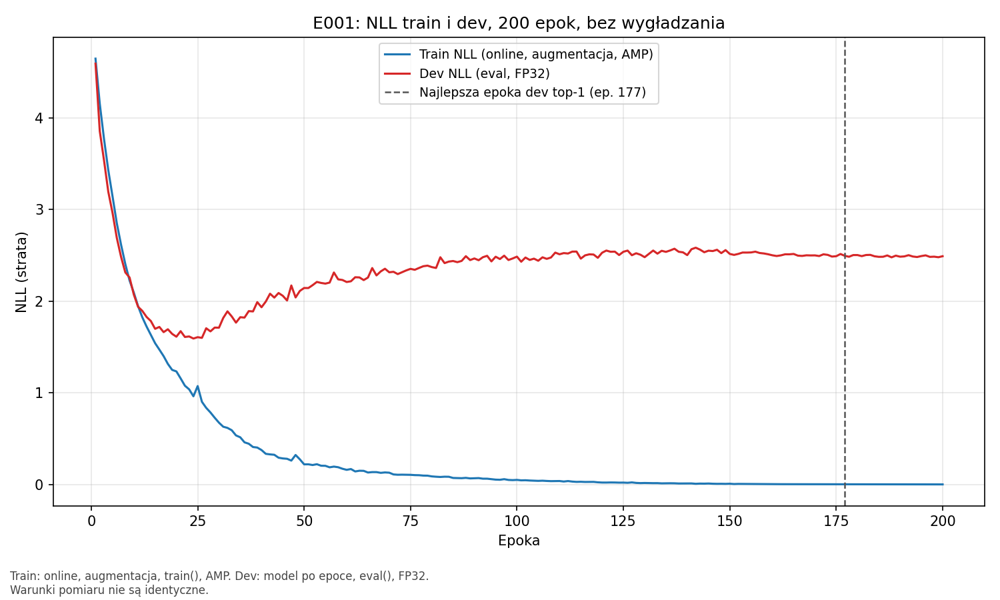
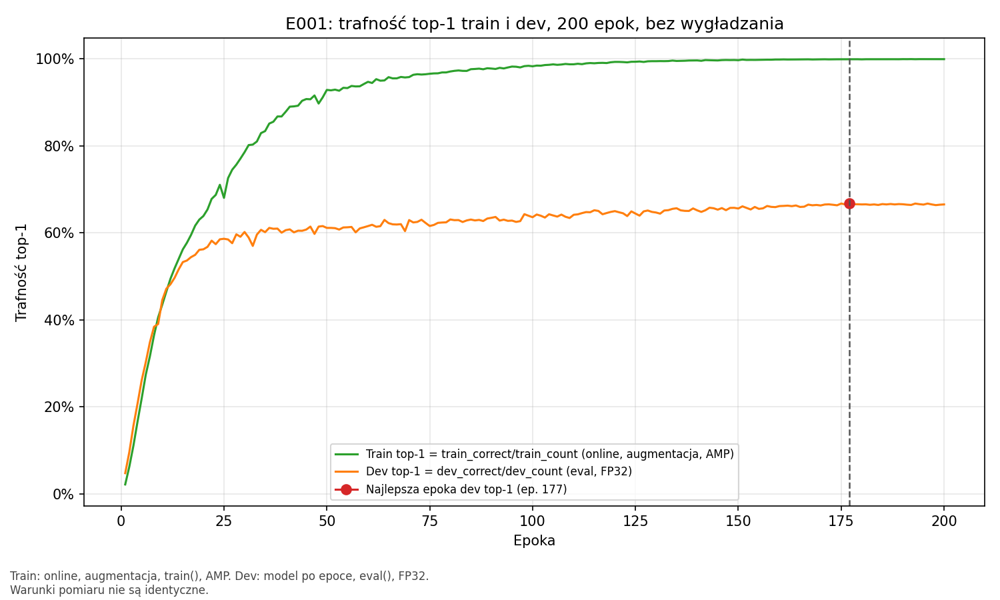

# E001 — wynik audytu modelu i przebiegu uczenia

Data: **2026-09-29 UTC**. Status: **completed / passed**.
Protokół ustalony przed uruchomieniem: [AUDYT_OPIS_v1.md](AUDYT_OPIS_v1.md), v1.0.
Audyt i wykresy należą do E001, nie tworzą nowego eksperymentu E002.

## 1. Co sprawdzaliśmy i na czym

Czy zapisany `best.pt` daje te same odpowiedzi na tych samych 5000 obrazów dev,
oraz co przebieg 200 epok mówi o uczeniu i przeuczeniu?

- Trening źródłowy: `runs/E001/20260926T013203Z_7cc3f46_seed42_qHKULg/`.
- Kod treningu: `7cc3f46667990ff45686f7499c5dfd00d6d57649`.
- Kod audytu: **`1a4142ce319c9fd80665137c5bb34206ea4fb00a`**, czyste drzewo przed startem.
- Wyniki audytu: `runs/E001/audits/20260929T025515Z_1a4142c_seed42_dkgekjgf/`.
- Start: 02:55:15.036611 UTC; koniec: 02:55:32.856314 UTC, około **17,82 s**.
  To czas launchera z kontrolami i wykresami, nie benchmark samej inferencji.
- `manifest.json`: status completed, inference_exit_code=0, plots_exit_code=0.
  `stderr.log` jest pusty.

### Najważniejsze SHA-256

| Wejście | SHA-256 |
|---|---|
| `best.pt` | `f2ac9c3fddd140c0d45f2c244c78b432cbdd164b46dff32d00be956202ec5be8` |
| `config.resolved.json` (bajty pliku) | `e2e0575ef2e5dfea524a6d4236f020149cc3d28527da77a41039f803c8d10b69` |
| Konfiguracja jako obiekt JSON, zgodnie z E001 | `545613e02d9dfd094b8d14b148d65438201c3b923ee0b34d89814c8557a0a685` |
| `data/cifar100/splits.json` | `ecb8804e41fbc4bee7c61fd0585bf1c7dcfc94ac8472333fc283d51dc6460e86` |
| `cifar-100-python/train` | `735e79b04f092ca3d2e6d07f368c0a7d70d48c48d28865950cc24454cf45129b` |
| `metrics.jsonl` | `a5910ae927271f0d3b1b7087e385f2f9a432a646bb6b258a8aa6f615dc158e2e` |
| Stare i nowe predykcje dev (identyczne także bajtowo) | `7b84c25777b3cf9b5ee92c84b9b93cb228ec5821038b108ad687c871878b93de` |

Pełna lista wejść i wynik sprawdzenia: `integrity.json` w biegu audytu.
Przed oceną sprawdzono wszystkie 13 pozycji źródłowego `artifacts.sha256`;
po audycie ponowne `sha256sum -c artifacts.sha256` także dało 13/13 OK.
Źródłowe artefakty pozostały niezmienione. Hashe kodu treningu odpowiadają
zarówno manifestowi biegu, jak i plikom z commita `7cc3f46`.

## 2. Jak sprawdzaliśmy

EfficientNet-B0 z SE i SyncBatchNorm, utworzony z `weights=None`, potem ścisłe
wczytanie lokalnego `best.pt`. Sprawdzono metadane konfiguracji, danych, epoki,
commita, środowiska i inicjalizacji. Ocena: `eval()`, `inference_mode()`, FP32,
bez autocast i TF32. Resize PIL bilinear do 96×96, antialias, ToTensor,
mean=std=(0.5,0.5,0.5), bez augmentacji.

**Cztery GPU dzielą jedną ocenę, a nie stanowią czterech powtórzeń.** Rank r
otrzymał `dev_ids[r::4]`, batch 32, dwa workery i końcowy batch 2. Nie ma
dopełniania próbek. Po agregacji sprawdzono 5000 unikalnych ID, ich dokładną
zgodność z listą dev, etykiety oraz wszystkie predykcje. Dev zawiera po 50
przykładów każdej klasy. Potwierdzono rozłączność list train/dev/rezerwa.

| GPU / rank | Liczba obrazów | Poprawne |
|---|---:|---:|
| 0 | 1250 | 824 |
| 1 | 1250 | 855 |
| 2 | 1250 | 830 |
| 3 | 1250 | 833 |
| **Łącznie** | **5000** | **3342** |

Conda `attention`, Python 3.11.15, torch 2.12.0+cu130, torchvision 0.27.0+cu130,
NumPy 2.4.6, CUDA 13.0, cuDNN 92000, sterownik 580.173.02, 4×RTX 2080 Ti.
`environment_comparison.json` nie wykazał różnic w polach zapisywanych przez
E001; nie oznacza to porównania każdego możliwego składnika systemu.
Pełniejsze zapisy: `environment.json`, `pip-freeze.txt`, `conda-explicit.txt`.
Losowość i deterministyczność opisuje protokół; stany RNG przed/po zapisano
osobno dla każdego ranku. Szczyt zaalokowanej pamięci PyTorch: 117337600 B/GPU
(około 111,9 MiB); nie jest to całkowita pamięć procesu raportowana przez sterownik.

## 3. Wynik ponownej oceny

| Kontrola | Wynik |
|---|---|
| Epoka checkpointu | **177** |
| Trafność | **3342/5000 = 66,84%** |
| Różne predykcje względem E001 | **0/5000** |
| Brakujące lub powielone ID | **0** |
| NLL odtworzone | **2.4950394832244323** |
| NLL zapisane w E001 | **2.4950394832244323** |
| Różnica NLL | **0**, kryterium przed startem: ≤ 1e-6 |
| Hashe wag i buforów przed/po | Identyczne na wszystkich czterech GPU |

Hash tensorów modelu przed i po inferencji:
`0ce0a309b9108d0d4b0db6af3ebd207c7c91b7107009df469ed2c2f08917f4ea`.
Nie wykonano aktualizacji parametrów ani statystyk BatchNorm.

## 4. Wykresy i interpretacja uczenia

Wykresy obejmują wszystkie 200 epok bez wygładzania:





[Loss PDF](wykresy/20260929T025515Z_1a4142c_seed42_dkgekjgf/loss.pdf),
[accuracy PDF](wykresy/20260929T025515Z_1a4142c_seed42_dkgekjgf/accuracy.pdf),
[podsumowanie liczbowe](wykresy/20260929T025515Z_1a4142c_seed42_dkgekjgf/curve_summary.json),
[opis generowany przez skrypt](wykresy/20260929T025515Z_1a4142c_seed42_dkgekjgf/KRZYWE.md).
Kod: [plot_metrics.py](plot_metrics.py).

| Epoka | Train NLL | Train poprawne/liczba | Dev NLL | Dev top-1 |
|---|---:|---:|---:|---:|
| 24 — minimum dev NLL | 0,962571 | 28376/39936 | **1,592417** | 58,52% |
| 177 — maksimum dev top-1 | 0,002379 | 39904/39936 | 2,495039 | **66,84%** |
| 200 — ostatnia | 0,001631 | 39918/39936 (**99,9549%**) | 2,490339 | 66,54% |

**Model rzeczywiście się uczył:** na początku poprawiały się obie straty
i obie trafności. Później strata treningowa dalej spadała niemal do zera,
a strata dev po minimum w epoce 24 rosła. Trafność dev mimo tego powoli
wzrastała, podczas gdy treningowa zbliżała się do 100%.

To **mocna oznaka przeuczenia**, szczególnie w jakości przewidywanych
prawdopodobieństw. Trafność sprawdza tylko, która klasa jest pierwsza. NLL
uwzględnia prawdopodobieństwo właściwej klasy i mocno karze bardzo pewne,
błędne odpowiedzi. Model może więc trafnie rozpoznawać więcej obrazów,
a jednocześnie otrzymywać większą karę za rozkłady prawdopodobieństw.
Wzrost NLL jest zgodny z nadmierną pewnością błędów, ale bez analizy
prawdopodobieństw nie ustalamy dokładnego mechanizmu ani kalibracji.

Nie wybieramy teraz innego checkpointu: regułą E001 było najwyższe dev top-1,
a nie minimum NLL. Epoka 24 ma niższą trafność. Z samych tych krzywych nie
wynika, że cały dalszy trening był bezwartościowy, ani jaki trening należy
przeprowadzić zamiast niego.

**Uwaga o porównaniu train/dev:** train liczono online, przy zmieniających
się wagach, augmentacji, dropout/stochastic depth, trybie train i AMP.
Dev oceniano po epoce, bez augmentacji, w eval i FP32. Różnica końcowych
trafności około 33,41 punktu procentowego nie jest pomiarem luki w
identycznych warunkach. Train_count=39936 wynika z drop_last, nie z utraty
próbek dev. Mimo tych różnic rozbieżne trendy są istotnym sygnałem.

## 5. Co potwierdzono, a czego nie

Potwierdzono integralność lokalnych artefaktów względem zachowanych hashy,
zgodność wejść i konfiguracji oraz odtworzenie oceny tego checkpointu w
obecnym środowisku. Nie wykryto błędu powielania przykładów ani niezgodności
predykcji, który tłumaczyłby zapisany wynik dev.

Nie odtworzono całego treningu 200 epok ani instalacji w nowym środowisku.
Nie badano wielu seedów. Dev służył do wyboru spośród 200 epok i nie jest
niezależnym testem generalizacji. Rozłączność ID nie zastępuje audytu
duplikatów zawartości obrazów. Nie ustalono przyczyny przeuczenia ani
skuteczności proponowanego kryterium kompresji. Nie oceniano oficjalnego
testu ani rezerwy; loader nie otwierał pliku testowego. Wspólny plik treningowy
CIFAR zawierający wszystkie splity był czytany i hashowany, ale do modelu
trafiły wyłącznie obrazy dev.

Duże artefakty pozostają lokalnie; nie skonfigurowano zewnętrznej kopii
zapasowej. Sam Git zawiera kod, protokół, raport i małe wykresy, nie checkpoint.

## 6. Odtworzenie i sprawdzenie dowodów

Z czystego checkoutu commita audytu, w katalogu głównym repozytorium,
z dostępnymi lokalnie wejściami o podanych hashach:

```bash
conda run --no-capture-output -n attention python experiments/2026-09-26_E001_efficientnet_b0_od_zera/launch_audit.py
```

Launcher wybierze nowy run-ID i nowy katalog wykresów. Nie uruchamiać ręcznie
starej komendy z istniejącym `--run-dir`. Dokładne argumenty wykonanej
inferencji i zmienne środowiska są w `command.sh` oraz `manifest.json`.
W katalogu danego biegu można wykonać `sha256sum -c artifacts.sha256`.
Weryfikacja po tym audycie: **40/40 plików audytu OK** i **13/13 plików
treningu OK**. Wykresy mają osobne hashe w `manifest.json`.

| Artefakt audytu | SHA-256 |
|---|---|
| `manifest.json` | `b59dea02a5e696fabd2e29e97b45cef17be844ec7a10452ad0fb4a940435d298` |
| `result.json` | `682f6357cc4bf4edb1f7d926701167722d850b9d86295b0c7fda0d796d524668` |
| `integrity.json` | `f5bf06c36568638acb4476260cc0d027ac438c07b7d751f95b50d20fbb361f7c` |
| `artifacts.sha256` | `bcb856fac41d101b723857ee5bffc79276fec35cbbcab7d6513a6cb804af2351` |

## 7. Decyzja po etapie 2

Kontrola zakończona pozytywnie. Checkpoint nadaje się jako **zweryfikowany
technicznie model pilotażowy**, z jasno opisanym przeuczeniem i ograniczeniami.
Proponowany następny krok: ustalić krótki protokół obserwacji podobieństwa
kanałów przed/po SE i zmienności wag atencji dla jednego wybranego bloku.
Tego etapu jeszcze nie uruchomiono. Kompresja i kolejny trening nie rozpoczęły się.
