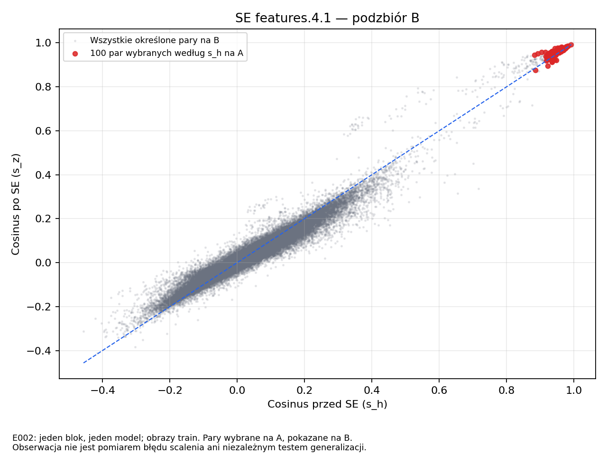
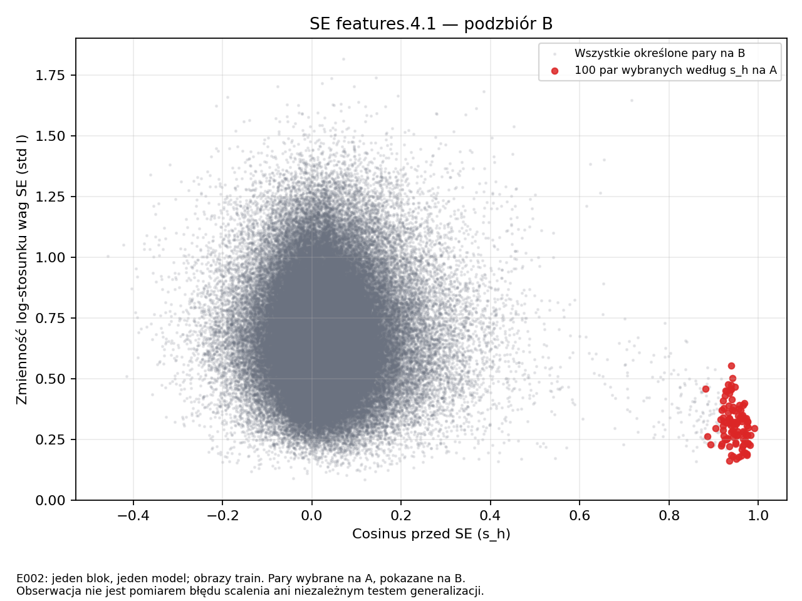
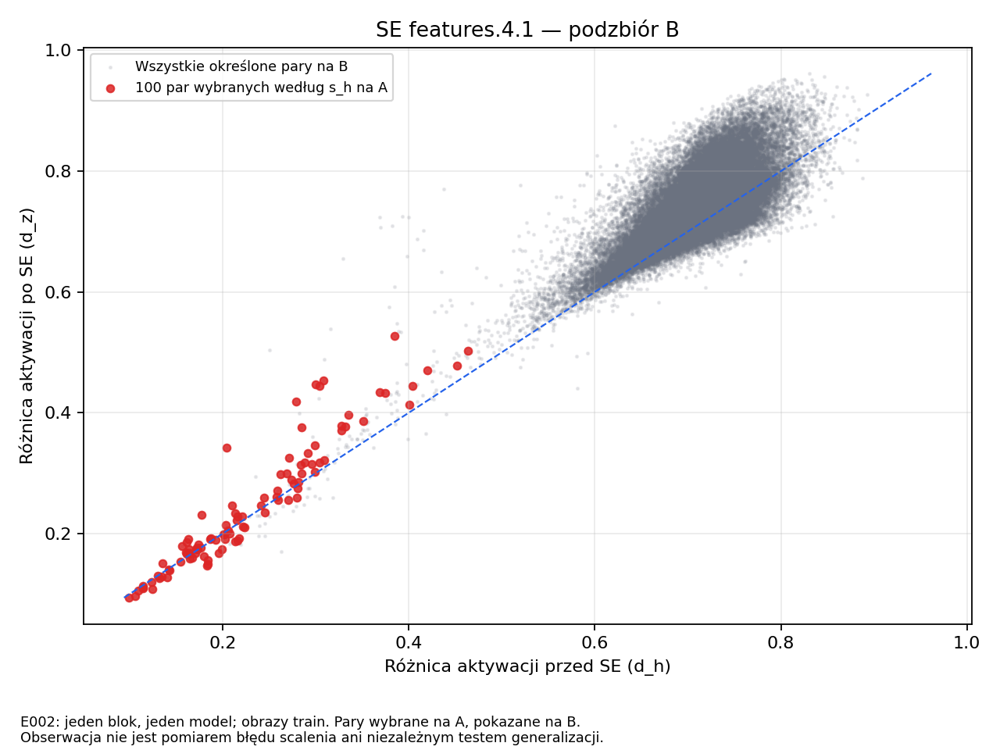

# E002 — pierwsza obserwacja kanałów i SE

Data: 2026-10-01 UTC. **Status wykonania: completed.**
Protokół przed pomiarem: [PROTOKOL_v1.md](PROTOKOL_v1.md), v1.0.

## 1. Co sprawdzaliśmy?

Czy pary kanałów podobne przed SE są różnie ważone zależnie od obrazu
i jak wygląda ich podobieństwo po SE? Jeden blok `features.4.1`, jeden
checkpoint E001, bez modyfikowania wag ani łączenia kanałów.

**Główna obserwacja:** 100 najbardziej podobnych par wybranych na A
pozostaje bardzo podobnych na B i po SE. Ich względne wagi zmieniają się
między obrazami, lecz typowa zmiana cosinusa jest dodatnia, nie ujemna.
To nie potwierdza scenariusza, że SE zwykle rozdziela najbardziej podobne
kanały w tej próbie. Nie jest też dowodem bezpieczeństwa ich scalenia.

## 2. Dokładne wejścia i wykonanie

- Bieg: **`runs/E002/20261001T051649Z_e0b3121_seed42_a8l9uuks/`**.
- Commit kodu/protokołu przed pomiarem:
  **`e0b3121bef65d7722861aebbbfdaafe563883831`**, dirty=false.
- Start: 05:16:49.726957 UTC; koniec: 05:17:23.903601 UTC,
  około **34,18 s** łącznie z kontrolami, inferencją i analizą/wykresami.
  Nie jest to pomiar wydajności samego modelu.
- Odczyt i analiza zakończone kodem 0; stderr.log pusty.
- Model E001: best.pt, epoka 177, źródłowy seed treningu 42.
- SHA-256 checkpointu:
  `f2ac9c3fddd140c0d45f2c244c78b432cbdd164b46dff32d00be956202ec5be8`.
- SHA-256 frozen config.json:
  `be754fce82823dade502ab780269f43597927779e1bd09b21c2aa05d501d3dbd`.
- SHA-256 [SAMPLES.json](SAMPLES.json):
  `338eb31862ab3d35495c22c8ae58109aed280a8218f1c32e234c941c3d1bae1d`.
- Pełne hashe źródłowych plików i danych: [INPUTS.json](INPUTS.json)
  oraz integrity.json w biegu. Utrwalono je przed inferencją.

Użyto **1000 obrazów train**, po 10/klasę: A=500, B=500, po 5/klasę
w każdej połowie. Listy są rozłączne. A służył wyłącznie do wyboru 100
par z najwyższym cosinusem przed SE, B do oceny tych samych par. To dane,
na których model był wcześniej trenowany — B nie jest niezależnym testem.
Dev, rezerwa i oficjalny test nie trafiły do modelu. Wspólny kontener train
był czytany i hashowany; listy innych splitów sprawdzano tylko jako metadane.

Preprocessing jak ocena E001: PIL resize bilinear z antialias do 96×96,
ToTensor, Normalize mean=std=(0.5,0.5,0.5), bez augmentacji. Model eval,
inference_mode, FP32, bez AMP i TF32, algorytmy deterministyczne.

### Cztery GPU — jedna obserwacja

| Rank / GPU | Obrazy | Batche | Ostatni batch | Maks. błąd z=a*h |
|---|---:|---:|---:|---:|
| 0 | 250 | 8 | 26 | 0 |
| 1 | 250 | 8 | 26 | 0 |
| 2 | 250 | 8 | 26 | 0 |
| 3 | 250 | 8 | 26 | 0 |
| Łącznie | **1000 unikalnych ID** | — | — | **0** |

Każdy rank otrzymał records[rank::4], bez dopełniania i odrzucania końcówki.
Nie są to cztery powtórzenia naukowe. Hooki wykonały się raz/batch,
h/z miały kształt B×480×6×6, a B×480×1×1. Hash wszystkich parametrów i
buforów przed/po i między GPU był identyczny:
`0ce0a309b9108d0d4b0db6af3ebd207c7c91b7107009df469ed2c2f08917f4ea`.
To ten sam hash modelu co w audycie E001. Wagi nie zostały zmienione.

Środowisko Conda attention: Python 3.11.15, torch 2.12.0+cu130,
torchvision 0.27.0+cu130, NumPy 2.4.6, CUDA 13.0, cuDNN 92000,
sterownik 580.173.02, 4×RTX 2080 Ti. Nie było różnic względem zapisanych
pól środowiska E001. Pełne eksporty Condy/pip i seedy/RNG są w biegu.
Szczyt pamięci zaalokowanej przez PyTorch: 123753984 B/rank, około 118 MiB;
nie jest to cała pamięć procesu widoczna w nvidia-smi.

## 3. Co wyszło?

Obliczono **114960 par na A i 114960 na B**. Wybrano 100 par według s_h
na A, bez korzystania z różnic atencji. Tabele wszystkich par pozostają
w biegu, mała tabela wybranych par jest [tutaj](wykresy/20261001T051649Z_e0b3121_seed42_a8l9uuks/selected_pairs.csv).

Wybrane pary obejmują **tylko 19 z 480 kanałów** (około 4%). To ważne:
100 par nie oznacza 200 różnych kanałów ani 100 niezależnych obserwacji.

### Wybrane pary, sprawdzone na B

| Miara | Mediana | Q25–Q75 | Min–max |
|---|---:|---:|---:|
| Cosinus przed SE, s_h | **0,946173** | 0,933226–0,964274 | 0,882432–0,991859 |
| Cosinus po SE, s_z | **0,957851** | 0,947419–0,972218 | 0,875471–0,992079 |
| Zmiana cosinusa s_z−s_h, liczona parami | **+0,005734** | +0,001743–+0,018648 | −0,026961–+0,062336 |
| Różnica aktywacji przed SE, d_h | 0,213195 | 0,169421–0,283731 | 0,099281–0,463833 |
| Różnica aktywacji po SE, d_z | 0,212437 | 0,167560–0,315271 | 0,093692–0,527413 |
| Std różnicy wag, b_std | 0,113672 | 0,093115–0,132747 | 0,051585–0,177474 |
| Std log-stosunku wag, l_std | **0,308247** | 0,251460–0,362270 | 0,161269–0,553468 |

Q25–Q75 to zakres środkowej połowy wyników, **nie przedział ufności**.
Mediana s_h wybranych par na A wynosiła 0,960488; na B wynosi 0,946173.
Wysokie podobieństwo zatem utrzymuje się na innych obrazach, choć słabnie.
Mediana zmiany s_z−s_h nie jest różnicą dwóch osobno liczonych median.
d_h/d_z uwzględniają również skalę i nie są błędem scalenia.

### Odniesienie: wszystkie pary na B

Mediana s_h=0,021019, s_z=0,018569, zmiany s_z−s_h=−0,001765,
a l_std=0,657823 (Q25–Q75: 0,525530–0,809731). Zmienność względnych wag
wybranych podobnych kanałów jest **niższa** niż dla wszystkich par.
To opis rozkładów w tej próbie, bez testów istotności na zależnych parach.

Nie było numerycznie zerowych kanałów ani dokładnie zerowych map na A/B.
Wszystkie miary par były określone. Nie przycinano wag do logarytmu ani
cosinusów do zakresu [-1,1]. Minimum normy h na B: 22,871175,
minimum normy z: 4,777502, znacznie powyżej progu 1e-12.

## 4. Wykresy



Czerwone punkty: te same 100 par wybranych na A, pokazane na B. Pozostają
blisko prawego górnego rogu. Duża część nieco powyżej przekątnej:
SE nie rozdziela typowo tych par według tego pomiaru.



Wybrane pary mają zmienny stosunek wag, ale jego zmienność nie jest
szczególnie duża na tle całego zbioru par. Samo l_std nie mówi, jak
mocno błędy ewentualnego scalenia dotknęłyby wyjście bloku.



Zmiany różnicy skali bywają w obie strony. Wysoki cosinus nie oznacza
identycznych wartości, co pokazuje rozrzut d_h/d_z.

Pozostałe wykresy:
[zmienność stosunku wag](wykresy/20261001T051649Z_e0b3121_seed42_a8l9uuks/gate_ratio_distribution.png),
[rozkłady wag kanałów](wykresy/20261001T051649Z_e0b3121_seed42_a8l9uuks/channel_gates.png).
Każdy z pięciu wykresów ma też PDF w tym samym folderze.
Pełne podsumowanie: [summary.json](wykresy/20261001T051649Z_e0b3121_seed42_a8l9uuks/summary.json).

## 5. Co możemy z tego powiedzieć?

**Zaobserwowano zmienne względne ważenie** także dla bardzo podobnych
kanałów. Nie można zakładać identycznych wag tylko na podstawie s_h.
Jednak najbardziej podobne pary nadal pozostają podobne po SE, a mediana
ich zmiany cosinusa jest dodatnia. Nie ma tu prostego dowodu na tezę
„podobne przed atencją stają się przez nią różne”.

Zmienność samych wag nie jest równoznaczna z destrukcyjnym wpływem na
aktywacje. Liczy się ich współwystępowanie z mapami i siłą reakcji na
poszczególnych obrazach. Ten eksperyment nie rozstrzyga przyczyny
zachowania wybranych par, np. wpływu wspólnej składowej stałej map.

Wniosek praktyczny: **nie projektujemy jeszcze nowego kryterium kompresji**
na podstawie samego l_std. Najpierw trzeba rozumieć, co reprezentują
wybrane kanały; później zmierzyć rzeczywistą stratę po kontrolowanych
scaleniach i porównać wybór oparty na aktywacjach po SE.

Ograniczenia: jeden wybrany blok, jeden przeuczony checkpoint, dane train,
brak niezależnego testu generalizacji. Pary pokrywają tylko 19 kanałów i są
zależne. Nie wykonano scalenia, rekonstrukcji, naprawy ani pomiaru jakości
po kompresji. Nie wykazano nowości ani przewagi metody.

## 6. Dowody i odtworzenie

Przed realnym odczytem przeszły [kontrole CPU](TESTY_CPU_v1.json) na sztucznych
danych, a listy A/B były już w commicie. Po odczycie:

- `sha256sum -c artifacts.sha256` w biegu: **54/54 OK**.
- Hashe 12 artefaktów w folderze wykresów z manifestu: **12/12 OK**
  (5 PNG, 5 PDF, summary.json i selected_pairs.csv).
- Niezależna kontrola tylko do odczytu przez general-flash: dokładne ID
  i etykiety rank::4, rozłączność A/B, po 5/klasę, ranking 100 par na A,
  19 kanałów; zgodność potwierdzona.
- Dla pierwszych trzech par według rankingu A (nie największego efektu)
  ponownie policzono bezpośrednie s_h/s_z/b_std/l_std na zapisanych
  aktywacjach B. Zgodność z tabelą przy atol=1e-10; maksymalna różnica
  około 7e-16. Bez ponownej inferencji.

Pierwsze trzy pary to (4,418), (14,208), (177,329). Przykład pierwszej:
s_h=0,991859, s_z=0,992079, l_std=0,297310 — zmienne wagi współistnieją
tu z prawie niezmienionym wysokim podobieństwem aktywacji.

| Artefakt biegu | SHA-256 |
|---|---|
| manifest.json | `675f342ae39f51f5358f3de17da9e849b36957b249d593aed79eae4fbe975091` |
| summary.json | `875b20747124e40ae31dc37a0d72df900d0dca9abc6c861f0af01438a8236cfb` |
| collection.json | `252aca6e3764e654f937819e8b05dd5f58211bce4ce79da4534c801e00b184a6` |
| artifacts.sha256 | `c7c162e76ed54f38941b278a6ba298af4da234baf204896aa5f21a9b98b0483f` |

Powtórzenie z czystego checkoutu commita e0b3121, przy lokalnych danych
i checkpoincie o podanych hashach, Conda attention i czterech GPU:

```bash
conda run --no-capture-output -n attention python experiments/2026-10-01_E002_obserwacja_se/launch.py
```

Launcher utworzy nowy katalog, nie nadpisze tego biegu. Komendy wykonane,
środowisko i źródła są zachowane w biegu. Po aktualizacji dokumentacji
można użyć nowszego czystego commita z niezmienionym kodem/configiem;
launcher sprawdza ich zgodność z kontrolami CPU. Nie powtórzono jeszcze
całego E002 z nowego środowiska ani drugiego seeda modelu.

Dane, surowe aktywacje i duże tabele pozostają poza Git; małe wykresy,
wybrane pary i podsumowanie zapisujemy w Git. Brak zewnętrznego magazynu
dużych artefaktów pozostaje ograniczeniem archiwizacji.

CSV zapisano ze standardowym zakończeniem wierszy CRLF. Reguła
`.gitattributes` zachowuje dokładne bajty tej tabeli w Git, aby jej hash
pozostał zgodny z manifestem; nie zmieniano pliku wynikowego po pomiarze.

## 7. Jeden proponowany następny krok

**Sprawdzić na już zapisanych aktywacjach tych 19 kanałów, czy ich wysoki
cosinus nie wynika głównie ze wspólnej składowej stałej.** Byłaby to
uzupełniająca analiza E002, z osobnym opisem ustalonym przed obliczeniem,
bez zmiany wag i bez nowych danych. Nie wykonano jej w tym biegu.
Zatrzymujemy się przed kontrolowanymi scalenami i kolejnym treningiem.
