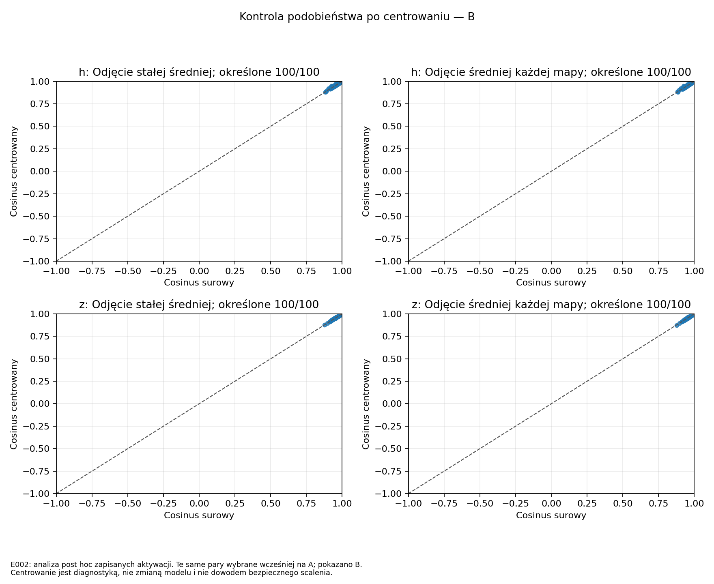
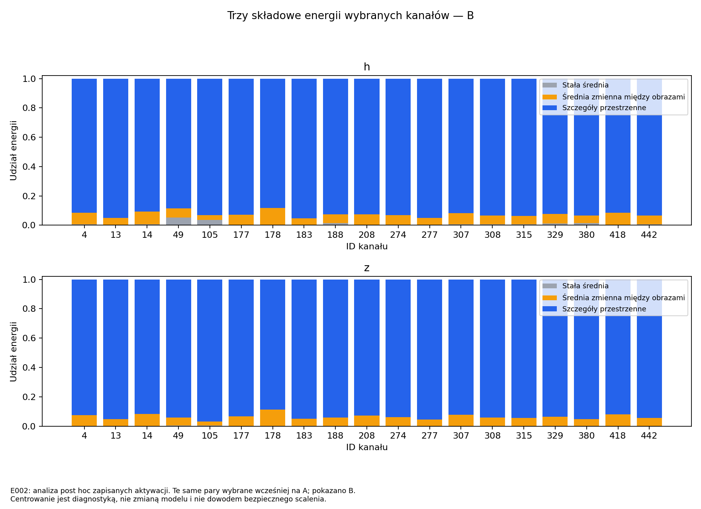

# E002 — wynik kontroli stałej średniej kanałów

Data: 2026-10-02 UTC. **Status: completed**. Protokół:
[OPIS.md](OPIS.md), v1.0, ustalony przed przeliczeniem zapisanych aktywacji.
**Analiza post hoc:** pytanie powstało po obejrzeniu pierwszego wyniku E002.

## Co sprawdzaliśmy i w jakim celu?

Czy wysokie podobieństwo 100 wcześniej wybranych par (19 kanałów)
wynika głównie ze wspólnej stałej średniej map? Celem była kontrola
interpretacji podobieństwa, przed ewentualnymi próbami łączenia kanałów.
Nie wybrano nowych par ani nowych obrazów.

**Wynik:** wpływ stałej średniej jest mały, a podobieństwo utrzymuje się
również po odjęciu średniej każdej mapy. W tej próbie wysoki cosinus nie
jest głównie skutkiem wspólnej średniej. Nie dowodzi to bezpieczeństwa
scalenia ani przydatności osobnego kryterium atencji.

## Wejścia i wykonanie

- Źródło: `runs/E002/20261001T051649Z_e0b3121_seed42_a8l9uuks/`.
- Nowa analiza:
  **`runs/E002/analyses/20261002T055900Z_9dc2720_constant_kc4jiyub/`**.
- Commit kodu przed uruchomieniem:
  **`9dc2720c77b53e0e177545a09c8d6271e609b860`**, dirty=false.
- SHA-256 konfiguracji:
  `82ebb000ba74e42447be93d3f451ab7daf6d1d30e87c3bbdfb1f805996b2d336`.
- SHA-256 źródłowego artifacts.sha256:
  `c7c162e76ed54f38941b278a6ba298af4da234baf204896aa5f21a9b98b0483f`.
- Pełne identyfikatory źródłowych tensorów, list obrazów i par:
  [config.json](config.json), [protokół](OPIS.md), inputs_verified.json w nowym biegu.
- 1000 unikalnych ID, A=500 i B=500, po 5/klasę/połowę, zgodne z E002.
  Główna prezentacja na B; te same pary wybrane wcześniej na A.
- Start: 05:59:00.402815 UTC; koniec: 05:59:08.946848 UTC,
  około **8,54 s** launchera wraz z kontrolami i wykresami.
- Exit code 0, stderr.log pusty. Conda attention, Python 3.11.15,
  NumPy 2.4.6, matplotlib 3.10.9, FP64, jeden wątek OMP/MKL/OpenBLAS.

**Wyłącznie analiza CPU.** Mapy źródłowe wcześniej odczytano na dokładnie
4 GPU po 250 obrazów/rank. Nie wykonano nowej inferencji ani treningu,
nie otwierano checkpointu lub danych CIFAR, nie użyto dev/test/rezerwy.
Nie modyfikowano zapisanych map ani modelu; nowe wyniki mają osobny katalog.
Nie deklarujemy nowego wykorzystania GPU w tej analizie.

## Jak rozdzieliliśmy mapy?

Dla każdego kanału i połowy osobno:

1. **Stała średnia:** jedna liczba dla wszystkich obrazów i pozycji.
2. **Średnia zmienna między obrazami:** ogólna reakcja mapy na dany obraz,
   po odjęciu średniej stałej.
3. **Składowa przestrzenna:** różnice między pozycjami wewnątrz mapy.

Energia (suma kwadratów) rozkłada się na te trzy części. Globalnie
centrowany cosinus usuwa tylko część 1; przestrzennie centrowany usuwa
części 1 i 2. To przeliczenie zapisanych liczb, nie nowy forward modelu.

## Wyniki na B — te same 100 par

| Rodzaj cosinusa | Przed SE, h: mediana | Q25–Q75 | Po SE, z: mediana | Q25–Q75 |
|---|---:|---:|---:|---:|
| Surowy | **0,946173** | 0,933226–0,964274 | **0,957851** | 0,947419–0,972218 |
| Po odjęciu stałej średniej | **0,947623** | 0,935997–0,967464 | **0,958804** | 0,947831–0,972740 |
| Po odjęciu średniej każdej mapy | **0,946867** | 0,934932–0,967310 | **0,958807** | 0,947530–0,971869 |

Wszystkie 100 par ma określone cosinusy w każdym wariancie. Q25–Q75
to środkowa połowa wartości, nie przedział ufności. Podobieństwo nie
załamało się po centrowaniu. Mediany zmian liczonych parami:

- h, globalny minus surowy: +0,000641; przestrzenny minus surowy: +0,000246;
- z, globalny minus surowy: +0,000274; przestrzenny minus surowy: +0,000117.

Mediana zmiany nie jest różnicą osobno policzonych median.

Kontrola A daje ten sam ogólny obraz: h surowy 0,960488, globalny
0,962676, przestrzenny 0,958588; z odpowiednio 0,969878, 0,970305,
0,968655. Nie zmieniono pierwotnego rankingu.

### Energia wybranych 19 kanałów na B

| Składowa | h: mediana udziału | h: min–max | z: mediana udziału | z: min–max |
|---|---:|---:|---:|---:|
| Stała średnia | **0,6090%** | 0,000149–5,372064% | **0,0163%** | 0,001109–0,378858% |
| Średnia zmienna między obrazami | 6,1069% | 3,205378–11,616696% | 5,7958% | 2,866668–11,318738% |
| Składowa przestrzenna | **92,8250%** | 88,329141–95,333775% | **94,1794%** | 88,628470–96,811204% |

Każdy kanał ma udziały sumujące się do 100%, ale mediany różnych
składowych nie muszą sumować się do 100% (mogą pochodzić z innych kanałów).
W **żadnym** z 19 kanałów stała średnia nie ma większości energii.
Nie wykryto składowych numerycznie zerowych ani bardzo małych względnie
według progów protokołu. Nie przycinano cosinusów.

Odniesienie dla wszystkich 480 kanałów na B: mediana udziału stałej
średniej to 3,2076% przed SE i 2,7511% po SE. Wybrana grupa ma więc
mniejszy, a nie większy typowy udział stałej średniej niż cały blok.

Rozkład surowego cosinusa na wkład stały C_const oraz resztę C_rest
także potwierdza mały wpływ tła. Mediana C_const to 0,003985 dla h i
0,000015 dla z; mediany C_rest to 0,940392 i 0,957528.
To wkłady ze znakiem, nie procenty. Mediany wkładów nie muszą sumować
się do mediany surowego cosinusa; tożsamość sprawdzono dla każdej pary.

## Wykresy i tabele



Punkty pozostają w prawym górnym rogu także po odjęciu średnich.



Niebieska część to zmienność przestrzenna wewnątrz map; w tej grupie
dominuje nad średnimi. **Nie oznacza to jeszcze, że ta zmienność przestrzenna
różni się między obrazami.** Może zawierać również powtarzalny przestrzenny wzór.

Pozostały wykres: [udział stałej średniej na tle 480 kanałów](../../wykresy/20261002T055900Z_9dc2720_constant_kc4jiyub/constant_energy.png).
Wszystkie trzy wykresy mają PNG i PDF w tym samym folderze.

Tabele: [kanały A](../../wykresy/20261002T055900Z_9dc2720_constant_kc4jiyub/channels_A.csv),
[kanały B](../../wykresy/20261002T055900Z_9dc2720_constant_kc4jiyub/channels_B.csv),
[pary A](../../wykresy/20261002T055900Z_9dc2720_constant_kc4jiyub/pairs_A.csv),
[pary B](../../wykresy/20261002T055900Z_9dc2720_constant_kc4jiyub/pairs_B.csv),
[pełne podsumowanie](../../wykresy/20261002T055900Z_9dc2720_constant_kc4jiyub/summary.json).

## Co wyjaśniliśmy, a czego nie?

Kontrola przemawia przeciw wyjaśnieniu, że podobieństwo tej grupy bierze
się głównie ze wspólnej **skalarnej średniej**. Dotyczy też średniej
odejmowanej osobno z każdej mapy. Kanały mają podobne wzory przestrzenne
na badanym zbiorze, zarówno przed SE, jak i po nim.

Nie sprawdziliśmy tutaj **stałego szablonu przestrzennego**, czyli całej
mapy powtarzającej się na różnych obrazach. Składowa przestrzenna może
zawierać taki szablon oraz odpowiedź zależną od obrazu. Nie dowodzimy
więc jeszcze, że podobieństwo dotyczy informacyjnych różnic między obrazami.

Stała średnia albo szablon także mogą być użyteczne dla następnej
projekcji. Centrowanie nie wskazuje automatycznie zbędnych kanałów.
Podobieństwo nie gwarantuje bezpieczeństwa scalenia: fizyczna zmiana
bloku zmieni także wejście i odpowiedzi SE. Potrzebne będą rzeczywiste
próby scalenia i kontrola oparta na aktywacjach po SE przy równym budżecie.

Ograniczenia: analiza post hoc, jeden blok/checkpoint, przeuczenie E001,
dane train, zależne pary i tylko 19 kanałów. Bez nowej oceny generalizacji,
bez scalenia i naprawy, bez wykazania nowości metody.

## Dowody kontroli i odtworzenie

- [Kontrole CPU przed pomiarem](TESTY_CPU.json): passed, sztuczne mapy,
  zero kanałów, mapy stałe przestrzennie, bezpośrednie cosinusy i energia.
- Maks. różnica surowych cosinusów względem E002: **7,88e-15**,
  wobec tolerancji 1e-10.
- Maks. błąd względny sumy energii: **1,88e-14**, tolerancja 1e-10.
- Maks. błąd s_raw=C_const+C_rest: **1,21e-14**, tolerancja 1e-10.
- Hashe nowej analizy: **22/22 OK**; hashe folderu wykresów: **11/11 OK**
  (3 PNG, 3 PDF, 4 CSV i summary.json).
- Ponowna weryfikacja źródłowego biegu po analizie: **54/54 OK**.
  Dotychczasowe artefakty E002 niezmienione.
- Niezależna kontrola tylko do odczytu przez general-flash: dla pierwszych
  trzech par w pierwotnym rankingu na A przeliczono na B surowy/globalny/
  przestrzenny cosinus h/z (18 porównań). Maks. błąd względem tabel około
  **9,55e-15**, atol=1e-10. Dla kanału 4 niezależny rozkład energii także
  zgodny; sprawdzono wszystkie 19 kanałów pod względem udziału stałej <1/2.

| Artefakt nowej analizy | SHA-256 |
|---|---|
| manifest.json | `8f85c297aa417d7118751696171c175aa037aab9087cbed4b00940ad0c5d82f5` |
| summary.json | `8c4d766c995cc39613655fe29f6e974a4c561c16a58bf276b8621ac8d7099ce4` |
| artifacts.sha256 | `ee780ee5e3326bb0990827d257de4b5d9da9cd645efe1a80955d556d907e82ae` |

Z czystego checkoutu commita analizy, przy dostępnym źródłowym biegu
o podanych hashach, z katalogu głównego repo:

```bash
conda run --no-capture-output -n attention python experiments/2026-10-01_E002_obserwacja_se/analizy/2026-10-02_skladowa_stala/launch.py
```

Launcher utworzy nowy katalog wyników i wykresów. W katalogu analizy:
`sha256sum -c artifacts.sha256`. Hashe wykresów są w manifest.json.
Nie powtarzano tej analizy w świeżym środowisku, na innym komputerze ani
innym modelu. Zewnętrzna kopia źródłowych aktywacji nadal nie jest skonfigurowana.

## Jeden proponowany następny krok

**Sprawdzić zmienność przestrzennego wzoru między obrazami:** oddzielić
średnią mapę kanału po obrazach od odchyleń poszczególnych obrazów,
na tych samych zapisanych aktywacjach i parach. Opisać tę kontrolę przed
obliczeniem; nie wykonano jej tutaj. Pozwoli to odróżnić podobny
powtarzalny szablon od podobnych zmian odpowiedzi na różne obrazy.
Pozostajemy w etapie 3, przed scalenami i nowym treningiem.
