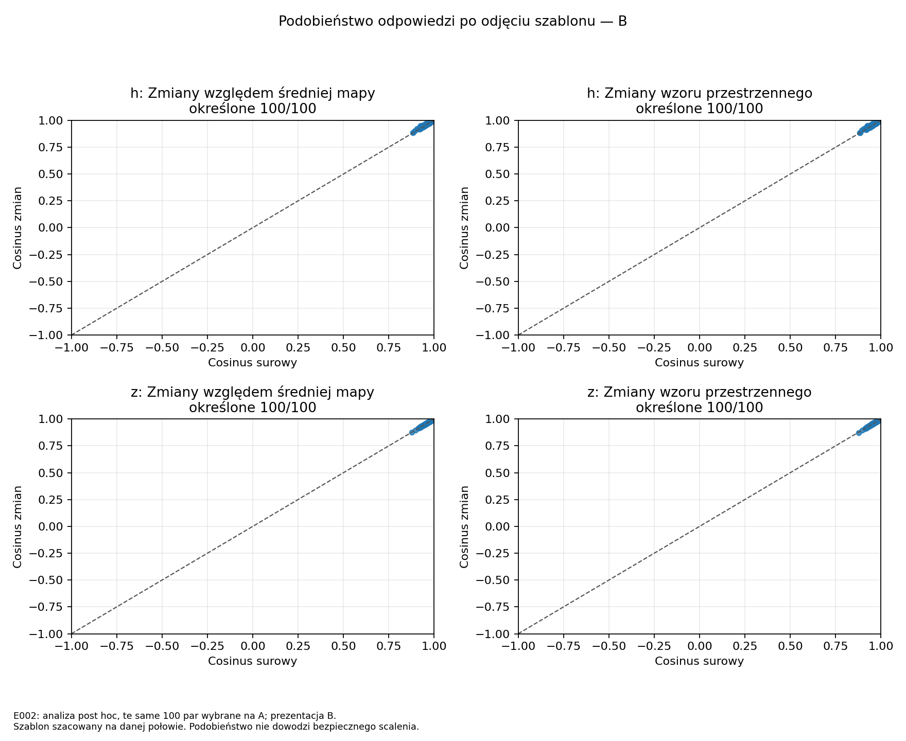
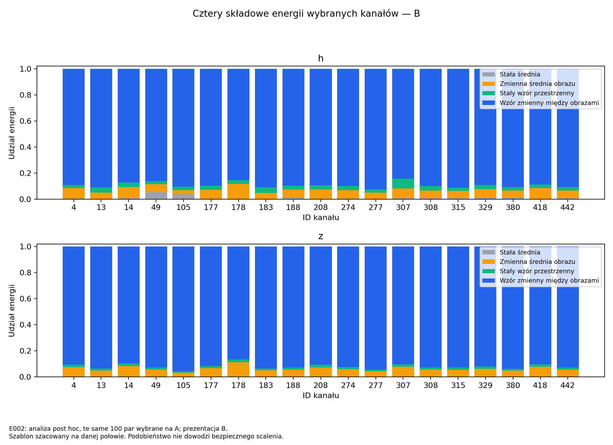

# E002 — szablon przestrzenny nie wyjaśnia głównie podobieństwa tej grupy

Data: 2026-10-07 UTC. **Status: completed**. Protokół [OPIS.md](OPIS.md),
v1.0, zapisany przed przeliczeniem rzeczywistych aktywacji. Analiza
**post hoc**, po wcześniejszych obserwacjach E002.

## Co sprawdziliśmy?

Czy 100 par obejmujących 19 kanałów jest podobnych głównie przez
powtarzalny szablon mapy, czy podobne są też ich zmiany między obrazami?
Te same pary wcześniej wybrane na A, bez nowego rankingu. Główna
prezentacja na B, kontrola na A. Jeden blok EfficientNet-B0, h przed
SE i z po SE, bez jakichkolwiek zmian modelu.

**Wynik:** po odjęciu całej średniej mapy podobieństwo pozostaje wysokie.
Szablon ma mały udział energii, a większość stanowią odpowiedzi
zmieniające się między obrazami. Kontrole średniej i szablonu nie
wskazują, żeby były one głównym wyjaśnieniem wysokiego podobieństwa
badanej grupy. Nie dowodzi to wymienności kanałów ani korzyści kompresji.

## Dokładne wejścia i wykonanie

- Źródło: `runs/E002/20261001T051649Z_e0b3121_seed42_a8l9uuks/`.
- Odniesienie: `runs/E002/analyses/20261002T055900Z_9dc2720_constant_kc4jiyub/`.
- Nowy bieg:
  **`runs/E002/analyses/20261007T140917Z_7388d23_template_qwki6pnw/`**.
- Commit przed analizą: **`7388d23fe8f66394af71a0529eb70af11ba96924`**,
  dirty=false.
- SHA-256 config.json:
  `1d6734af6c354a879f703f1b76246c2d1492102e75d9639a54565753c53f4dbc`.
- SHA-256 źródłowego artifacts.sha256:
  `c7c162e76ed54f38941b278a6ba298af4da234baf204896aa5f21a9b98b0483f`.
- Pełne hashe rank*.npz, ID/par i odniesienia: [config.json](config.json),
  inputs_verified.json w nowym biegu, [protokół](OPIS.md).
- 1000 unikalnych ID, A/B po 500 i po 5/klasę. Wybór 100 par/19 kanałów
  zgodny z pierwotną kolejnością E002. Nie zmieniano list po wyniku.
- Start: 14:09:17.974231 UTC; koniec: 14:09:26.440056 UTC,
  około **8,47 s**, wraz z kontrolami i wykresami, nie benchmark inferencji.
- Exit code 0, stderr.log pusty. Conda attention, Python 3.11.15,
  NumPy 2.4.6, matplotlib 3.10.9, FP64, jeden wątek OMP/MKL/OpenBLAS.

### Dlaczego tu jest CPU i „no model, no GPU”?

Komunikat testu dotyczył **sztucznych map**, na których sprawdzono kod.
Właściwa analiza użyła **rzeczywistych aktywacji wytrenowanego modelu**,
już zapisanych w E002. Ich źródłowy odczyt odbył się na **4 GPU, po
250 różnych obrazów na kartę**. Obecna analiza wyłącznie podsumowuje te
liczby na CPU; nie wykonuje forwardu ani treningu. Nie deklarujemy
nowej pracy czterech GPU w obliczeniach średnich.

Nie otwierano checkpointu, obrazów CIFAR, dev, rezerwy ani testu.
Odczytywano tylko niezmienione artefakty E002. Zależności od poprzedniego
kodu kontroli hashy/ID są przypięte hashami i skopiowane do manifestu biegu.

## Jak oddzieliliśmy szablon od zmian?

**T(p)** to średnia mapa kanału po obrazach. **D(x,p)=U(x,p)-T(p)**
to odpowiedź różna od szablonu. Z D dodatkowo odejmujemy zmienną średnią
każdego obrazu: **R** pozostawia same zmiany wzoru przestrzennego.

Energia rozkłada się na cztery części: stała średnia, zmienna średnia
obrazu, stały wzór przestrzenny oraz wzór zmienny między obrazami.
Szablon zawiera stałą średnią i stały wzór; D zawiera zmienną średnią
obrazu i R. Szablony szacowano osobno na A i B, jako statystykę próbki.
Nie jest to wyuczona transformacja ani nowy uniwersalny wzór kanału.

## Wyniki na B — te same 100 par

| Cosinus | h przed SE: mediana | Q25–Q75 | z po SE: mediana | Q25–Q75 |
|---|---:|---:|---:|---:|
| Surowy | 0,946173 | 0,933226–0,964274 | 0,957851 | 0,947419–0,972218 |
| Zmiany po odjęciu szablonu, D | **0,952046** | 0,941008–0,968724 | **0,959075** | 0,947999–0,973516 |
| Zmiany samego wzoru przestrzennego, R | **0,950625** | 0,938879–0,967988 | **0,959806** | 0,947285–0,972430 |

Wszystkie 100 cosinusów są określone w każdym wariancie. Q25–Q75 to
środkowa połowa wartości, nie przedział ufności. Nie ma załamania
podobieństwa po usunięciu szablonu. Mediany zmian liczonych parami:
D minus surowy +0,003426 dla h i +0,000784 dla z; R minus surowy
+0,002385 dla h i +0,000653 dla z. Nie mylimy mediany różnic z różnicą median.

Szablony także są podobne (mediana cosinusa T: h 0,882565, z 0,916740),
ale stanowią małą część energii. Sam cosinus szablonu nie określa więc
jego wkładu do podobieństwa pełnych map. Rozkład s_raw=C_template+C_dynamic
daje na B medianę C_template 0,032717 dla h i 0,015835 dla z,
a C_dynamic 0,913890 i 0,943006. Wkłady mają znak, nie są procentami;
tożsamość zachodzi dla każdej pary, nie dla sumy osobno liczonych median.

Kontrola A: h raw/D/R=0,960488/0,964881/0,962160,
z=0,969878/0,970455/0,968963. Ogólny obraz nie zależy tylko od połowy B.

### Energia 19 wybranych kanałów na B

| Udział | h: mediana | h: min–max | z: mediana | z: min–max |
|---|---:|---:|---:|---:|
| Cały szablon T | **4,0701%** | 2,6652–8,1204% | **1,7166%** | 1,3157–2,4009% |
| Zmiany odpowiedzi D | **95,9299%** | 91,8796–97,3348% | **98,2834%** | 97,5991–98,6843% |
| R jako część całej energii | 89,7534% | 84,3230–92,6487% | 92,6117% | 86,5235–95,6554% |
| R jako część dawnej składowej przestrzennej | 96,6910% | 91,8469–97,4419% | 98,3090% | 97,4875–98,8061% |

R jest częścią D — wierszy tabeli nie należy dodawać. Dawna składowa
przestrzenna zawierała stały wzór oraz R. W **żadnym z 19 kanałów**
szablon nie stanowi większości energii. Nie wykryto zerowych lub bardzo
małych względnie reszt D/R; nie przycinano cosinusów.

Dla wszystkich 480 kanałów mediana udziału szablonu na B wynosi
8,4559% przed SE i 7,0153% po SE. Wybrane podobne kanały nie są
więc grupą o szczególnie wysokim typowym udziale szablonu.

## Wykresy i tabele



Punkty pozostają blisko prawego górnego rogu: współzmienność nie znika
po odjęciu średniej mapy ani po odjęciu zmiennej średniej obrazu.



Niebieska część to zmiany wzoru przestrzennego między obrazami, zielona
stały wzór. W badanej grupie dominuje pierwsza. Energia nie jest
bezpośrednią miarą znaczenia dla klasyfikacji.

[Udział szablonu na tle wszystkich kanałów](../../wykresy/20261007T140917Z_7388d23_template_qwki6pnw/template_energy.png).
Wszystkie trzy wykresy mają PNG i PDF. Tabele:
[kanały A](../../wykresy/20261007T140917Z_7388d23_template_qwki6pnw/channels_A.csv),
[kanały B](../../wykresy/20261007T140917Z_7388d23_template_qwki6pnw/channels_B.csv),
[pary A](../../wykresy/20261007T140917Z_7388d23_template_qwki6pnw/pairs_A.csv),
[pary B](../../wykresy/20261007T140917Z_7388d23_template_qwki6pnw/pairs_B.csv),
[pełne podsumowanie](../../wykresy/20261007T140917Z_7388d23_template_qwki6pnw/summary.json).

## Co wynika z całego E002?

W tej grupie podobieństwo przed i po SE obejmuje **zmiany odpowiedzi
na obrazy**, nie tylko wspólną średnią lub powtarzalny szablon. To
uzasadnia dalsze rozważenie tych kanałów jako kandydatów do kontrolowanych
prób. Nie dowodzi, że różnice między nimi są nieistotne dla następnej
projekcji lub klasyfikatora, ani że wszystkie obrazy dają identyczne reakcje.

Wagi SE są zmienne, ale aktywacje po SE nadal bardzo podobne. Dotychczas
nie wykazano dodatkowej korzyści osobnej informacji o wagach a ponad z.
Następny etap powinien mierzyć **rzeczywisty skutek zmiany bloku**,
a nie projektować kryterium na podstawie samego cosinusa.

Domykamy zaplanowane kontrole interpretacji podobieństwa w E002.
Nie wykonano scalenia, rekalibracji BN, naprawy ani treningu. Ograniczenia:
analiza post hoc, jeden blok/model, train, przeuczenie E001, tylko
19 kanałów i zależne pary. Szablon szacowano na tej samej połowie,
na której opisano reszty; nie jest to niezależna walidacja ani test generalizacji.

## Dowody i odtworzenie

- [TESTY_CPU.json](TESTY_CPU.json): passed przed obliczeniem realnych map;
  sztuczne mapy, przeciwne zmiany przy wspólnym szablonie, zerowe reszty,
  bezpośrednie energie i cosinusy, czynnik N oraz niezmienność wejść.
- Maks. różnica surowych cosinusów względem E002: **1,39e-14**.
- Maks. różnica udziałów względem wcześniejszej kontroli średniej: **1,55e-14**.
- Maks. błąd względny rozkładu energii: **3,16e-15**.
- Maks. błąd s_raw=C_template+C_dynamic: **8,55e-15**.
  Wszystkie poniżej tolerancji 1e-10 ustalonej przed analizą.
- Hashe nowego biegu: **24/24 OK**; wykresy i tabele: **11/11 OK**
  (3 PNG, 3 PDF, 4 CSV, summary.json).
- Po analizie źródło E002: **54/54 OK**, poprzednia kontrola: **22/22 OK**;
  oba biegi pozostały niezmienione.
- General-flash niezależnie sprawdził ID, wybór 100 par/19 kanałów i
  pierwsze trzy pary z pierwotnego rankingu na A: (4,418), (14,208), (177,329).
  Na B bezpośrednie cosinusy U/T/D/R dla h/z zgodne z tabelą przy atol=1e-10;
  rozkład energii kanału 4 także zgodny. Bez nowego forwardu.

| Artefakt nowej analizy | SHA-256 |
|---|---|
| manifest.json | `a71a06ccdf6df7c23f7f6dc813d19aecdc7b57d06691f861755f2d9f2f982ce3` |
| summary.json | `0e29b2b78a88cb91a190d7db88b37d221809353599660fe172f4a991adf51423` |
| artifacts.sha256 | `104f1c10258cb47ec4ec5915addc6afef30d60288f6e35c981555c1b5ad480b3` |

Z czystego checkoutu commita analizy, przy lokalnych wejściach o podanych hashach:

```bash
conda run --no-capture-output -n attention python experiments/2026-10-01_E002_obserwacja_se/analizy/2026-10-07_szablon_przestrzenny/launch.py
```

Nowy bieg nie nadpisuje poprzednich. Zależności kodu, pełna komenda,
wersje środowiska i hashe zapisane w manifestach. `sha256sum -c artifacts.sha256`
w katalogu biegu, wykresy według manifest.plots_sha256. Nie odtwarzano
analizy w świeżym środowisku ani na drugim modelu. Surowe aktywacje
pozostają poza Git, bez zewnętrznej kopii zapasowej.

## Jeden następny krok

**Przygotować protokół pierwszej kontrolowanej próby scalenia jednej pary
w tym bloku.** Najpierw dokładnie opisać operator zmiany szerokości,
wszystkie zależne warstwy (także SE), kontrole poprawności i pomiar błędu
wyjścia bloku oraz jakości sieci. Będzie to nowa próba badawcza, z nowym
folderem i ustalonym przed uruchomieniem budżetem. Dopiero później porównać
kryteria wyboru, obowiązkowo z aktywacjami po SE przy takim samym
budżecie kompresji i naprawy. Etapu 4 jeszcze nie uruchomiono.
