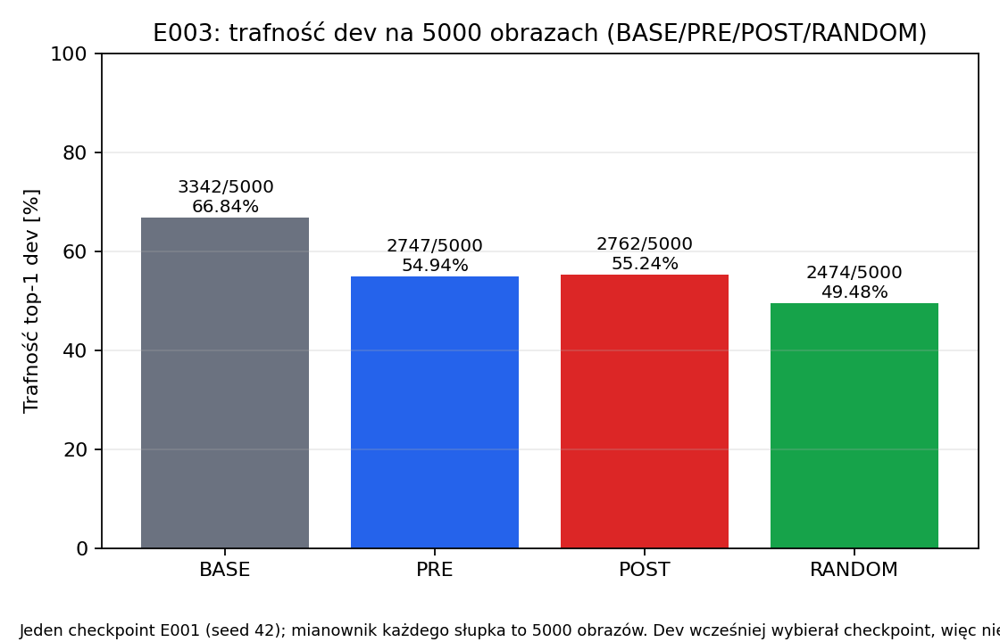
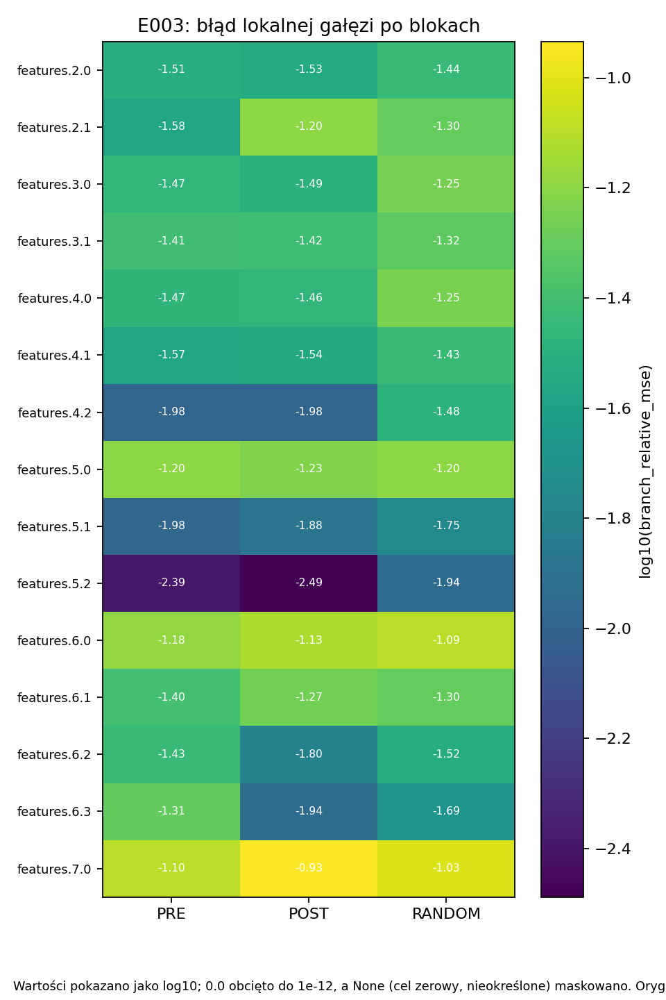

# E003 — wynik rzeczywistej kompresji 10% parametrów, bez dostrajania

Data: 2026-10-10 UTC. **Status wykonania: completed**.
Protokół przed uruchomieniem: [PROTOKOL_v1.md](PROTOKOL_v1.md), v1.0.
Pytanie: POST kontra PRE przy tym samym mniejszym grafie i wspólnym operatorze;
RANDOM jako kontrola. Nie wykonano treningu gradientowego po kompresji.

## Najważniejszy wynik

Powstały trzy fizycznie mniejsze modele: **3721424 parametry zamiast
4135648**, czyli **10,0159% mniej w całej sieci**. Wszystkie mają te same
szerokości 15 bloków i 1016 kanałów wewnętrznych mniej.

| Wariant | Poprawne / 5000 | Dev top-1 | Zmiana względem BASE | NLL |
|---|---:|---:|---:|---:|
| BASE | 3342 / 5000 | **66,84%** | — | 2,495039 |
| PRE | 2747 / 5000 | **54,94%** | −11,90 pp | 2,841055 |
| POST | 2762 / 5000 | **55,24%** | −11,60 pp | 2,811400 |
| RANDOM | 2474 / 5000 | **49,48%** | −17,36 pp | 3,193653 |

POST−PRE: **15 dodatkowych trafień = +0,30 pp**. Sparowany bootstrap
stratyfikowany po klasach (2000 replikacji, seed20261009): 95% przedział
**[−0,60; +1,22] pp**. Przedział obejmuje brak różnicy; nie mamy wyraźnego
dowodu przewagi POST w tym biegu. Nie jest to dowód równoważności metod.
Obie metody podobieństwa wypadają liczbowo lepiej niż RANDOM.

Strata jakości jest duża mimo umiarkowanej redukcji parametrów. Nie
przedstawiamy tej wersji jako skutecznej, gotowej metody kompresji ani
kontrybucji algorytmicznej. To wynik **przed wspólną naprawą**.

## Czy model był trenowany?

**W E003 nie było epok, optymalizatora, backpropagation, dostrajania ani
rekalibracji BN.** E001 wcześniej wytrenował EfficientNet-B0 od losowych
wag przez200epok; E003 użyło best.pt z epoki177.

Na500obrazach train A dopasowano analitycznie dwa skalary/parę:
alpha dla wejścia SE i beta dla projekcji czytającej mapy po SE.
Wagi nowych kopii zmieniły się przez fizyczne usunięcie kanałów i
wchłonięcie ich wkładu do macierzy. To kalibracja/operator, nie
gradientowy trening całej sieci. Oryginalny checkpoint niezmieniony.

Modele pracowały w eval/inference_mode. SE nadal wylicza zależne od
obrazu wagi kanałów — eval nie wyłącza atencji. Wyłącza m.in. dropout
i aktualizację statystyk BatchNorm. W rezultacie55,24% nie jest wynikiem
po fine-tuningu. Dostrajanie będzie osobnym eksperymentem z równym budżetem.

## Dokładny bieg, wejścia i 4 GPU

- Bieg: **`runs/E003/20261010T095706Z_5a2f233_seed42__0o_uckk/`**.
- Commit kodu/protokołu: **`5a2f233a27664e306dfac6be64e207e5ef7dffa3`**,
  dirty=false. Start09:57:06.495894 UTC, koniec09:57:47.133779 UTC:
  **40,64s** wraz z przygotowaniem, kalibracją, oceną, bootstrapem i wykresami.
  To nie czas treningu i nie benchmark samej inferencji.
- Study/analysis exit_code=0, stderr.log pusty.
- Parent E001 best.pt SHA-256:
  `f2ac9c3fddd140c0d45f2c244c78b432cbdd164b46dff32d00be956202ec5be8`.
- [Plan szerokości](PLAN_STRUKTURY.json) SHA-256:
  `fdfa35242201b9544afa47838a83f1683aa35482f9164555910b90ed225cab74`.
- Frozen config SHA-256:
  `ce7d8937d27488607e4cbc145f423ef271f97b511686801c1d9366f6124c7a82`.
- ID A/B utrwalone w E002 SAMPLES.json, SHA-256:
  `338eb31862ab3d35495c22c8ae58109aed280a8218f1c32e234c941c3d1bae1d`.
- A=500 train do par/cof, B=500 train do diagnostyki, dev=5000 ID E001.
  Nie użyto oficjalnego testu ani rezerwy. Kontener train jest czytany
  jako całość, ale do modelu trafiają wyłącznie dozwolone ID.

| GPU / rank | A | B | Dev dla każdego wariantu |
|---|---:|---:|---:|
| 0 | 125 | 125 | 1250 |
| 1 | 125 | 125 | 1250 |
| 2 | 125 | 125 | 1250 |
| 3 | 125 | 125 | 1250 |
| Łącznie | **500** | **500** | **5000 unikalnych ID** |

CzteryRTX2080Ti rzeczywiście wykonały forwardy kalibracji, diagnostyki,
dev i benchmarku. Dane records[rank::4], batch32/GPU, końcówki29 dla
A/B i2 dla dev, bez dopełniania/drop_last. To cztery procesy pracy
na wariantach jednego checkpointu, nie cztery niezależne seedy treningu.
Każdy obraz dev oceniono raz przez każdy model, nie cztery razy przez BASE.

Conda attention, Python3.11.15, torch2.12.0+cu130, torchvision0.27.0+cu130,
NumPy2.4.6, FP32forward, FP64statystyki, AMP/TF32off i algorytmy deterministyczne.
Po naprawie środowiska driver580.178.04 i kernel6.8.0-146 zamiast
580.173.02/6.8.0-139 w E001; różnice są w environment_comparison.json.
Pomimo zmian BASE odtworzył **wszystkie predykcje E001 i identyczny NLL**.

## Fizyczne modele i rozmiar artefaktów

| Wariant | Parametry | Inference-only plik, bajty | Redukcja pliku względem BASE |
|---|---:|---:|---:|
| BASE | 4135648 | 16818789 | — |
| PRE | 3721424 | 15149431 | 9,9256% |
| POST | 3721424 | 15149797 | 9,9234% |
| RANDOM | 3721424 | 15156993 | 9,8806% |

Nie porównujemy pliku best.pt zawierającego optimizer/scaler z plikiem
student tylko z wagami. Wszystkie powyższe zapisy mają ten sam cel:
inference-only, FP32, state_dict i metadane architektury. Budżet dotyczył
**parametrów**, nie dokładnie10% bajtów; narzut/bufory i nazwy w formacie
zapisu wyjaśniają różnice wielkości przy tych samych kształtach studentów.
Każdy model został odtworzony przez materializację grafu i strict load,
bez ponownego foldingu, i sprawdzony hashem przed oceną.

| Model | SHA-256 inference-only pliku |
|---|---|
| BASE | `44c44691acd501caffdbbe359ecc3892163cbd3cee6a50500b8abea6393a2817` |
| PRE | `8186ff8155b3f9fca8a79aeebb15b65cb7b0816abcb3b943255939a992011882` |
| POST | `9f4e94ddafdc6986a5bfcb6551e988b1dcc4a4e262047a00f51e23c95a9c2b8d` |
| RANDOM | `c4ba8b4fec2fa00cff76f87a80a9a74e4cfe95504a23119979b1c4182c89002e` |

Szczyt zaalokowanej pamięci PyTorch:188678656B/rank (około179,9MiB).
Nie jest to całkowita pamięć procesu/sterownika. Mały model/batch nie
musi wypełniać11GB, żeby używać wszystkich czterech kart.

## Sparowane odpowiedzi i błędy bloków

POST trafiał przy błędzie PRE na311obrazach; PRE trafiał przy błędzie
POST na296. Oba trafiały na2451, oba myliły się na1942. To rozbieżność
**poprawności**, nie liczba wszystkich różnych przewidywanych klas.
Przedział bootstrap opisuje tylko zmienność obrazów przy jednej bazie
wag i jednej kalibracji, nie niepewność między treningami/selekcjami.

Błędy B liczone na tych samych wejściach nauczyciela jako
sum((y_student-y_teacher)^2)/sum(y_teacher^2), osobno gałąź przed
residual oraz całe wyjście bloku. Nie są spadkiem accuracy.
POST nie poprawia każdego bloku: np. gałąź features.6.3 ma błąd
0,011563 vs PRE0,049289, lecz features.7.0 ma0,116326 vs PRE0,080066.
Źródłowe wejścia pozwalają opisać błąd lokalny; nie mierzą kumulacji
zmienionych wejść podczas pełnego forwardu student. Nie wskazujemy
jednego bloku jako przyczyny całej utraty jakości na podstawie tej tabeli.

## Czas wykonania — brak jednolitego przyspieszenia

Mediany ms/forward, batch32 syntetycznych tensorów3×96×96,10warmupów,
50CUDAevent-pomiarów perwariant/perGPU, eval/inference_mode/FP32:

| GPU | BASE | PRE | POST | RANDOM |
|---|---:|---:|---:|---:|
| 0 | 11,17 | 10,98 | 10,48 | 10,55 |
| 1 | 10,75 | 11,21 | 10,74 | 11,06 |
| 2 | 14,70 | 13,50 | 12,38 | 11,57 |
| 3 | 11,54 | 12,29 | 11,84 | 11,61 |

Nie ma stabilnej poprawy na wszystkich kartach. Kompaktowe warianty
mają tę samą strukturę; różnice ich czasów mogą wynikać m.in. z szumu
pomiaru, kolejności i obciążenia hosta. Kolejność była stała, rangi
nie startowały benchmarku w idealnie tej samej chwili, a pomiar ma jedną
serię/tryb/kartę. Nie deklarujemy10% przyspieszenia ani wyższości POST
w czasie wykonania. To forwardbezloadera, nie end-to-end throughput.

## Wykresy





Wartości na heatmapie są log10 względnego MSE, nie samym MSE.
[Czasy perGPU](wykresy/20261010T095706Z_5a2f233_seed42__0o_uckk/latency_by_gpu_mode.png),
[parametry/rozmiar](wykresy/20261010T095706Z_5a2f233_seed42__0o_uckk/parameters_and_filesize.png).
PNG/PDF i małe CSV/JSON w tym samym katalogu. Pełne wartości:
[summary.json](wykresy/20261010T095706Z_5a2f233_seed42__0o_uckk/summary.json),
[metrics.csv](wykresy/20261010T095706Z_5a2f233_seed42__0o_uckk/metrics.csv),
[latency_summary.csv](wykresy/20261010T095706Z_5a2f233_seed42__0o_uckk/latency_summary.csv).

Wygenerowane wykresy zachowano bez zmiany po pomiarze. W PNG czasu oraz
w stopkach części rysunków układ napisów jest ciasny/przycięty; nie
zmienia to danych. Do dokładnego odczytu należy użyć tabel i raportu.

## Dowody, status i odtworzenie

- Kontrole kodu przed badaniem: [TESTY_CPU_v1.json](TESTY_CPU_v1.json)
  i [TEST_FOLDING_CPU.json](TEST_FOLDING_CPU.json), syntetyczne CPU.
- Hashe biegu: **71/71 OK**;11/11 małych plików wynikowych z manifestu
  wykresów. Sourcecheckpoint i wszystkie stany BASE/student przed/po
  oceną zachowane; hashe stanów zgadzają się na wszystkich4GPU.
- 1016 rozłącznych par/warunek,15bloków/warunek, wspólny budżet;
  candidate_manifest i współczynniki zapisano przed oceną B/dev.
- Niezależny przegląd tylko-do-odczytu general-flash potwierdził hashe,
  ID/klasy, argmax/liczniki, rozbieżne trafienia, grupy i czasy.
- BASE ma0różnic predykcji i0różnicy NLL względem E001 mimo zmiany środowiska.

| Artefakt | SHA-256 |
|---|---|
| manifest.json | `4ce59154b13374e6e67b734cdb2443590d449a06127ffa187fd19f6a4c9a8c8c` |
| summary.json | `ceeddb6ae36d488be5295c63cc60e686c087b194147e238d61af358f6b0759ad` |
| candidate_manifest.json | `47ae4db38c86ac4e46bbf69c69eaf7eac34c0afd8b76036882e306f0688b3627` |
| dev_predictions.npz | `987533fc1f89e542b4c33b4d7b29afc62ca7466928f8148975c7036cf9859319` |
| artifacts.sha256 | `2061bd604d270b960426fe8dbb4879a346c97f49ccc9125e07177396f77e381c` |

Pole `compression_executed:false` w frozen config opisuje wejściowy stan
przed uruchomieniem. Nie aktualizujemy zakończonej konfiguracji; dowód
wykonania to manifest=completed, rzeczywiste modele z compression_applied=true
i [WYNIKI.json](WYNIKI.json). Nie należy używać configu jako statusu biegu.

Powtórzenie z czystego checkoutu commita wykonania i dostępnych wejść
o zapisanych hashach, Conda attention i czterech GPU:

```bash
conda run --no-capture-output -n attention python experiments/2026-10-09_E003_kompresja_10proc_parametrow/launch.py
```

Nowy katalog bez nadpisywania; `sha256sum -c artifacts.sha256` w biegu.
Nie wykonano powtórzenia w świeżym środowisku ani drugim seedzie rodzica.
Modele, logity i wielkie momenty pozostają poza Git; nie mają jeszcze
zewnętrznej kopii zapasowej. Kod/raport/małe wykresy wersjonowane w Git.

## Wniosek i następny krok

E003 spełniło cel **fizycznej redukcji10% parametrów** i kontrolowanego
porównania, ale kosztem11,6–17,36pp jakości bez naprawy. POST−PRE nie
daje obecnie wyraźnego dowodu przewagi. Nie jest to jeszcze wynik
potwierdzający nową metodę dla artykułu.

Na prośbę użytkowniczki następny etap obejmie **jednakowe gradientowe
dostrajanie wszystkich czterech warunków, także BASE**, z opublikowanym
budżetem CIFAR-100, bez zmiany selekcji lub szerokości. Źródło decyzji
o budżecie zostanie podane w osobnym E004. E003 pozostaje wynikiem
przed dostrajaniem; nie poprawiamy go po fakcie. Trening E004 jeszcze nie
został uruchomiony podczas sporządzenia tego raportu.
