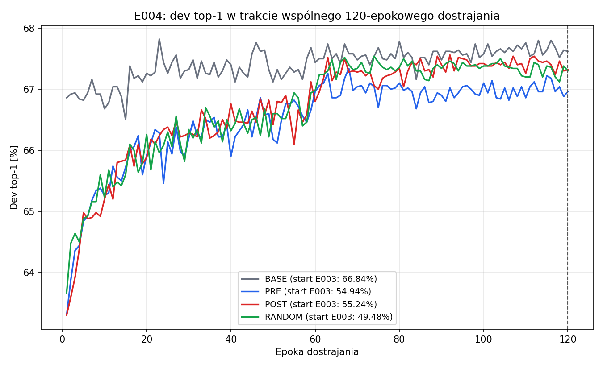
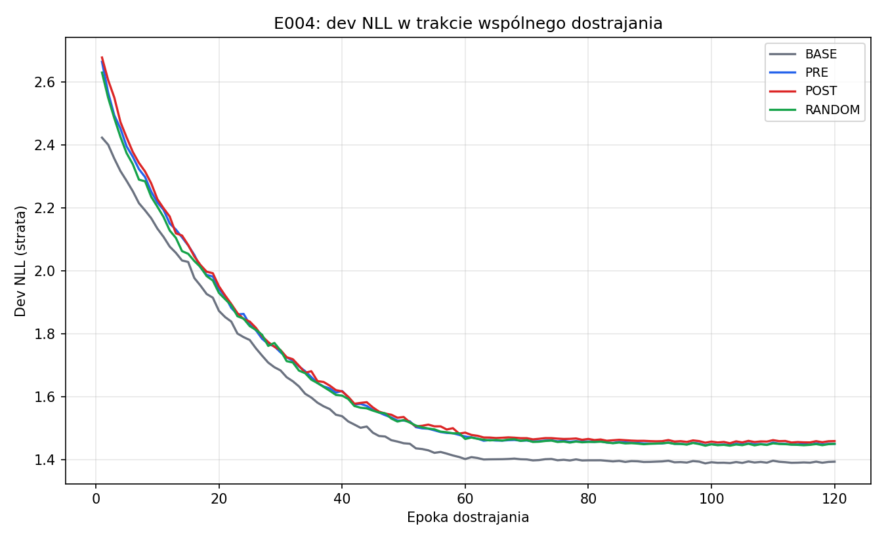
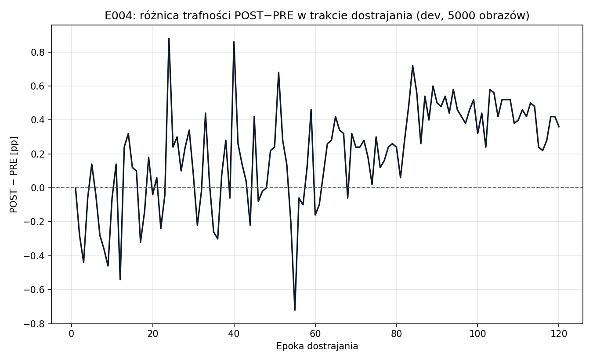

# E004 — wynik wspólnego dostrajania po kompresji

Data: 2026-10-10 UTC. **Status wykonania: completed.**
Protokół przed uruchomieniem: [PROTOKOL_v1.md](PROTOKOL_v1.md), v1.0.
Bieg: **`runs/E004/20261010T140203Z_560deb2_seed42_zutghyj2/`**,
commit kodu **`560deb2d930a…`**, dirty=false.

## Najważniejszy wynik

Po **identycznym** dostrojeniu (120 epok, SGD, batch256) wszystkie cztery
warianty osiągnęły podobną jakość na dev:

| Wariant | Start po E003 | Epoka 120 (wynik główny) | Poprawa | Najlepszy dev (diagnostyka) | NLL końcowa |
|---|---:|---:|---:|---:|---:|
| BASE | 66,84% | **67,62%** (3381/5000) | +0,78 pp | 67,82% (ep. 23) | 1,393 |
| PRE | 54,94% | **66,96%** (3348/5000) | +12,02 pp | 67,34% (ep. 68) | 1,450 |
| POST | 55,24% | **67,32%** (3366/5000) | +12,08 pp | 67,56% (ep. 92) | 1,458 |
| RANDOM | 49,48% | **67,30%** (3365/5000) | +17,82 pp | 67,54% (ep. 74) | 1,450 |

**Kluczowy fakt: po równym dostrojeniu różnice między metodami wyboru
kanałów praktycznie zniknęły.** POST−PRE to **+18 trafień (+0,36 pp)**,
95% przedział **[−0,30; +1,02] pp** — obejmuje brak różnicy.
POST−RANDOM: +1 trafienie, przedział [−0,72; +0,78] pp — wyniki
nierozróżnialne. PRE−RANDOM: −17 trafień, przedział [−1,08; +0,36] pp.
Wybór losowy po dostrojeniu dorównuje wyborowi opartemu na atencji.

To ważny wynik **kontrolny i negatywny** dla hipotezy na tym budżecie:
przy 10% redukcji parametrów i pełnym dostrojeniu o końcowej jakości
decyduje naprawa, a nie kryterium wyboru kanałów do scalenia. Samo
występowanie różnic w wagach SE nie przekłada się na korzyść końcową.

## Co to znaczy dla całego projektu?

1. Duże spadki z E003 (55,24% POST) były w większości **odwracalne**:
   brakowało etapu naprawy, nie „stracono” strukturalnie nieodwracalnej
   informacji przy 10% redukcji.
2. Przy tym budżecie **nie widać podstaw do nowego kryterium
   attention-aware**: POST nie bije PRE ani RANDOM w sposób wiarygodny.
3. Gdyby kryterium miało znaczenie, trzeba go szukać przy **większej
   kompresji** (tam selekcja jest trudniejsza) albo **bez dostrajania**
   (ustawienia, w których naprawa nie zamazuje wyboru) — ale to wymaga
   nowego, osobno zaprojektowanego eksperymentu, nie zmiany E004.
4. BASE po dodatkowych 120 epokach też nieznacznie urósł (66,84→67,62),
   co potwierdza, że dostrajanie dodało realną wartość, a nie tylko
   „wyrównało” modele.

## Wykonanie i koszt

- Start 14:02:03 UTC, koniec 17:37:55 UTC — **3 h 36 min** całości
  (trening + analiza). Czasy wariantów: BASE 3266,8 s, PRE 3230,1 s,
  POST 3219,6 s, RANDOM 3211,0 s (po ~54 min).
- 120 epok na wariant, ~27 s/epokę na 4 GPU (DDP, batch64/GPU = 256),
  AMP FP16, SyncBatchNorm, deterministyczne algorytmy.
- Train: 40000 obrazów (Sampler dzieli po 10000/rank); dev: 5000,
  każdy wariant widzi te same obrazy w tej samej kolejności;
  dev liczony co epokę, wynik główny z epoki 120.
- Zero epok early-stoppingu i zero wyboru najlepszej epoki jako wyniku
  głównego. Rezerwa i oficjalny test nieużywane.

## Artefakty i hashe

- `artifacts.sha256`: **63/63 plików OK**; wykresy 7/7 (3 PNG, 3 PDF,
  metrics_final.csv) zgodne z manifestem.
- Modele po dostrojeniu (`runs/.../models/*_ft.pt`, inference-only):

| Wariant | Parametry | Bajty | SHA-256 pliku |
|---|---:|---:|---|
| BASE | 4135648 | 16840815 | `06c07163c897eb97b24298aefcac09a42ac9e203361ce581ec14468bc1ca452a` |
| PRE | 3721424 | 15160385 | `4664ea960adf20203dbeaab7a4b030a49a3fd6508944effc5dee7e197f823ad0` |
| POST | 3721424 | 15163503 | `58442ef22bafe8a326f5aa94d62d5c0cc8510ffdd969ba5a84a3dcb7603dc220` |
| RANDOM | 3721424 | 15164747 | `190399855f087323c4ed2b94200c53f68f203b57193f6748685343231b907a71` |

| Artefakt | SHA-256 |
|---|---|
| manifest.json | `48ddad562b9d7bb1599bb93f0171f3766144f416fbc698eff15633eebc53a42d` |
| summary.json | `40d7657c18bcdb9088c8157add2b327b6b68b72a51bd591d51b2d5b8c0acb4f1` |
| artifacts.sha256 | `1a7df2167f762bcb775f331de743fc4441389cbfa920f779a065a32b70500508` |

Hashe wag modeli (stan, nie plik): BASE `74663618…`, PRE `99a48593…`,
POST `1d7eb043…`, RANDOM `f27552d4…` (pełne wartości w `variant_*.json`).

## Wykresy



Widać zbieganie się wszystkich krzywych do ~67% pod koniec treningu.





Różnica POST−PRE oscyluje wokół zera przez cały trening — brak trwałej
przewagi. PNG/PDF + [metrics_final.csv](wykresy/20261010T140203Z_560deb2_seed42_zutghyj2/metrics_final.csv)
i [summary.json](wykresy/20261010T140203Z_560deb2_seed42_zutghyj2/summary.json).

## Ograniczenia

- Jeden model bazowy (seed42), jeden poziom kompresji (10,0159%),
  jeden wspólny protokół dostrajania (adaptacja GReg) — nie uogólniamy
  na inne budżety ani architektury.
- Dev był wcześniej używany w E001–E003; nie jest niezależnym testem.
  Bootstrap opisuje zmienność obrazów, nie między treningami.
- Cztery warianty trenowano sekwencyjnie na tym samym sprzęcie —
  to jeden przebieg, nie cztery niezależne powtórzenia.
- Nie oceniano oficjalnego testu ani rezerwy; nie zmieniano checkpointu E001.

## Odtworzenie

```bash
conda run --no-capture-output -n attention python experiments/2026-10-10_E004_wspolne_dostrajanie/launch_finetune.py
```

Wymaga: czystego checkoutu commita wykonania, modeli E003 o hashach
z config.json, danych CIFAR-100 o zapisanych hashami, Condy attention
i dokładnie 4 GPU. Launcher tworzynowy katalog i sam uruchamia analizę CPU.

## Proponowany następny krok

Zatrzymujemy się przy wyniku E004. Skoro po dostrojeniu selekcja nie ma
znaczenia przy 10%, naturalny kolejny eksperyment to **ten sam protokół
przy większej redukcji (np. 20–30%)**, gdzie wybór kanałów może zacząć
odgrywać rolę — albo świadoma decyzja o zakończeniu wątku attention-aware
na tym pilocie. Decyzja należy do użytkowniczki; nic nie uruchamiam
automatycznie.
