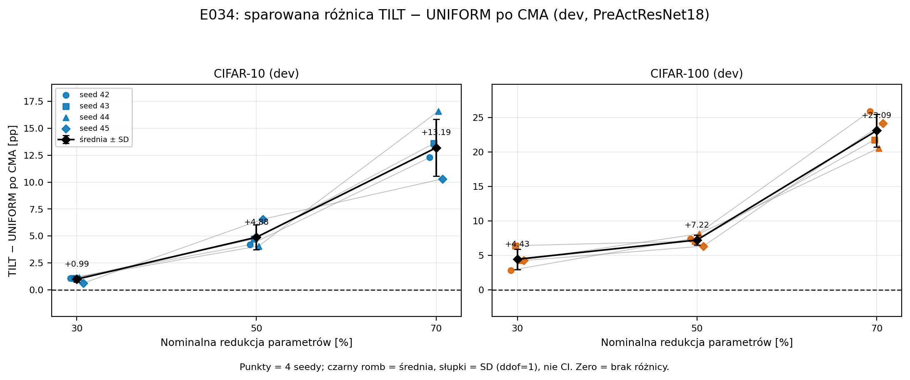

# E034 — transfer alokacji na PreActResNet18

Status: **Phase 1 completed, primary spełniony na obu zbiorach**, 2026-11-06.
Wszystkie 6 bramek CMA i 6 wtórnych bramek `repair_bn` spełnione.
TILT−UNIFORM dodatni na 4/4 seedach w każdej komórce.

**Wykresy w tym eksperymencie:** [figures/README.md](figures/README.md)
— punkty per seed, średnie±SD, PNG/PDF, CSV i SHA256 źródeł.



## Wykonanie i kontrola

- Trening: `runs/E034/train_20261105T014209Z_21b44f52`, 8 checkpointów,
  po 200 epok; 4×exit0, 8503,09 s (2 h 22 min), ukończony 2026-11-05.
  `audit_train.py` potwierdził kompletność epok, hashe checkpointów i sanity.
- Folding: `runs/E034/fold_20261106T003625Z_9ec4f2ea`, **144 oceny +24 kontrole**,
  4×exit0, **179,07 s**. Analiza: `analysis_20261106T004001Z/analysis.json`.
  Niezależna kontrola CPU: `verification.json` w tym samym katalogu, PASS.
- 4×RTX 2080 Ti, seed42–45 przypisane GPU0–3; każdy worker oba zbiory
  sekwencyjnie. Python3.11.15, Torch2.12.0+cu130, CUDA13.0, Conda attention.
  Trening: batch128 na GPU i efektywny128 na model, bez akumulacji;
  SGD0.1/momentum0.9/WD5e-4, cosine200, crop/flip. BN i ocena batch128.
- Architektura i operator upstream commit `694691556e8314a835178a741938dd3d4d80c171`,
  repo upstream niezmienione. 13 grup; TILT+0.30 to nasz adapter alokacji.
  Strict load checkpointów, pełne niepuste klastry, parametry zgodne z planami,
  skończone top1/NLL. Audyt potwierdził hashe źródeł, danych i kontroli.
- BN: A4096 crop/flip jak E031, CMA/reset i oryginalne retained EMA0.1
  `repair_bn`. Bez fine-tuningu po foldingu. Test i rezerwa nietknięte.

## Baseline i kontrole teacher

| Seed | CIFAR-10 dev [%] | CIFAR-100 dev [%] |
|---:|---:|---:|
| 42 | 95,12 | 77,02 |
| 43 | 95,22 | 76,30 |
| 44 | 95,26 | 77,18 |
| 45 | 95,26 | 77,12 |
| Średnia | **95,215** | **76,905** |

Sanity≥90/65% spełnione 8/8. Użyto `last.pt` (epoka200), bez wyboru najlepszego seeda.
Teacher PRE→CMA→repair_bn: CIFAR-10 **95,215→95,290→95,240%**;
CIFAR-100 **76,905→76,965→76,990%**. Brak załamania jakości samej kalibracji.

## Primary — CMA

Budżety oznaczają **redukcję parametrów**, nie kanałów. Średnie po4 seedach;
SD dotyczy sparowanych różnic. Przy30% próg>0 i≥3/4; przy50/70% ≥+2pp i≥3/4.

| Zbiór | Redukcja | UNIFORM [%] | TILT [%] | T−U ±SD [pp] | Dodatnie | Próg |
|---|---:|---:|---:|---:|---:|---|
| CIFAR-10 | 30% | 93,590 | 94,575 | +0,985 ±0,246 | 4/4 | TAK |
| CIFAR-10 | 50% | 88,995 | 93,875 | +4,880 ±1,156 | 4/4 | TAK |
| CIFAR-10 | 70% | 78,595 | 91,785 | +13,190 ±2,636 | 4/4 | TAK |
| CIFAR-100 | 30% | 66,870 | 71,305 | +4,435 ±1,469 | 4/4 | TAK |
| CIFAR-100 | 50% | 56,845 | 64,070 | +7,225 ±0,738 | 4/4 | TAK |
| CIFAR-100 | 70% | 23,425 | 46,520 | +23,095 ±2,395 | 4/4 | TAK |

### Sparowane różnice per seed (42/43/44/45)

| Zbiór/budżet | CMA [pp] | repair_bn [pp] |
|---|---|---|
| CIFAR-10/30 | 1,08 / 1,08 / 1,16 / 0,62 | 1,00 / 0,92 / 1,24 / 0,92 |
| CIFAR-10/50 | 4,18 / 4,72 / 4,06 / 6,56 | 4,24 / 4,94 / 3,96 / 6,54 |
| CIFAR-10/70 | 12,28 / 13,60 / 16,58 / 10,30 | 12,34 / 13,98 / 16,26 / 10,34 |
| CIFAR-100/30 | 2,84 / 6,40 / 4,26 / 4,24 | 2,72 / 6,80 / 4,16 / 4,72 |
| CIFAR-100/50 | 7,38 / 7,06 / 8,12 / 6,34 | 7,16 / 7,26 / 7,86 / 6,42 |
| CIFAR-100/70 | 25,90 / 21,76 / 20,56 / 24,16 | 26,26 / 21,82 / 20,98 / 24,18 |

## Secondary — repair_bn, PRE i NLL

| Zbiór/budżet | U repair [%] | T repair [%] | T−U repair [pp] | T−U PRE [pp] | NLL CMA U/T |
|---|---:|---:|---:|---:|---|
| CIFAR-10/30 | 93,530 | 94,550 | +1,020 | +2,145 | 0,253904 / 0,215563 |
| CIFAR-10/50 | 89,035 | 93,955 | +4,920 | +11,070 | 0,439713 / 0,240115 |
| CIFAR-10/70 | 78,550 | 91,780 | +13,230 | +26,835 | 0,874088 / 0,316743 |
| CIFAR-100/30 | 66,715 | 71,315 | +4,600 | +9,675 | 1,377652 / 1,185844 |
| CIFAR-100/50 | 56,835 | 64,010 | +7,175 | +20,380 | 1,847132 / 1,515008 |
| CIFAR-100/70 | 23,080 | 46,390 | +23,310 | +17,905 | 3,448271 / 2,359523 |

Wszystkie różnice PRE i repair dodatnie4/4. Wniosek primary nie wymaga
wyboru korzystniejszej procedury BN; obie dają podobne zyski.
Na CIFAR-100/70 CMA zwiększa przewagę względem PRE, na pozostałych komórkach
ją zmniejsza. NLL po CMA niższe dla TILT we wszystkich6 średnich.
Pełne pomiary i krzywe treningowe są w summary.json oraz metrics.jsonl runów.

## Budżety

| Zbiór/budżet | U=target | T |
|---|---:|---:|
| CIFAR-10/30 | 7 806 560 | 7 806 023 |
| CIFAR-10/50 | 5 583 314 | 5 582 715 |
| CIFAR-10/70 | 3 344 925 | 3 344 550 |
| CIFAR-100/30 | 7 845 170 | 7 843 463 |
| CIFAR-100/50 | 5 580 280 | 5 579 192 |
| CIFAR-100/70 | 3 333 871 | 3 333 509 |

TILT zawsze≤target i≥99,9% targetu (maks. różnica ok.0,022%). Dokładne
szerokości13 grup zapisano przed oceną w `plans.json`, audyt odtworzył je.
Zaokrąglenia kanałów powodują niewielkie odstępstwo od nominalnych30/50/70%.

## Poprawki wykonania

Przed pomiarami poprawiono zliczanie kontroli teacher w analizatorze:
były dodawane trzy razy, raz na budżet (72 zamiast24). Nie zmieniono miar/progów.
Pierwszy folding `fold_20261105T224040Z_4270a30f` zakończył się błędem:
odtwarzany bias FC miał domyślnie `requires_grad=True`. Kontrola CMA przerwała
wykonanie; run zachowany, bez udziału w analizie. Poprawiono wyłącznie flagę
zamrożenia biasu, nie jego wartości. Finalny run wykonano od początku.
Nie uruchamiano nowego treningu. Commity kodu: `fdd4113`, `221da68`.

## Wniosek i ograniczenia

**Reguła alokacji przeniosła się na drugą architekturę, także na CIFAR-100.**
To wzmacnia wkład: nierówny budżet per grupa może istotnie poprawiać folding
bez fine-tuningu przy tej samej liczbie parametrów, względem UNIFORM.
Słaby wynik CIFAR-100 w E015/E031 nie jest ogólną własnością samego zbioru.
Nie wykazano jednak przyczynowej roli preaktywacji: zmieniają się architektura,
geometria13 grup, checkpointy i wektor alokacji. E031/E033 zachowują werdykty.

Na CIFAR-100/70 pozostaje duży spadek względem teacher: 46,52% vs76,905%
(−30,385pp). Silny zysk względny nie oznacza zachowania jakości baseline.
Dwie pokrewne architektury,4seedy, używany wcześniej dev, jeden przepis
na architekturę; brak niezależnego testu, dowodu optymalności i pełnej
reprodukcji CLFM1:1. Progi są opisowe, nie testami istotności.

Następny krok: zamrozić zakres twierdzeń i protokół niezależnej oceny przed
otwarciem testu/rezerwy. Decyzja publikacyjna pozostaje otwarta. Search,
AUTO50, miary grupowania i prosta hipoteza layer4 pozostają zamknięte.
Kolejny trening wyłącznie po wyraźnej zgodzie.

## Odtworzenie

OPIS.md zachowano z oryginalnym hashem; jego komendy `experiment.py` były
nieaktualnymi nazwami plików. W Conda attention, w katalogu projektu:

```bash
CUDA_VISIBLE_DEVICES='' python -B experiments/2026-11-05_E034_preactresnet18/audit_train.py runs/E034/train_20261105T014209Z_21b44f52
CUDA_VISIBLE_DEVICES='' OMP_NUM_THREADS=2 OPENBLAS_NUM_THREADS=2 python -B experiments/2026-11-05_E034_preactresnet18/fold_preact.py check
CUDA_VISIBLE_DEVICES=0,1,2,3 python -B experiments/2026-11-05_E034_preactresnet18/fold_preact.py fold --train-run runs/E034/train_20261105T014209Z_21b44f52
CUDA_VISIBLE_DEVICES='' python -B experiments/2026-11-05_E034_preactresnet18/fold_preact.py analyze --fold-run runs/E034/fold_20261106T003625Z_9ec4f2ea
```

Folding tworzy nowy unikalny katalog; analyze należy skierować do wybranego runu.
