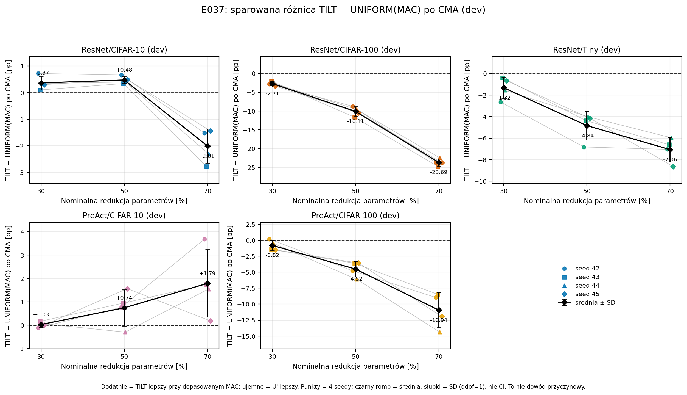

# E037 — brak ogólnej przewagi TILT przy zbliżonym MAC

Status: **completed, primary negatywny**, 2026-11-08. Kontrola na dev,
bez treningu i bez ponownej oceny testu. **Po poszerzeniu UNIFORM do budżetu
MAC TILT, U' wygrywa średnio w10/15 komórek; TILT wygrywa w5/15.**
U' ma jednocześnie więcej parametrów. Wynik nie rozdziela wpływu kosztu
obliczeń od większej pojemności modelu i nie wyjaśnia przyczynowo zysku TILT.

## Wykonanie i integralność

- Protokół [OPIS.md](OPIS.md) zamrożony w `2ec059c`; poprawka monitora
  `7f0aaeb` przed finalnym runem. [DZIENNIK.md](DZIENNIK.md).
- Run `runs/E037/20261108T031759Z_855c0b33`: **completed**,4×exit0,
  **292,28s (4,87min)**. 4GPU, seed42–45→GPU0–3.
- **180 ocen +60 kontroli teacher**:5par×3budżety×4seedy×3tryby dla U'
  oraz60 kontroli. Oryginalne U/T to **reuse dev E035** z weryfikacją hashy.
- `check.json` i `analysis/verification.json` **PASS**:15/15 U' ma
  MAC≤MAC(T), parametry i klastry zgodne, brak dostępu do testu
  (`data_open_attempts=[]`), metryki skończone, wagi niezmienione.
  Po finalnym runie poprawiono w `analyze` nazwę klucza czasu
  (`wall_seconds`→`elapsed_seconds`) i dodano tabelę `averages`; kod oceny
  i zapisane metryki pozostały bez zmian (`source/` runu ma wersję z runu).
- Conda attention, Python3.11.15, Torch2.12.0+cu130, CUDA13.0,
  4×RTX2080Ti; FP32/TF32 off, deterministyczne, batch128.
- U' jest profilem **UNIFORM**: wszystkie grupy mają tę samą redukcję,
  dobraną tak, by zmieścić się w MAC TILT. Liczba parametrów U' wynosi
  **1,10–1,82× liczby parametrów T**. To kontrola compute, nie rozmiaru.

## Główny wynik

Top-1 dev [%] po CMA; różnice [pp]. U'=UNIFORM dopasowany MAC.
Pełne NLL i per-seed: `analysis/analysis.json`, `analysis/per_seed.csv`.



| Para | Red. | U'/T param. | MAC U'/T | U | T | U' | T−U' | U'−U | T−U' repair |
|---|---:|---:|---:|---:|---:|---:|---:|---:|---:|
| R/C10 | 30% | 1,10× | 0,998 | 93,49 | 94,52 | 94,16 | **+0,37** | +0,66 | +0,33 |
| R/C10 | 50% | 1,36× | 0,992 | 89,44 | 93,43 | 92,95 | +0,48 | +3,52 | +0,51 |
| R/C10 | 70% | 1,79× | 0,985 | 77,31 | 88,21 | 90,22 | −2,01 | +12,92 | −1,85 |
| R/C100 | 30% | 1,10× | 0,998 | 66,34 | 66,96 | 69,67 | **−2,71** | +3,33 | −2,39 |
| R/C100 | 50% | 1,37× | 0,994 | 53,85 | 55,55 | 65,66 | **−10,11** | +11,80 | −9,99 |
| R/C100 | 70% | 1,80× | 0,995 | 31,40 | 33,02 | 56,71 | **−23,69** | +25,31 | −22,49 |
| R/Tiny | 30% | 1,11× | 0,998 | 34,81 | 38,59 | 39,91 | −1,32 | +5,10 | −1,39 |
| R/Tiny | 50% | 1,37× | 0,988 | 19,93 | 29,33 | 34,17 | −4,84 | +14,25 | −4,73 |
| R/Tiny | 70% | 1,82× | 0,999 | 8,43 | 16,18 | 23,24 | −7,06 | +14,81 | −6,96 |
| P/C10 | 30% | 1,10× | 0,998 | 93,59 | 94,58 | 94,55 | +0,03 | +0,96 | +0,00 |
| P/C10 | 50% | 1,36× | 0,996 | 89,00 | 93,88 | 93,14 | +0,74 | +4,14 | +0,93 |
| P/C10 | 70% | 1,75× | 0,993 | 78,60 | 91,79 | 90,00 | +1,79 | +11,40 | +1,52 |
| P/C100 | 30% | 1,10× | 0,998 | 66,87 | 71,31 | 72,12 | −0,81 | +5,25 | −0,85 |
| P/C100 | 50% | 1,37× | 0,998 | 56,84 | 64,07 | 68,58 | −4,52 | +11,74 | −4,62 |
| P/C100 | 70% | 1,77× | 0,998 | 23,43 | 46,52 | 57,46 | −10,94 | +34,03 | −11,04 |

**T−U' CMA dodatni tylko5/15; ujemny10/15.** Bramka primary przechodzi
tylko R/C10/30 (+0,37pp,4/4); przy50/70 próg≥2pp nie jest spełniony
nawet na CIFAR-10. P/C10 jest blisko zera (+0,03/+0,74/+1,79pp), ale
nie osiąga progu. Na CIFAR-100 i Tiny U' wygrywa wyraźnie, do+23,69pp.
Po `repair_bn` kierunek jest taki sam; NLL U' jest lepszy na CIFAR-100
i Tiny, a TILT ma niższe NLL na CIFAR-10.

## Interpretacja

E034/E035 porównywały TILT i UNIFORM przy **tej samej liczbie parametrów**.
E036 pokazał, że TILT ma wtedy 1,105–1,823× MAC. E037 usuwa tę nierówność:
UNIFORM może użyć większej liczby parametrów, by zmieścić się w MAC TILT.
W takim porównaniu U' bije U we wszystkich15 komórkach, a TILT wygrywa
tylko na CIFAR-10 i to głównie przy30/50%.

**Wniosek:** przewaga TILT przy stałych parametrach nie przenosi się ogólnie
na porównanie ze szerszym UNIFORM przy zbliżonym MAC. Nie wykazano więc
ogólnej przewagi TILT przy ograniczeniu MAC. Jednocześnie ten eksperyment
zmienia liczbę parametrów U', zatem nie dowodzi, jaka część zysku TILT
„wynika z compute”. Artykuł musi pokazywać oba porównania: parameter-matched
(TILT wygrywa) i MAC-matched (szerszy UNIFORM wygrywa na CIFAR-100/Tiny),
z jawnym wskazaniem różnych budżetów parametrów.

To nie jest unieważnienie E034/E035: przy zadanym rozmiarze sieci TILT
nadal jest lepszy w zbadanych warunkach. Przydatność wdrożeniowa zależy
od jednoczesnych ograniczeń parametrów, MAC, pamięci i czasu; E037 nie
mierzył opóźnienia U' i nie rozstrzyga wszystkich tych ograniczeń naraz.

## Ograniczenia

- Dev był używany wcześniej; test po E035 jest użyty i **nie był otwierany**.
  To kontrola mechanizmu, nie niezależna walidacja potwierdzająca.
- U' ma więcej parametrów niż T; porównanie dotyczy MAC, nie rozmiaru.
  MAC to nie latency: E036 nie wykazał jednoznacznego kierunku zmiany
  opóźnienia batch1 ani przyczynowej roli narzutu uruchomienia.
- Jeden serwer,4seedy, dwie pokrewne architektury, jeden przepis treningu.
- Profile U' są ograniczone do jednakowej redukcji we wszystkich grupach
  i maks.90% szerokości; nie jest to optymalizacja profilu.
- Różnice MAC U'/T są ≤2%; dobór szerokości jest całkowitoliczbowy.
- Brak testu istotności; progi są opisowe. Nie strojono progów po wynikach.

## Błąd wykonania

`20261108T030702Z_a7428da3` failed: monitor użył funkcji sprawdzającej
bezczynność GPU, gdy workery już liczyły (600MiB/31–47%). Poprawiono
telemetrię; bez zmian profili, danych i kryteriów. Run zachowany bez wyników.
Historyczny manifest i statusy workerów pozostały `running`, gdyż błąd
objął także sekcję końcową launchera. Audyt potwierdził brak tych procesów;
nie traktować statusu historycznego jako aktywnego zadania.

## Odtworzenie

```bash
export CONDA_DEFAULT_ENV=attention
export OMP_NUM_THREADS=2 MKL_NUM_THREADS=2 OPENBLAS_NUM_THREADS=2
PY=/home/users/s224574/miniconda3/envs/attention/bin/python
E=experiments/2026-11-08_E037_kontrola_mac
R=runs/E037/20261108T031759Z_855c0b33
CUDA_VISIBLE_DEVICES='' "$PY" -B "$E/experiment.py" freeze
CUDA_VISIBLE_DEVICES='' "$PY" -B "$E/experiment.py" check
CUDA_VISIBLE_DEVICES=0,1,2,3 "$PY" -B "$E/experiment.py" run
CUDA_VISIBLE_DEVICES='' "$PY" -B "$E/experiment.py" analyze --run "$R"
CUDA_VISIBLE_DEVICES='' "$PY" -B "$E/audit.py" "$R"
```

Wykresy lokalne: [figures/README.md](figures/README.md) — PNG/PDF, punkty
per seed w CSV oraz SHA256 źródeł. [Audyt zapisów E034–E037](../../reports/2026-11-08_wykresy/AUDYT_WYKONANIA.md).
