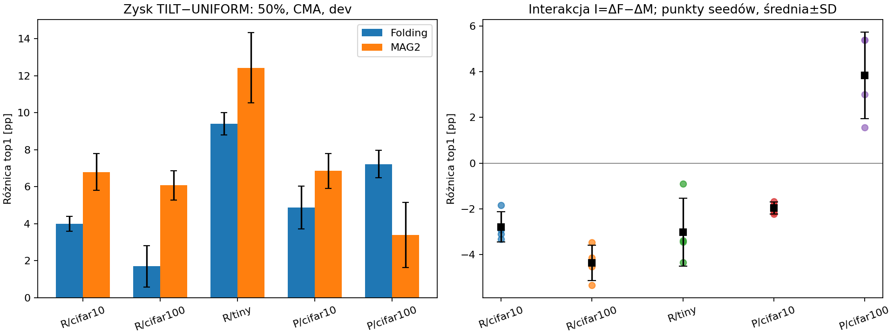

# E038 — TILT pomaga również pruningowi

**Completed, 2026-11-08. Primary H_F niespełniony: dodatnia interakcja
przy50% tylko1/5 par.** Średni zysk TILT jest większy dla MAG2 w4/5 par.
To dowód komponentu ogólnego alokacji, bez ogólnej specyficzności dla foldingu.

## Wykonanie i kontrola

- [Protokół](OPIS.md), [dziennik techniczny](DZIENNIK.md).
- Run `runs/E038/20261108T215451Z_a5912565`: **completed,4×exit0,
  340,86s**. PID launchera1064058, workery1064126–1064129.
- 4×RTX2080Ti; seed42/43/44/45→GPU0/1/2/3. Conda attention,
  Python3.11.15, Torch2.12.0+cu130, CUDA13.0, batch128,
  OMP/BLAS/MKL2, deterministycznie, TF32off. Bez treningu i testu/rezerwy.
- **360 ocen MAG2 +120 odtworzeń FOLD +60 teacher**;360 metryk FOLD reuse.
  Odtworzenia FOLD/teacher: identyczny top1 i hash stanu, NLL≤1e-5.
- `analysis/verification.json` **PASS**. Niepuste wybory kanałów, zgodne
  profile, hashe wejść, widoki A, brak gradientów, bias zachowany.
- CPU check30 par operatorów: identyczne kształty, parametry i MAC
  FOLD=MAG2 dla danego profilu. Zerowa kompresja i ranking L1/L2/remisy PASS.
- Dodatkowy audyt techniczny po runie: **120/120 modeli MAG2 bitowo zgodnych**
  z niezależną przebudową przez oryginalne upstream `apply`, z adapterem
  wyłącznie liczby k i reguły remisów. Zgodne również hashe wag użytych
  w pomiarze. `analysis/operator_verification.json` **PASS**.
- Protokół SHA256 `aedf98ecacfed9e73066b7644e3d6832f1cbee1a91e85071040cdac447134095`;
  kod i źródła zachowane w `source/`, bez nowych commitów/push.

## Primary: 50% redukcji parametrów, CMA, dev

Średnie po4 sparowanych seedach. R=ResNet18, P=PreActResNet18.
Top1 w%, kontrasty i SD wpp; **I=ΔF−ΔM**.

| Para | F/U | F/T | MAG/U | MAG/T | ΔF | ΔM | I ±SD | I dodatnie |
|---|---:|---:|---:|---:|---:|---:|---:|---:|
| R/C10 | 89,4350 | 93,4300 | 85,2250 | 92,0200 | +3,9950 | +6,7950 | −2,8000 ±0,6627 | 0/4 |
| R/C100 | 53,8550 | 55,5500 | 40,7350 | 46,8050 | +1,6950 | +6,0700 | −4,3750 ±0,7778 | 0/4 |
| R/Tiny | 19,9250 | 29,3325 | 10,5600 | 22,9925 | +9,4075 | +12,4325 | −3,0250 ±1,4804 | 0/4 |
| P/C10 | 88,9950 | 93,8750 | 85,5400 | 92,3900 | +4,8800 | +6,8500 | −1,9700 ±0,2636 | 0/4 |
| P/C100 | 56,8450 | 64,0700 | 38,1950 | 41,5800 | +7,2250 | +3,3850 | +3,8400 ±1,8948 | 4/4 |

Na całej siatce CMA **średnie ΔM dodatnie15/15**, a I dodatnie4/15
(PreAct/C100 przy30/50/70 oraz Tiny/70). FOLD/T zachowuje wyższy
średni top1 niż MAG2/T we wszystkich15 komórkach — mniejszy przyrost
od UNIFORM nie oznacza niższej jakości końcowej.

Pełne PRE/CMA/repair_bn i wszystkie budżety: [TABLES.md](TABLES.md),
[cells.csv](cells.csv). Surowe sparowane wyniki i opisowe t(df3) przedziały:
`analysis/per_seed.csv`, `analysis/analysis.json` w runie.



## Interpretacja i ograniczenia

TILT jest użytecznym profilem także dla magnitude pruningu. **Nie ma podstaw
do ogólnej tezy o mechanizmie specyficznym dla foldingu.** Bezpieczny wkład:
kontrolowana alokacja budżetu i jej skuteczność w foldingu oraz pruningu.
Folding pozostaje jakościowo lepszy od tego MAG2 przy tych samych profilach.

Interakcja jest różnicą przyrostów w surowych pp, nie dowodem przyczynowym
ani porównaniem przy dopasowanej jakości wyjściowej. Niskie poziomy MAG2,
zwłaszcza przy70%, ograniczają interpretację (efekt podłogi/nieliniowość).
Parametry dopasowane między U/T, ale MAC różni się; oba operatory mają
identyczny MAC dopiero w obrębie tego samego profilu. Dane dev użyte,
4seedy, dwie pokrewne architektury; brak niezależnej oceny nowego MAG2.
PRE ma inne wyjściowe bufory BN; primary używa wspólnej procedury CMA.

## Odtworzenie dodatkowej analizy

Pierwsze przygotowanie: [OPIS.md](OPIS.md); pełny replay zamrożonych wejść:
[URUCHOMIENIE.md](URUCHOMIENIE.md). Dodatkowy audyt i wykres:

```bash
CUDA_VISIBLE_DEVICES='' OMP_NUM_THREADS=2 MKL_NUM_THREADS=2 OPENBLAS_NUM_THREADS=2 \
  /home/users/s224574/miniconda3/envs/attention/bin/python -B \
  experiments/2026-11-08_E038_operator_alokacja/audit_operator.py \
  runs/E038/20261108T215451Z_a5912565
CUDA_VISIBLE_DEVICES='' OMP_NUM_THREADS=2 MKL_NUM_THREADS=2 OPENBLAS_NUM_THREADS=2 \
  /home/users/s224574/miniconda3/envs/attention/bin/python -B \
  experiments/2026-11-08_E038_operator_alokacja/tables.py \
  runs/E038/20261108T215451Z_a5912565
```

Następny krok: E039 — z góry ustalone przestawienia odchyleń TILT.
