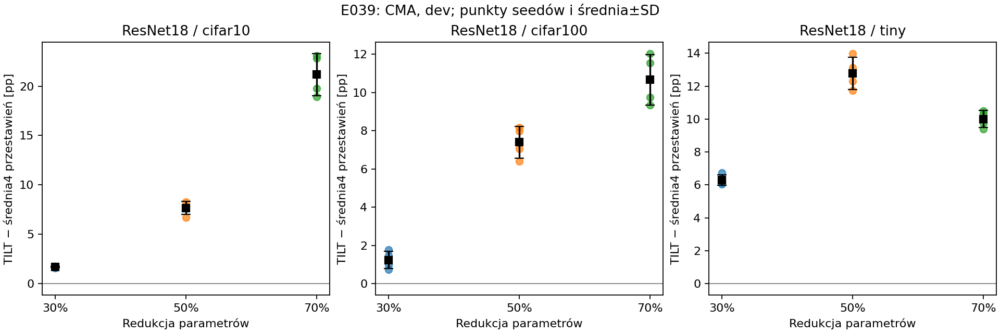

# E039 — uporządkowany TILT lepszy od czterech przestawień

**Completed,2026-11-08. Primary H_ORDER spełniony9/9, każda komórka4/4
dodatnie seedy.** Kierunek utrzymuje się także po oryginalnym repair_bn.
Wniosek dotyczy dopasowanych parametrów; MAC nie jest dopasowany.

## Wykonanie i integralność

- [Protokół](OPIS.md) i wejścia zamrożone przed oceną, cztery permutacje101–104
  bez selekcji po jakości. Siła TILT nadal+0.30.
- Run `runs/E039/20261108T223038Z_9d2d039e`: **completed,4×exit0,
  684,24s (11,40min)**. Launcher PID1069120, workery1069177–1069180.
- 4×RTX2080Ti, seed42/43/44/45→GPU0/1/2/3. Conda attention,
  Python3.11.15, Torch2.12.0+cu130, CUDA13.0, batch128, OMP/BLAS/MKL2,
  deterministycznie, TF32off. Bez treningu i dostępu do testu/rezerwy.
- **432 nowe oceny SHUFFLED +36 odtworzeń T +36 kontroli teacher**.
  Odtworzenia przy50%: top1 i stan identyczne E035; NLL≤1e-5.
- CPU:36 geometrii i3 rzeczywiste złożenia/forwardy; uporządkowany wzór
  dokładnie odtwarza szerokości T z E035. W runie wszystkie profile mają
  zgodne MAC, parametry, niepuste klastry i zachowany bias; wagi bez zmian.
- `analysis/verification.json` **PASS**, wszystkie4GPU rzeczywiście użyte,
  `data_open_attempts=[]`, hashe danych/checkpointów/kodu zgodne.
- Protokół SHA256 `63d493aefddf0a0835dc999503858635943f4cf0caa6c36ea8920d6a7fe2e4f5`;
  snapshot źródeł i środowisko w runie. Brak failed runów GPU.

## Primary: TILT−średnia4 przestawień, CMA, dev [pp]

Najpierw średnia czterech permutacji w obrębie seeda, następnie agregacja
po czterech seedach modeli. SD próbne(ddof=1), nie po16 niezależnych modelach.

| Zbiór | 30% redukcji parametrów | 50% | 70% |
|---|---:|---:|---:|
| CIFAR-10 | +1,6888 ±0,0617 | +7,6663 ±0,6667 | +21,1613 ±2,1084 |
| CIFAR-100 | +1,2462 ±0,4605 | +7,4000 ±0,8271 | +10,6663 ±1,3209 |
| Tiny ImageNet64 | +6,2869 ±0,3130 | +12,7794 ±0,9793 | +9,9975 ±0,5199 |

W każdej komórce **4/4** dodatnie. Osobny opisowy próg≥1pp także9/9.
Po repair_bn: CIFAR-10+1,68/+6,98/+17,79pp,
CIFAR-100+1,40/+6,58/+9,76pp, Tiny+6,12/+12,33/+9,73pp;
również9/9 i każda4/4. PRE ma dodatni kierunek9/9, ale jest diagnostyczny.

TILT bije **każdą z czterech permutacji osobno w średniej po seedach**:
36/36 komórek CMA. Średnia4 SHUFFLED jest gorsza od UNIFORM9/9.
To ogranicza narrację, że dowolna niejednorodna alokacja wystarcza.

Pełne absolute top1, wszystkie permutacje, S−U i koszty:
[TABLES.md](TABLES.md), [cells.csv](cells.csv), [permutations.csv](permutations.csv).
Surowe oceny/kontrasty i opisowe t(df3) przedziały: `analysis/` w runie.



## Koszt i granice wniosku

Parametry SHUFFLED wynoszą **0,999842–0,999999×P(U)**. Jednak wszystkie
przestawienia mają **mniej MAC niż TILT:0,433–0,910×MAC(T)**.
Przy30% zakres jest0,824–0,910, przy50%0,609–0,765,
przy70%0,433–0,657. To ważne ograniczenie, zgodne z wcześniejszym E036.

**Wniosek:** przy ograniczeniu liczby parametrów zbadany uporządkowany
profil daje lepszą jakość niż ta ustalona pula przestawień. E039 nie
izoluje wpływu samej kolejności od kosztu obliczeń i nie wykazuje
optymalności TILT ani ogólnej przewagi przy ograniczeniu MAC.

Permutujemy odchylenia przed clippingiem. Ponowne dopasowanie base,
zaokrąglenia i naprawa budżetu zmieniają finalny histogram ratio.
Cztery ustalone permutacje nie reprezentują całej przestrzeni i nie
stanowią formalnego testu permutacyjnego. Cztery seedy, jedna architektura,
używany wcześniej dev — kontrola diagnostyczna, nie niezależna walidacja.
Bezwzględna jakość TILT przy70% nadal niska na CIFAR-100/Tiny.

## Odtworzenie

Pierwsze przygotowanie: [OPIS.md](OPIS.md). Replay istniejących zamrożonych
wejść: [URUCHOMIENIE.md](URUCHOMIENIE.md). Wykres i tabele:

```bash
CUDA_VISIBLE_DEVICES='' OMP_NUM_THREADS=2 MKL_NUM_THREADS=2 OPENBLAS_NUM_THREADS=2 \
  /home/users/s224574/miniconda3/envs/attention/bin/python -B \
  experiments/2026-11-08_E039_przestawienia_tilt/tables.py \
  runs/E039/20261108T223038Z_9d2d039e
```

Następny krok: opracowanie artykułu z E035–E039; traktować TILT jako profil
przy ograniczeniu parametrów, z korzyścią także dla pruningu (E038).
