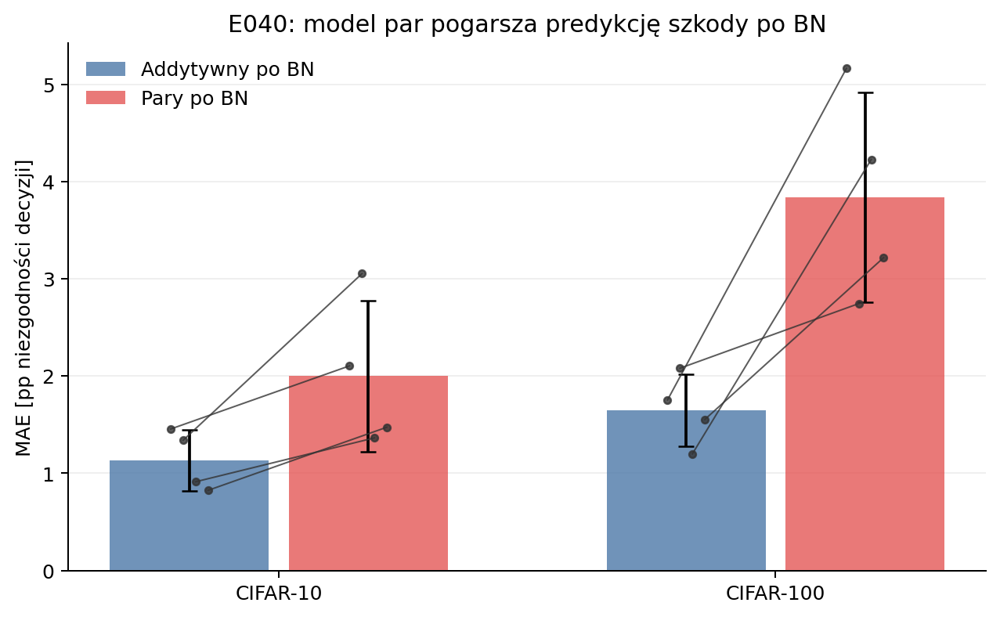

# E040 — model par pogarsza predykcję szkody, próba zakończona

**Completed, primary niespełniony na etapie predykcji, 2026-11-11.**
Model drugiego rzędu po BN ma większy MAE niż model addytywny na obu CIFAR-ach,
na każdym z4seedów. Zgodnie z protokołem zatrzymano badanie **przed dev**.
Nie oceniano przewagi top1 ani wymaganych kontrastów jakości ablacji.
**Decyzja: zamknąć tę próbę i wrócić do artykułu na E035–E039.**

## Wykonanie i integralność

- Protokół [OPIS.md](OPIS.md), [korekta wykonawcza przed oceną](UZUPELNIENIE_WYKONAWCZE.md),
  [instrukcja](URUCHOMIENIE.md), [dziennik](DZIENNIK.md).
- Run `runs/E040/20261111T032100Z_07ac54f7`: **completed,4×exit0**,
  `execution_outcome=stopped_C`, **3032,72s (50,55min)**, ≤3,370GPU-h
  rezerwacji4urządzeń, wobec limitu120min/8GPU-h.
- Własne ResNet18 E011/E015, CIFAR-10/100, seedy42–45→GPU0–3.
  Conda attention, Python3.11.15, Torch2.12.0+cu130, CUDA13.0, 4×RTX2080Ti,
  batch128, FP32/TF32off. Telemetria potwierdza aktywność każdego GPU.
- **1558konstrukcji łącznie z8teacherami;1550przebiegów CMA**.
  Każdy checkpoint mieści się w limitach200konfiguracji/200CMA.
  79sond na operator i checkpoint; osobne profile FOLD/MAG2, referencje
  U/TILT, wybrane alokacje i16sond predykcji FOLD na C.
- CPU check, freeze i check zamrożenia PASS. SHA256 frozen.json:
  `996d624cd87e65b05084f93c903c767da4d6de79ec15ae6a6131f957b44abbba`.
  Wersja Git b239056 + jawny stan niecommitowanych plików; dokładny kod
  oraz zależności są w `source/` runu. Nie zmieniano kodu pomiarowego po starcie.
- `analysis/audit.json` **PASS**: przeliczono błędy z zapisanych predykcji,
  kontrasty i minima surrogate'u, koszty, hashe, bariery, liczniki, kalibrację
  i brak odczytu dev. P/MAC potwierdzone na zrealizowanych modelach hookami.
- Bez treningu, testów E035 i wykorzystania rezerwy C100. A/B/C pochodzą
  z train i są rozłączne z dev/rezerwą. Etykiety nie uczestniczyły w doborze
  ani bramce C. C był wcześniej używany w projekcie: to audyt rozwojowy,
  nie nowy niezależny test.
- **Bez nowych plików wag.** Stany terminalne były w RAM i zostały zwolnione
  przy normalnym zakończeniu procesów. Run z kodem, predykcjami i metrykami
  zajmuje około79MiB. Wszystkie cztery GPU zostały zwolnione.

Korekta kolejności grup dotyczyła mapowania nazw pomiędzy tabelą E040 i
upstream. Została ustalona i sprawdzona przed oceną; nie zmieniła menu,
budżetów ani bramek. Poprawne koszty projekcji TILT okazały się takie same
jak w notatce. Nie było nieudanego runu GPU ani naprawy metody po wynikach.

## Wynik bramki predykcji

Przewidywana szkoda to niezgodność decyzji modelu po CMA z oryginalnym
teacherem. MAE porównuje przewidywany D z rzeczywistym D na C2048,
uśredniając16zamrożonych, dopuszczalnych alokacji zmieniających≥3grupy.
Tabela podaje **pp niezgodności decyzji**, nie pp błędu top1.
Średnia±SD(ddof=1) po4seedach, osobno dla każdego zbioru.

| Zbiór | MAE addytywny po BN [pp] | MAE par po BN [pp] | Iloraz średnich | Pary lepsze | Bramka |
|---|---:|---:|---:|---:|---|
| CIFAR-10 | **1,1330±0,3114** | 1,9997±0,7756 | **1,7650×** | 0/4 | NIE |
| CIFAR-100 | **1,6472±0,3694** | 3,8406±1,0789 | **2,3316×** | 0/4 | NIE |

Warunek: iloraz≤0,80 i poprawa na≥3/4seedów, na obu zbiorach.
Zamiast redukcji MAE o≥20%, otrzymano wzrost o **76,5%/133,2%**.
Iloraz jest ilorazem średnich MAE, nie średnią ilorazów per seed.

| Seed | C10 addytywny/pary [pp] | C100 addytywny/pary [pp] |
|---:|---:|---:|
| 42 | 1,4557 / 2,1057 | 1,7548 / 5,1666 |
| 43 | 1,3397 / 3,0548 | 2,0813 / 2,7466 |
| 44 | 0,9125 / 1,3641 | 1,1993 / 4,2297 |
| 45 | 0,8240 / 1,4740 | 1,5533 / 3,2196 |

Źródła: `analysis/prediction_per_seed.csv`, `C_GATE.json` i
`analysis/audit.json`. [Pełne tabele i koszt](TABLES.md),
[wykres i hashe źródeł](wykresy/README.md).

## Budżety i rzeczywiste rozmiary

Twarde limity, bez tolerancji przekroczenia:
- C10: P≤**5 584 580**, MAC≤**276 383 716**;
- C100: P≤**5 581 542**, MAC≤**275 335 732**.

P liczy wszystkie parametry, bez buforów BN; MAC obejmuje Conv/Linear na
obrazie3×32×32. Wszystkie końcowe alokacje i referencje spełniają oba limity.
Sondy profilujące wokół anchora mogą być poza nimi, zgodnie z protokołem.
Zakresy po4seedach wybranych alokacji FOLD:

| Zbiór | Reguła | Rzeczywiste P [M] | Rzeczywiste MAC [M] |
|---|---|---:|---:|
| C10 | Addytywny-post | 4,832814–5,321473 | 271,204942–275,824206 |
| C10 | Pary-post | 4,884325–5,408656 | 249,147274–274,717450 |
| C100 | Addytywny-post | 5,445556–5,563557 | 270,883924–274,754260 |
| C100 | Pary-post | 5,352136–5,569615 | 264,886356–273,424348 |

To wspólne ograniczenia, **nie dokładnie dopasowane P i MAC**. Pełne koszty
MAG2, par-pre i referencji U/TILT/anchor są w TABLES.md oraz
`analysis/model_costs.csv` i `analysis/selected_profiles.csv`.
MAC nie jest pomiarem latencji;3032,72s to czas całej procedury profilowania.

## Interpretacja i granice wniosku

1. Jawny drugi rząd **nie poprawił przewidywania** całych alokacji w tym
   zamrożonym menu i przy tym celu. Dokładne odtworzenie79sond dopasowania
   wynika z konstrukcji kontrastów; nie przełożyło się na kombinacje≥3zmian.
2. Dodatkowy objaw niedopasowania: na C10 wszystkie4minima Q₂_post mają
   ujemną prognozę szkody. Np. seed42: prognoza na B **−3,61%**, zmierzona
   niezgodność **7,23%**. Nie obcinano prognoz ani nie zmieniano wyborów.
3. Nie rozdzieliliśmy, czy dominują wyższe rzędy, szum kontrastów,
   nieliniowość disagreement, zmiany klastrów czy reakcja BN. Wynik nie
   dowodzi nieistnienia interakcji ani ogólnej nieskuteczności repair-aware
   allocation. Odrzuca praktyczne uzasadnienie **tej konkretnej propozycji**.
4. **Brak wniosku o przewadze/przegranej top1 względem U/TILT/MAG2.**
   Te punkty zbudowano zgodnie z planem na B i oceniono kalibracyjnie na C,
   ale po negatywnej C nie otwarto dev. Praktyczny próg1pp oraz wkład
   interakcji0,50pp/BN0,25pp pozostają nieocenione, nie „prawie spełnione”.
5. Nie wykorzystano planu niezależnej oceny: rezerwa C100 pozostaje zamknięta,
   a użyty test E035 nie jest przedstawiany jako nowa walidacja tej metody.

## Decyzja

**Próba E040 zamknięta.** Nie dokładamy trzeciego rzędu, nowych poziomów
szerokości, celu, clippingu ani większej liczby sond na obejrzanych wynikach.
Nie wznawiamy AUTO50 ani search E024–E028. W tym kierunku nie uzyskano
potwierdzonego mocniejszego wkładu metodologicznego.

Następny krok: pełny szkic artykułu na E035–E039 z uczciwym zakresem
twierdzeń; E040 zachować jako negatywną kontrolę modelowania alokacji.
Nowy trening i otwarcie rezerwy nie są elementem tego następnego kroku.
