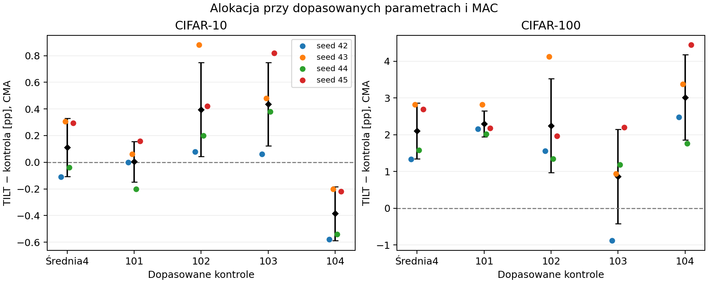

# E041 — wynik mieszany przy dopasowanych P i MAC

**Completed: 2026-11-16. Raport: 2026-11-19. Łączne primary niespełnione.**
TILT wygrywa ze średnią czterech geometrycznie dopasowanych kontroli
na CIFAR-100, ale nie spełnia kryterium kierunku na CIFAR-10.
**Tiny ImageNet nie był objęty tym pilotem.**

## 1. Wykonanie i integralność

- Run `runs/E041/20261116T040008Z_9e34f1e9`: **completed,4×exit0**,
  **227,054s** (3,78min), około0,2523GPU-h rezerwacji czterech urządzeń.
- 4×RTX2080Ti, seed42/43/44/45→GPU0/1/2/3; Conda `attention`,
  Python3.11.15, Torch2.12.0+cu130, CUDA13.0, FP32, TF32off, batch128.
  Telemetria potwierdza aktywność każdego GPU; po runie pamięć1MiB/GPU.
- **56modeli,168ocen**, w tym32nowe modele kontrolne×3stany=96ocen;
  pozostałe72oceny odtwarzają teacher/U/T. Wspólna bariera referencji
  przeszła na wszystkich4procesach przed pierwszą nową oceną.
- Geometria CPU8/8 i rzeczywisty operator CPU8/8 PASS:
  [WYNIKI_CPU.md](WYNIKI_CPU.md). Szerokości wspólne dla seedów;
  każda kontrola ma99,9–100%P i MAC TILT, bez przekroczenia jego kosztów.
- Frozen SHA256: `ddaacb15afe677681d832c85a87d9f02fd5bf10d429dd64b39bb07be56c36e16`.
  Protokół/kod/wejścia zachowane w `source/` runu; Git b239056 z jawnym
  stanem niecommitowanych plików. Nie zmieniano kodu pomiarowego po starcie.
- `analysis/audit.json` **PASS**; `analysis/table_audit.json` dodatkowo
  przelicza30kontrastów z96wierszy per-seed, **PASS**. Bez nowej inferencji.
- Bez treningu, odczytu testu/rezerwy i nowych plików wag. To istniejący
  dev, nie nowa niezależna walidacja. Artefakty runu przed analizą~8,4MiB.

## 2. Primary: CMA, TILT−średnia4kontroli

Najpierw uśredniamy cztery kontrole w obrębie seeda, następnie liczymy
średnią i SD(ddof=1) po4seedach. Top1 w%, różnice wpp.

| Zbiór | TILT | Średnia4kontroli | Różnica ±SD [pp] | Dodatnie seedy | Kierunek | ≥1pp |
|---|---:|---:|---:|---:|---|---|
| CIFAR-10 | 93,4300 | 93,31750 | **+0,11250 ±0,2184** | **2/4** | NIE | NIE |
| CIFAR-100 | 55,5500 | 53,44625 | **+2,10375 ±0,7602** | **4/4** | TAK | TAK |

| Zbiór | Seed42 | Seed43 | Seed44 | Seed45 |
|---|---:|---:|---:|---:|
| CIFAR-10 | −0,11000 | +0,30500 | −0,04000 | +0,29500 |
| CIFAR-100 | +1,33000 | +2,81500 | +1,57500 | +2,69500 |

**Dlaczego bramka nie przeszła?** Protokół wymagał mean(D)>0 oraz
co najmniej3/4dodatnich seedów **na każdym z dwóch zbiorów**. CIFAR-10
ma dodatnią średnią, ale tylko2/4dodatnie seedy. Dlatego kierunek przechodzi
1/2komórek, a łączna bramka nie. Próg1pp jest osobnym kryterium praktycznym,
nie przyczyną niespełnienia podstawowej bramki kierunku.

## 3. Procedura BN i poszczególne kontrole

Po oryginalnym `repair_bn` wzorzec jest podobny: CIFAR-10
**+0,12750±0,2690pp,2/4**, CIFAR-100 **+1,96375±0,6486pp,4/4**.
NLL TILT jest niższe niż średnie NLL czterech kontroli na wszystkich
seedach obu zbiorów po CMA; nie oznacza to przewagi nad każdą kontrolą.

Na CIFAR-10 kontrola104 osiąga **93,8150%** wobec TILT93,4300% po CMA,
czyli wygrywa o **0,3850pp,4/4seedy**. Po repair także wygrywa:
93,8500% vs93,4800%, +0,3700pp,4/4. Nie wybieraliśmy jej na podstawie
jakości; jest jednym z czterech z góry ustalonych profili. Jej wygrana
jest wynikiem opisowym, nie nową zamrożoną metodą doboru alokacji.

Na CIFAR-100 TILT ma dodatni średni kontrast względem każdej kontroli.
Najmniejszy margines występuje dla103: **+0,8600pp,3/4** po CMA i
**+0,5350pp,3/4** po repair. Zysk+2,10375pp dotyczy średniej4kontroli,
nie najlepszego z tych profili. Wszystkie wyniki: [TABLES.md](TABLES.md),
[cells.csv](cells.csv).

## 4. Co z Tiny ImageNet?

E041 od początku obejmował tylko CIFAR-10/100 przy50%redukcji P, jako
ograniczony pilot. Tiny nie został usunięty po wynikach i nie ma tu dla
niego wyniku negatywnego. Wcześniejsze E035 pokazuje na Tiny korzyść
TILT względem UNIFORM przy dopasowanych P (+9,36pp przy50%), ale nie
rozstrzyga nowego porównania przy dopasowanych jednocześnie P i MAC.

Ewentualna kontrola Tiny wymaga osobnego, zamrożonego rozszerzenia.
Nie zmieni historycznego wyniku bramki wymagającej obu CIFAR-ów.

## 5. Interpretacja i decyzja

1. Przy dopasowanych P/MAC profil ma znaczenie w porównaniu z tymi
   kontrolami na CIFAR-100. Efektu nie należy uogólniać na wszystkie zbiory.
2. Na CIFAR-10 nie potwierdziliśmy przewagi TILT nad średnią kontroli;
   jedna z nich jest lepsza na wszystkich seedach. Nie dowodzi to
   równoważności metod ani globalnej optymalności któregokolwiek profilu.
3. Kontrole mają minimalnie niższe koszty (maksymalnie0,0813%P i0,0993%MAC),
   różnią się głównie późnymi grupami i nie reprezentują całej przestrzeni.
   Nie izolujemy samej ochrony początku sieci ani latencji/pamięci.
4. Wynik nie unieważnia E035, lecz zawęża interpretację przewagi nad
   UNIFORM. E041 nie dostarcza nowej ogólnej metody ani pełnego rozwiązania
   problemu alokacji.

**Próbę zamykamy zgodnie z protokołem, bez wariantów ratunkowych.**
Następny krok: ocena/redakcja wąskiego studium empirycznego z E041 jako
kontrolą zależności od zbioru; zakres ewentualnego Tiny omawiamy osobno.
