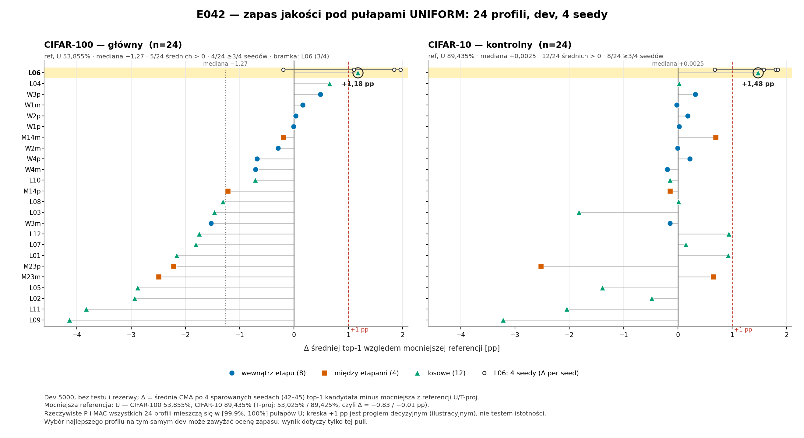

# E042 — dodatni zapas jakości przy obu pułapach UNIFORM

**Ukończony 2026-11-21. Bramka na CIFAR-100 spełniona:** najlepszy z 24
profili daje **+1,175 pp** i poprawę na **3/4** checkpointów. Na kontrolnym
CIFAR-10 ta sama propozycja przed projekcją daje **+1,475 pp (4/4)**.
Porównania względem mocniejszej referencji, w obu przypadkach UNIFORM.

## Wyniki na dev po CMA

ResNet18, ok. 50% redukcji parametrów, historyczny dev5000. Wszystkie profile
kompresji mają **99,9–100%** liczby parametrów i MAC profilu UNIFORM. Średnia
po seedach 42–45; SD dotyczy różnicy sparowanej. `T-proj` to historyczny
TILT po geometrycznym dostosowaniu do pułapów UNIFORM.

| Zbiór | Model wyjściowy | UNIFORM | T-proj | Najlepszy profil | Top‑1 [%] | Δ vs U ± SD [pp] | Δ per seed [pp] |
|---|---:|---:|---:|---|---:|---:|---|
| CIFAR-100 (główny) | 75,140 | 53,855 | 53,025 | L06 | **55,030** | **+1,175 ± 0,992** | +1,84 / +1,10 / −0,20 / +1,96 |
| CIFAR-10 (kontrolny) | 95,440 | 89,435 | 89,425 | L06 | **90,910** | **+1,475 ± 0,542** | +1,80 / +1,58 / +1,84 / +0,68 |

Na CIFAR-100 bramka wymagała ≥200 dodatkowych trafień i ≥3 dodatnich seedów:
uzyskano **235 trafień więcej i 3/4**. CIFAR-10 jest odrębną kontrolą
(+295 trafień). Profil L06 ma odpowiednio **5 576 517 P / 275 293 400 MAC**
i **5 579 528 P / 276 254 304 MAC**, nieco poniżej U w obu miarach. L06
oznacza ten sam losowy wektor przesunięć **przed** projekcją, nie identyczne
końcowe szerokości na obu zbiorach.

Na CIFAR-100 tylko **5/24** kandydatów ma dodatnią średnią, a mediana to
**−1,265 pp**; jedynie L06 spełnia cały próg. Na CIFAR-10 dodatnich jest
12/24, mediana +0,0025 pp. Rzutowany TILT daje −0,830 pp na CIFAR-100
(0/4) i −0,010 pp na CIFAR-10 (2/4). Strata najlepszego profilu względem
modelu wyjściowego nadal wynosi **20,110 pp** na CIFAR-100 i 4,530 pp
na CIFAR-10. Historyczny nieograniczony TILT z E035 jest trafniejszy na
tym samym dev, ale przekracza pułap MAC.

## Wykonanie i odtworzenie

- [Protokół](OPIS.md) i [komendy](URUCHOMIENIE.md). Geometria CPU
  `runs/E042/cpu_20261121T211306Z_957fea21`, PASS ~3,0 s: na zbiór 8 profili
  wewnątrz etapu, 4 między etapami i 12 losowych. Kontrola CPU operatora
  `runs/E042/check_20261121T211904Z_0ee66ea7`: **10/10**, 113,03 s.
- Zamrożony `frozen.json`, SHA256
  `2069b0d002ddc892be39bc6b24d66f4d059f1ee143f829d43a19a869c54da7c4`.
  Kod, protokół, zależności i ich hashe w `source/` runu.
- Run `runs/E042/20261121T212257Z_207ae03f`: **216 ocen CMA**, w tym 192
  kandydatów, 8 T-proj, 8 U i 8 teacherów. Cztery RTX 2080 Ti, seed→GPU
  42–45→0–3, **4×exit 0**, **723,49 s**, Conda `attention`, Python 3.11.15,
  Torch 2.12.0+cu130. Bariera odtworzenia top‑1 i stanów E035 przed
  nowymi ocenami przeszła na obu zbiorach i wszystkich seedach.
- `analysis/audit.json`: **PASS** (hashe źródeł, rzeczywiste koszty, seedy,
  split, CMA, wagi bez zmian). Wyniki: `analysis/summary.json`,
  `analysis/profiles.csv` i `analysis/per_seed.csv` w runie. [Figura i jej
  odtworzenie](wykresy/20261121T212257Z_207ae03f/README.md) dodatkowo
  przeliczają rankingi z zapisanych metryk. Bez treningu, użycia testu i
  rezerwy oraz bez nowych plików wag. Po runie GPU wolne.

## Decyzja

**Istnieje mierzalny zapas w tej puli przy obu pułapach UNIFORM.** Wynik
L06 jest maksimum wybranym na tym samym dev, więc nie jest oceną reguły
wyboru ani niezależnym potwierdzeniem transferu. Pojedynczy dobry profil
i ujemna mediana wskazują, że następnym pytaniem jest **jak znaleźć dobry
profil bez korzystania z etykiet oceny**, nie czy poszerzenie puli na tym
samym dev może jeszcze podnieść maksimum. Tania referencja dla przyszłego
testu to zamrożenie przesunięć L06 i deterministyczna projekcja na nowe
pułapy. Do wykazania zalety selektora potrzebne są mocniejsze referencje
i osobna, niewidziana ocena. [Plan dalszych prac](../../PLAN_PUBLIKACJI.md).
