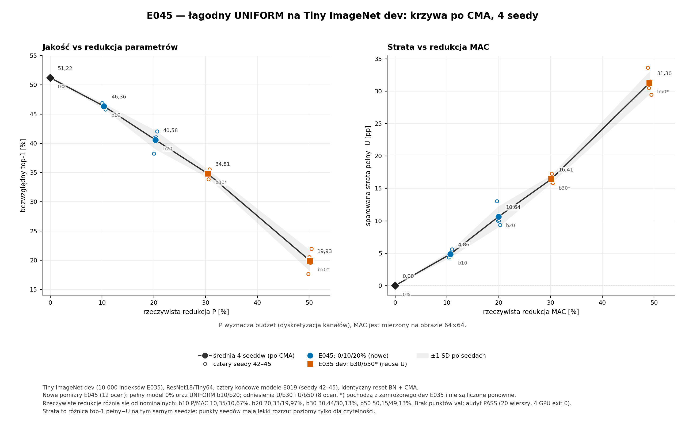

# E045 — łagodna kompresja UNIFORM na Tiny ImageNet

**Ukończony 2026-11-22.** Przy rzeczywistej redukcji **10,35% P / 10,67% MAC**
top‑1 spada z **51,22% do 46,36%** (−4,86 pp). Przy **20,33% P / 19,97% MAC**
top‑1 wynosi **40,58%** (−10,64 pp). Łagodniejszy budżet zachowuje znacznie
więcej jakości; nawet około 10% redukcji P nie jest bezstratne.

## Wspólna krzywa na dev

ResNet18/Tiny64, cztery checkpointy E019, te same 10 000 obrazów dev i ta
sama rekalibracja BN na A4096 co E035. Punkty 0/10/20% zmierzono w E045;
U przy 30/50% pochodzi z **E035 dev**, z tym samym pełnym modelem jako
odniesieniem. Strata jest liczona parami; SD to odchylenie próbki po seedach.

| Punkt | P | MAC/obraz | Redukcja P / MAC | Top‑1 [%] | Strata do pełnego ± SD [pp] |
|---|---:|---:|---:|---:|---:|
| Pełny | 11 279 112 | 148 148 224 | 0 / 0% | 51,2200 | 0 |
| U/b10 | 10 111 430 | 132 336 196 | 10,35 / 10,67% | **46,3625** | **4,8575 ± 0,531** |
| U/b20 | 8 985 746 | 118 569 428 | 20,33 / 19,97% | **40,5800** | **10,6400 ± 1,621** |
| U/b30, E035 | 7 845 193 | 103 503 916 | 30,44 / 30,13% | 34,8075 | 16,4125 ± 0,627 |
| U/b50, E035 | 5 623 142 | 75 359 828 | 50,15 / 49,13% | 19,9250 | 31,2950 ± 1,781 |

Strata dla seedów 42/43/44/45: b10 **4,38 / 4,85 / 4,60 / 5,60 pp**;
b20 **13,02 / 10,04 / 10,12 / 9,38 pp**. Przy b10 średnia jest blisko 5 pp,
ale spadek nie jest równomierny. Punkty nie wyznaczają uniwersalnej granicy
kompresji ani przewagi niejednolitej alokacji przy budżetach b10/b20.

## Wykonanie

- [CPU](../../runs/E045/cpu_20261122T030856Z_83060c6f/manifest.json): PASS,
  32,36 s; profile zapisane w `frozen.json`, SHA‑256
  `a7eaca3b8289a6c80784ef992e7ebe39c284ecfe344d98e80e3d18bd09b8dcfd`.
- [Run](../../runs/E045/20261122T031350Z_a58b56a3/manifest.json): **12/12
  ocen, 62,78 s, 4×exit 0**; cztery RTX 2080 Ti, Conda `attention`, seedy
  42–45 → GPU 0–3. Pełny model odtworzył stan po CMA i liczbę trafień E035
  dev na 4/4 seedach przed punktacją dwóch nowych profili. Bez treningu
  i użycia oficjalnego val.
- [Audyt PASS](../../runs/E045/20261122T031350Z_a58b56a3/analysis/audit.json)
  · [Trafienia i koszty per seed](../../runs/E045/20261122T031350Z_a58b56a3/analysis/per_seed.csv)
  · [Agregaty](../../runs/E045/20261122T031350Z_a58b56a3/analysis/summary.json)
  · [Protokół](OPIS.md) · [Odtworzenie](URUCHOMIENIE.md).
