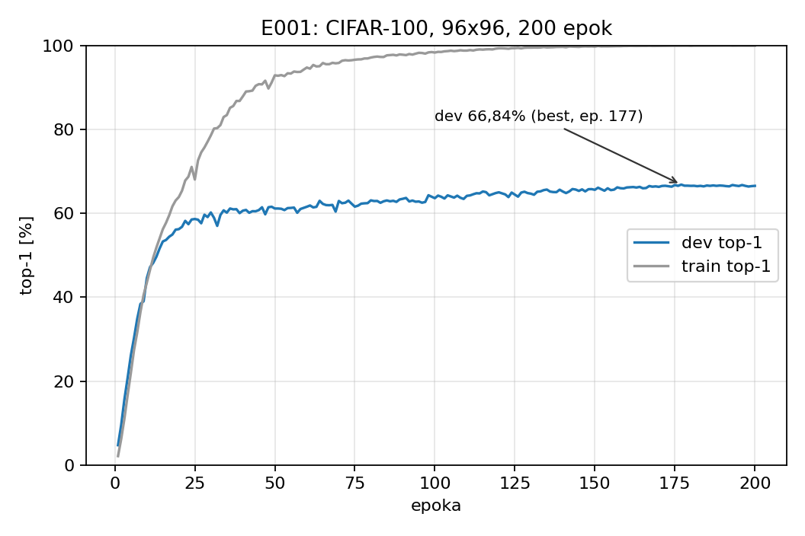
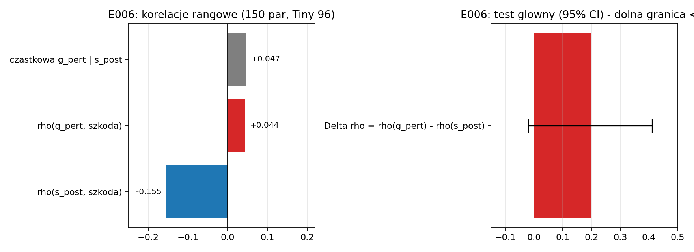
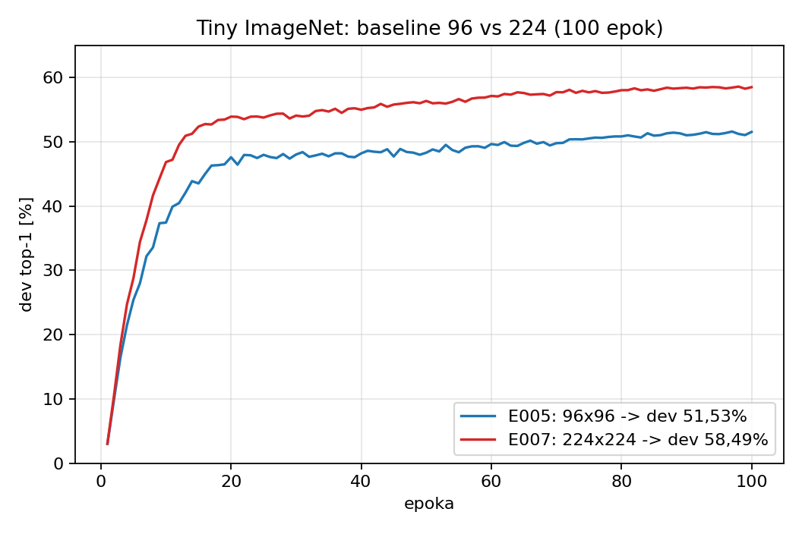
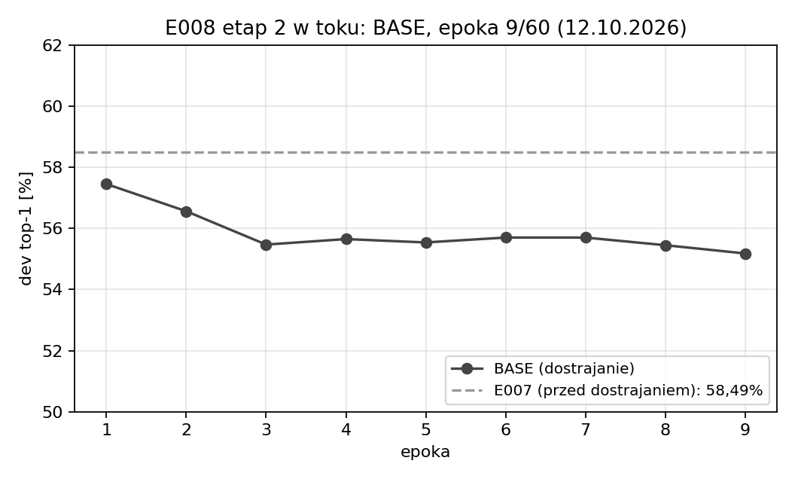

# Kompresja CNN a zachowanie atencji kanałowej — podsumowanie badań (E001–E008)

Stan na 12.10.2026 · prezentacja dla promotora · Lidia Cichońska
Repozytorium: github.com/Lidka99/attention-aware-compression

Wersja HTML (do wyświetlania/druku): [prezentacja.html](prezentacja.html).
Uwaga: bieg E008 (etap 2) trwa — sekcja E008 pokazuje stan na 04:58 UTC.

---

## 1. Pytanie badawcze i wymagania metodologiczne

- Hipoteza: kanały podobne przed atencją (SE) mogą być różnie ważone dla różnych
  obrazów, więc zachowanie bramek SE mogłoby poprawiać wybór kanałów do scalenia.
- Wymagana kontrola: POST (aktywacje po SE) wobec PRE (przed SE) i RANDOM,
  wspólny operator i równy budżet kompresji oraz naprawy.
- Wynik zerowy/negatywny jest pełnoprawnym wynikiem; progi ustalane przed biegiem.
- Cel nadrzędny: publikowalny wynik (także negatywno-analityczny).

## 2. Przebieg badań E001–E008

| ID | Pytanie | Ustawienie | Wynik | Status |
|---|---|---|---|---|
| E001 | baseline | CIFAR-100, 96×96, 200 ep. | dev 66,84%; przeuczenie (train ≈99%) | ukończony |
| E002 | obserwacja SE | 1000 obr., 1 blok, wagi stałe | podobieństwo po SE; średnia/szablon nie tłumaczą | ukończony |
| E003 | kompresja 10% | CIFAR-100, bez naprawy | POST−PRE +0,30 pp, CI obejmuje 0; obie selekcje > RANDOM | ukończony |
| E004 | naprawa | 120 ep. równego dostrajania | wszystkie ≈67%; RANDOM dorównał | ukończony |
| E005 | baseline 96 | Tiny ImageNet, 100 ep. | dev 51,53% | ukończony |
| E006 | bramki SE | 150 par, predykcja szkody | g_pert ≈ 0 ponad s_post; failed | ukończony (negatywny) |
| E007 | baseline 224 | Tiny 224, 100 ep., 4 h 37 min | dev **58,49%** (literatura 60,54%) | ukończony |
| E008 | kompresja 224 | 10%/30% + naprawa 30% | etap 1 ukończony; etap 2 w toku | w toku |

## 3. E001 — baseline CIFAR-100

- dev 66,84% (best, ep. 177), 66,54% (ep. 200); train ≈99% — silne przeuczenie.
- Świadomy punkt odniesienia dla E002–E004; audyt w folderze E001.

## 4. E002 — obserwacja: podobieństwo kanałów a atencja

- Pary bardzo podobne przed SE pozostają bardzo podobne po SE (mediana 0,952 → 0,959).
- Kontrole: stała średnia i szablon przestrzenny nie tłumaczą podobieństwa.
- Wagi bramek zmieniają się między obrazami, ale nie wykazano korzyści dla wyboru kanałów.

## 5. E003 — kompresja 10% bez naprawy

- 4 135 648 → 3 721 424 parametry (1016 kanałów w 15 blokach), wspólny operator.
- PRE 54,94% · POST 55,24% · RANDOM 49,48% (BASE 66,84%).
- POST−PRE +0,30 pp, CI [−0,60; +1,22] — brak przewagi; obie selekcje > losowa (~+6 pp).

## 6. E004 — równe dostrajanie

- Po 120 epokach: BASE 67,62% · PRE 66,96% · POST 67,32% · RANDOM 67,30%.
- Różnice selekcji zniknęły; przy 10% decyduje naprawa, nie wybór kanałów.

## 7. E006 — bramki SE nie przewidują szkody scalenia

- ρ(s_post, szkoda) = −0,155 (kierunek zgodny); ρ(g_pert) = +0,044.
- Δρ = +0,199, CI [−0,020; +0,411] → kryterium sukcesu nie spełnione; cząstkowa +0,047.
- Kontrola FWER rodziny wtórnej: p = 0,081. Wątek bramek zamknięty.

## 8. E005 i E007 — nowe baseline'y

- E005: 96×96 — dev 51,53%; E007: 224×224 — dev **58,49%** (+6,96 pp), 4 h 37 min.
- E007 jakościowo zgodny z literaturą (60,54%; inne warunki oceny) — główny baseline do E008.

## 9. E008 — protokół

- Etap 1: szkoda 10% i 30% bez naprawy dla PRE/POST/RANDOM (α/β na 1000 obrazach).
- Etap 2: równe dostrajanie 60 epok dla BASE + PRE + POST + RANDOM przy 30%.
- Kryterium główne: POST−PRE po naprawie (bootstrap 10 000, po klasach),
  sukces = dolna granica 95% CI > 0.

## 10. E008 etap 1 — ukończony

- 10%: PRE 47,4% · POST 47,1% · RANDOM 40,8%; 30%: PRE 9,7% · POST 6,7% · RANDOM 1,0% (BASE 58,5%).
- Selekcja > losowa o +5,7 do +6,6 pp; ale POST < PRE przy obu budżetach — odwrotnie niż w E003.
- Bramka baseline'u E007 odtworzona (5849/10000) — pomiar wiarygodny.

## 11. E008 etap 2 — w toku (stan 04:58 UTC)

- Sekwencyjnie BASE (bieżący), PRE, POST, RANDOM — po 60 epok.
- Koniec całości ~16:30–17:00 UTC; potem automatyczne podsumowanie z bootstrapem.

## 12. Wnioski (stan na 12.10.2026)

- POST nie wygrywa z PRE: E003 (zero różnicy) i E008 etap 1 (POST słabszy surowo).
- Bramki SE nie dodają informacji o szkodzie (E006).
- Po równej naprawie przy 10% różnice selekcji znikają (E004; baseline przeuczony) —
  E008 bada 30% na mocniejszym modelu.
- Selekcja oparta na podobieństwie jest surowo lepsza od losowej.
- Baseline 224 gotowy i zgodny z literaturą; nowość „attention-aware" wciąż niepotwierdzona.

## 13. Plan dalszy i pytania do promotora

- Dziś: dokończyć E008 i napisać WYNIKI.md.
- Scenariusz A (różnice znikają): zamknięcie wątku przy testowanych budżetach →
  praca negatywno-analityczna vs zmiana pytania.
- Scenariusz B (różnice zostają): ścieżka publikacyjna na baseline 224.
- Pytania: akceptowalność pracy negatywnej; priorytety (budżety vs inne mechanizmy);
  wymagania co do seedów/powtórzeń.
