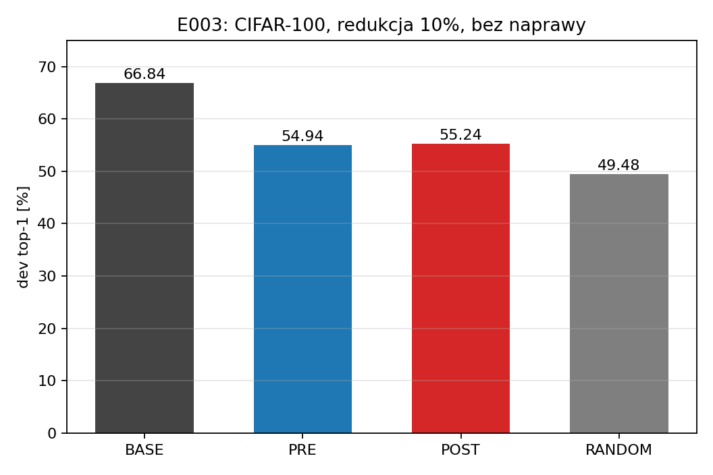
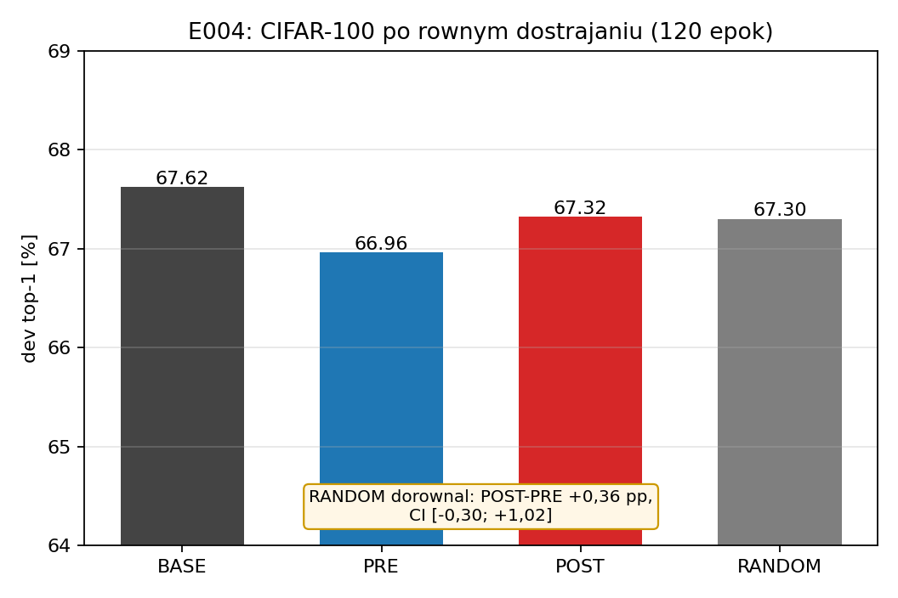
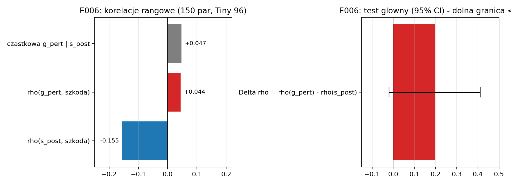
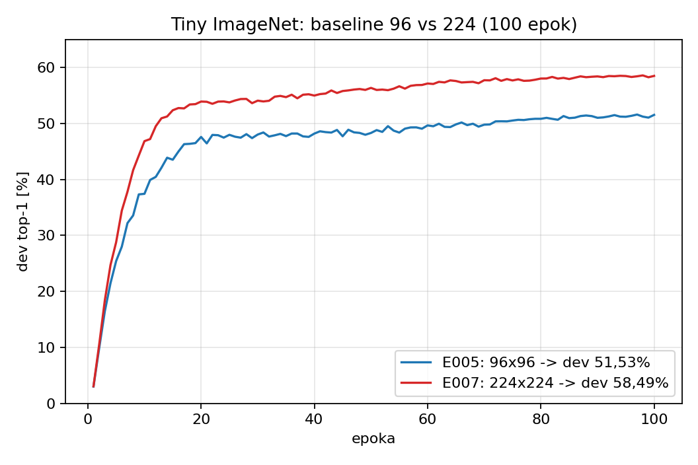
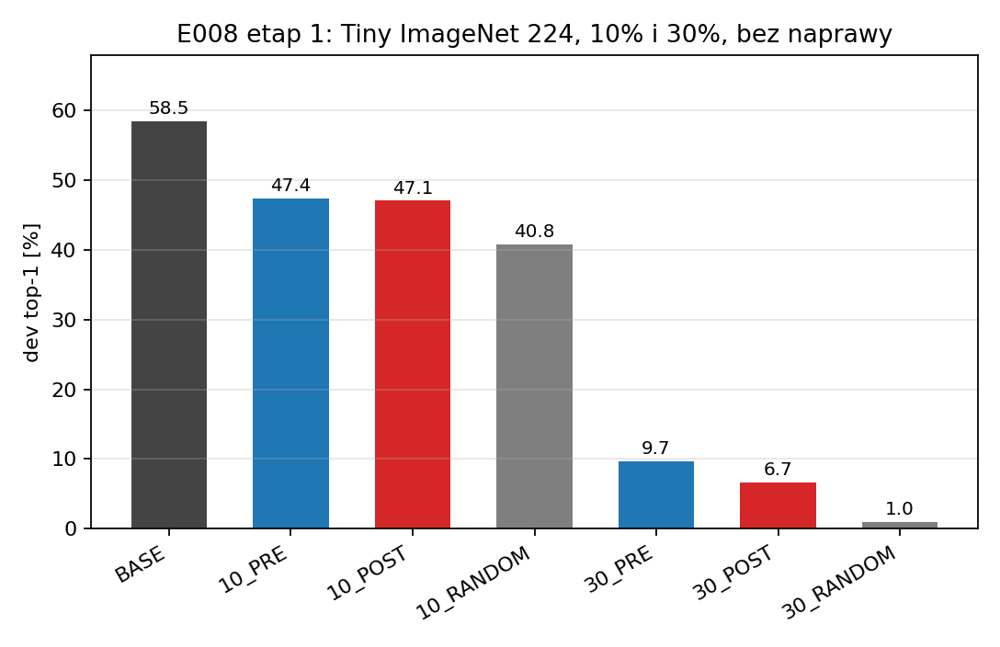
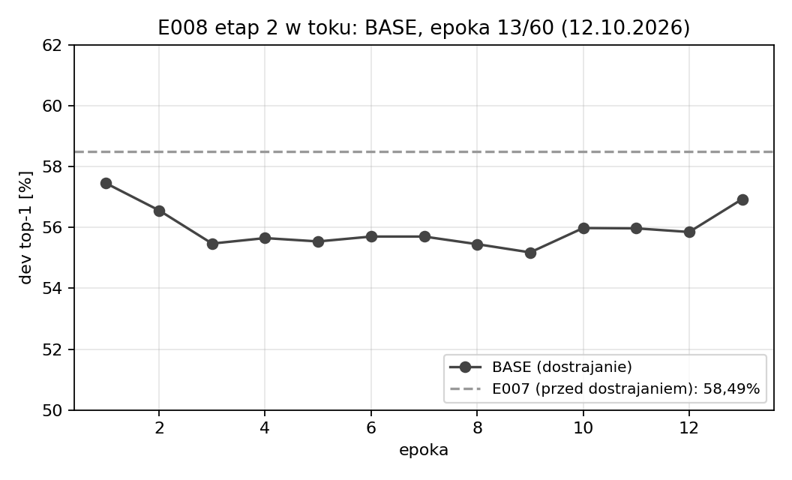

# Kompresja sieci CNN a zachowanie atencji kanałowej — podsumowanie badań

Prezentacja dla promotora · stan na 12.10.2026 · Lidia Cichońska
Wersja HTML (slajdy, druk do PDF): [prezentacja.html](prezentacja.html).
Trwa ostatni bieg (naprawa przy 30%); sekcja „Etap 2 w toku" pokazuje stan na 05:08 UTC.

---

## 1. Co chcieliśmy osiągnąć

- **Cel nadrzędny:** sprawdzić, czy **zachowanie atencji kanałowej** (bramki SE, zależne od obrazu)
  dostarcza informacji, która pozwala **lepiej wybierać kanały do scalenia** przy kompresji sieci —
  tak, by przy tym samym budżecie kompresji i naprawy tracić mniej jakości niż przy wyborze
  „przed atencją" lub losowym.
- **Droga do celu:** od rzetelnych baseline'ów od zera, przez pomiar realnej szkody scalenia,
  do decydującego porównania **po równym dostrojeniu** (to ono rozstrzyga o użyteczności).
- **Cel metodologiczny:** odtwarzalny pipeline na 4 GPU, wyniki z przedziałami ufności, progi
  ustalone przed biegiem; **wynik negatywny jest pełnoprawnym wynikiem**.
- **Cel praktyczny:** doprowadzić do **publikowalnego wyniku** (pozytywnego albo uczciwie
  udokumentowanego negatywnego) i wybrać dalszy kierunek doktoratu na podstawie danych.

## 2. Punkt wyjścia: literatura i hipoteza

- **Atencja kanałowa (SE)** — Hu, Shen, Sun 2018 (arXiv:1709.01507): bramki mówią, które kanały są
  ważne *dla danego obrazu*; warianty: ECA-Net (arXiv:1910.03151) i in.
- **Rodzina scalania/przycinania kanałów:** Neuron Merging (arXiv:2010.13160), Pick-or-Mix
  (arXiv:2406.10935), Cut Less Fold More (arXiv:2602.18116) — pokazują, że **to, co się scala,
  ma znaczenie**. Analiza nowości wobec tych prac: macierz nowości w repozytorium (w toku).
- **Hipoteza:** kanały podobne przed SE mogą być różnie ważone dla różnych obrazów, więc zachowanie
  bramek SE mogłoby poprawiać dobór par kanałów do scalenia ponad zwykłe podobieństwo aktywacji.
- **Warunek weryfikacji (kontrola po atencji):** porównanie kryterium **po SE** (POST) z kryterium
  **przed SE** (PRE) i **wyborem losowym** (RANDOM), wspólny operator, równy budżet kompresji i naprawy.
- **Kotwica dla baseline'ów:** Shahriar 2026 (arXiv:2607.01984) — EfficientNet-B0 od zera na
  Tiny ImageNet 224×224: 20 epok = 57,43%, **100 epok = 60,54%**.

## 3. Plan badań — co, po co i z jakim wynikiem

| Badanie | Po co | Wynik | Status |
|---|---|---|---|
| **Baseline CIFAR-100** (od zera, 200 ep.) | punkt odniesienia do pierwszych testów kompresji | dev 66,84%; silne przeuczenie (train ≈99%) | ukończone |
| **Obserwacja bloków SE** (1000 obr., wagi stałe) | czy podobieństwo kanałów i zmienność bramek pozwalają myśleć o selektywnym scalaniu | podobieństwo utrzymuje się po SE; średnia/szablon go nie tłumaczą | ukończone |
| **Pierwsza kompresja: 10%** (CIFAR-100, bez naprawy) | czy kryterium po atencji bije przed atencją i losowe | POST≈PRE; obie selekcje > losowa surowo | ukończone |
| **Równe dostrajanie po kompresji** (120 ep.) | czy różnice przetrwają naprawę | różnice zniknęły; RANDOM dorównał | ukończone |
| **Baseline Tiny ImageNet 96×96** | mniej przeuczony punkt odniesienia | dev 51,53% | ukończone |
| **Predykcja szkody z bramek SE** (150 par) | czy bramki przewidują szkodę scalenia ponad podobieństwo po SE | brak wartości predykcyjnej — wynik negatywny | ukończone |
| **Baseline Tiny ImageNet 224×224** (receptura literaturowa) | jakość porównywalna z literaturą pod publikację | dev 58,49% (literatura 60,54%; warunki oceny inne) | ukończone |
| **Kompresja 10% i 30% na baseline 224** | czy przy głębszej szkodzie selekcja (zwłaszcza po atencji) decyduje po naprawie | etap 1: wybór > losowy surowo, POST < PRE; etap 2 w toku | w toku |

## 4. Baseline CIFAR-100 — punkt wyjścia i jego ograniczenie

- dev 66,84% (best), train ≈99% — silne przeuczenie: nadmiarowe kanały łatwo usuwać.
- Stąd decyzja: dalsze badania na Tiny ImageNet (200 klas, prawdziwe zdjęcia) z recepturą z literatury.
- Wniosek metodologiczny: baseline musi być mocny i mało przeuczony, inaczej testy kompresji
  mierzą głównie nadmiarowość przeuczonego modelu.

## 5. Obserwacja bloków SE — czy jest na czym budować?

- Pary bardzo podobne przed SE pozostają bardzo podobne po SE (mediana 0,952 → 0,959).
- Kontrole: stała średnia i szablon przestrzenny nie tłumaczą podobieństwa.
- Wagi bramek zmieniają się między obrazami, ale nie wykazano korzyści dla wyboru kanałów.

## 6. Pierwsza kompresja: redukcja 10% bez naprawy

- 4 135 648 → 3 721 424 parametry (1016 kanałów w 15 blokach), wspólny operator.
- Bez naprawy: po SE 55,24% · przed SE 54,94% · losowo 49,48% (baseline 66,84%).
- Test główny (po SE minus przed SE): +0,30 pp, CI [−0,60; +1,22] — brak przewagi.
- Obie selekcje > losowa surowo (~5,5–6 pp). **Na tle literatury:** rodzina metod scalania
  (Neuron Merging, Pick-or-Mix) też dobiera kanały po podobieństwie/wadze; nasz wynik pokazuje,
  że informacja po SE nie dodaje przewagi przy tym budżecie.

## 7. Równe dostrajanie — co zostaje po naprawie?

- Po 120 epokach: baseline 67,62% · przed SE 66,96% · po SE 67,32% · losowo 67,30%.
- Różnice kryteriów zniknęły; przy 10% o wyniku decyduje naprawa, nie wybór kanałów.

## 8. Czy bramki SE przewidują szkodę scalenia?

- Kontrola działa kierunkowo: ρ(s_post, szkoda) = −0,155; sygnał: ρ(g_pert) = +0,044.
- Różnica +0,199, CI [−0,020; +0,411] — kryterium sukcesu nie spełnione; cząstkowa +0,047;
  kontrola FWER p = 0,081.
- Motywacja literaturowa (SE, Hu i in. 2018) naturalna, ale informacja z bramek **nie przekłada się**
  na przewidywanie szkody lepiej niż samo podobieństwo. Wątek zamknięty zgodnie z protokołem.

## 9. Nowe baseline'y Tiny ImageNet — zgodność z literaturą

- 96×96, 100 epok: dev 51,53%; 224×224, 100 epok: dev **58,49%** (+6,96 pp), 4 h 37 min.
- Receptura wg Shahriar 2026 (AdamW 3e-4, wd 0,01, LS 0,1, RRC 0,8–1,0 + color jitter).
- **Porównanie:** literatura 60,54% (20 epok: 57,43%); nasze 58,49% w tym samym rejonie — różnice
  wynikają z innego zbioru oceny (ich oficjalny val, nasz dev), batcha i warmupu; ocena jakościowa.

## 10. Kompresja 10% i 30% na baseline 224 — pytanie i protokół

- Etap 1 (bez naprawy): szkoda 10% i 30% dla kryteriów po SE / przed SE / losowego.
- Etap 2 (naprawa przy 30%): równe dostrajanie 60 epok dla baseline'u + trzech wariantów.
- Kryterium główne: „po SE minus przed SE" po naprawie (bootstrap 10 000, po klasach);
  sukces = dolna granica 95% CI > 0.
- Po co: przy 10% naprawa zacierała różnice na przeuczonym modelu — czy przy głębszej szkodzie
  (30%) i mocniejszym baseline selekcja zaczyna decydować?

## 11. Etap 1 — wybór kanałów pomaga surowo, ale nie po atencji

- 10%: przed SE **47,4%** · po SE 47,1% · losowo 40,8% (baseline 58,5%).
- 30%: przed SE **9,7%** · po SE 6,7% · losowo 1,0% — bez naprawy model praktycznie się rozpada.
- Selekcja > losowa o **+5,7 do +8,7 pp**; ale po SE < przed SE przy obu budżetach
  (przeciwnie niż na CIFAR-100).
- Kontrola: baseline odtworzony co do obrazu (5849/10000).

## 12. Etap 2 — równe dostrajanie (w toku; stan 12.10, 05:08 UTC)

- Sekwencyjnie: baseline (epoka 12/60), potem przed SE, po SE, losowo — po 60 epok.
- Początkowy spadek dev po restarcie LR — oczekiwany; porównanie na końcu, przy równym budżecie.
- Koniec ~16:50 UTC; potem automatyczne podsumowanie z bootstrapem.

## 13. Co wyszło, a co nie wyszło

**Wyszło:**

- Rzetelne baseline'y od zera na 4 GPU: CIFAR-100 66,84%; Tiny ImageNet 96×96 51,53%;
  Tiny ImageNet 224×224 **58,49%** — jakościowo zgodny z literaturą (60,54%).
- Kontrolowany pipeline kompresji: fizyczna redukcja parametrów, wspólny operator, dopasowane
  współczynniki, wyniki z przedziałami ufności.
- **Wybór kanałów oparty na podobieństwie działa surowo:** +5,5–6 pp nad losowym (10%, CIFAR-100)
  oraz +5,7–8,7 pp (30%, Tiny 224) — jest realny sygnał.
- Bramki SE przetestowane rzetelnie i **uczciwie zamknięte** (wynik negatywny, kontrola FWER).
- Trwa decydujący test: naprawa przy 30% na baseline 224.

**Nie wyszło:**

- **Hipoteza „attention-aware" niepotwierdzona:** kryterium po SE nie przewyższa przed SE —
  ani po naprawie (10%, CIFAR-100), ani surowo na Tiny 224 (po SE wręcz słabsze).
- **Bramki SE nie przewidują** szkody scalenia ponad podobieństwo po SE (dolna granica CI < 0).
- Po równym dostrojeniu przy 10% różnice między kryteriami znikają — wybór losowy dorównuje
  (na przeuczonym baseline).
- **Nowość badawcza wciąż niepotwierdzona** — brak pozytywnego wyniku publikacyjnego w obecnej formie.

Otwarta kwestia rozstrzyga się dziś: czy przy 30% po naprawie różnice zostają (ścieżka publikacyjna)
czy znikają (zamknięcie wątku).

## 14. Wnioski i plan dalszy

- Dziś: dokończyć etap naprawy przy 30% i napisać raport z wynikiem głównym.
- Scenariusz A (różnice znikają): zamknięcie wątku przy badanych budżetach; decyzja między pracą
  negatywno-analityczną a zmianą pytania (większe kompresje, kwantyzacja, inne mechanizmy uwagi).
- Scenariusz B (różnice zostają): ścieżka publikacyjna na baseline 224 (pełna kompresja,
  więcej kryteriów, dodatkowe seedy).
- Pytania do promotora: czy praca negatywno-analityczna jest akceptowalna? Priorytet dalszych badań?
  Wymagania co do liczby seedów i powtórzeń przed publikacją?
