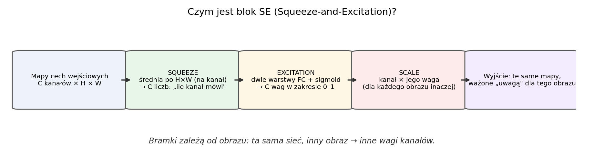
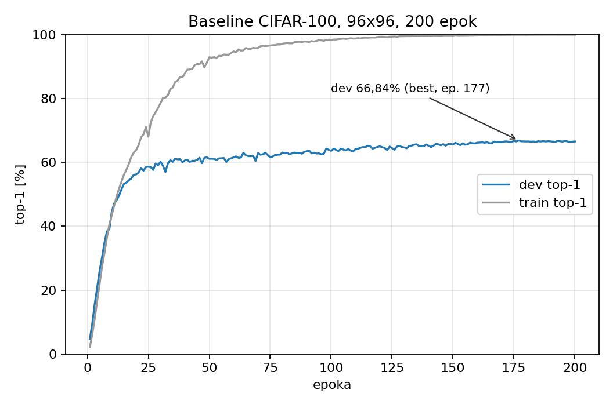
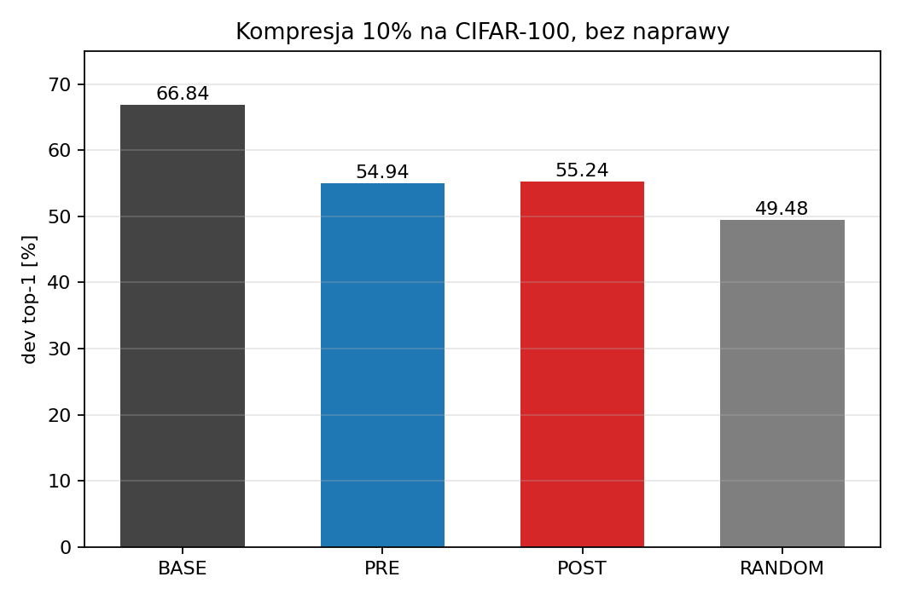
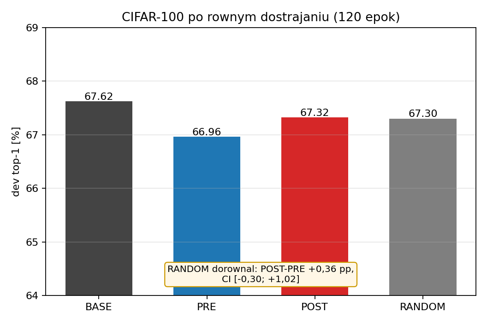
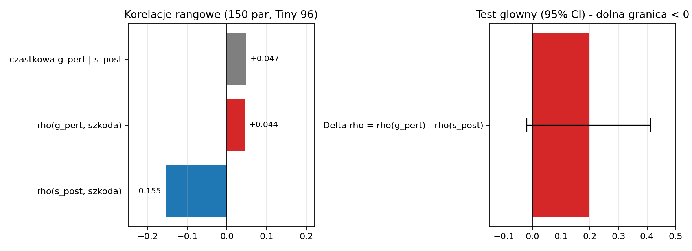
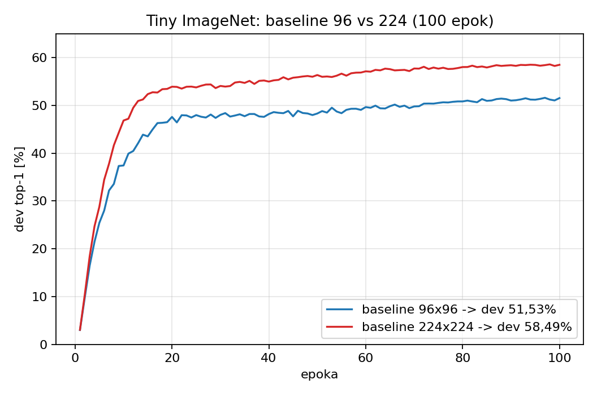
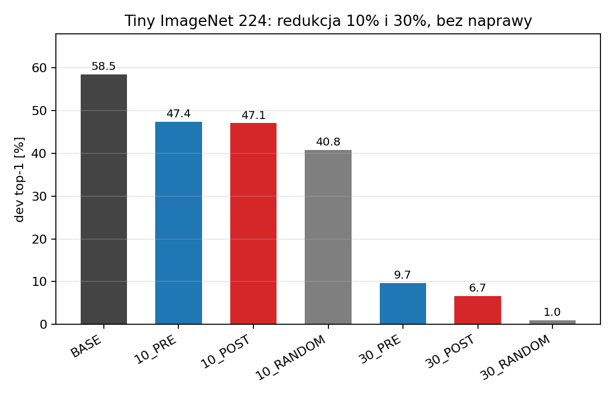
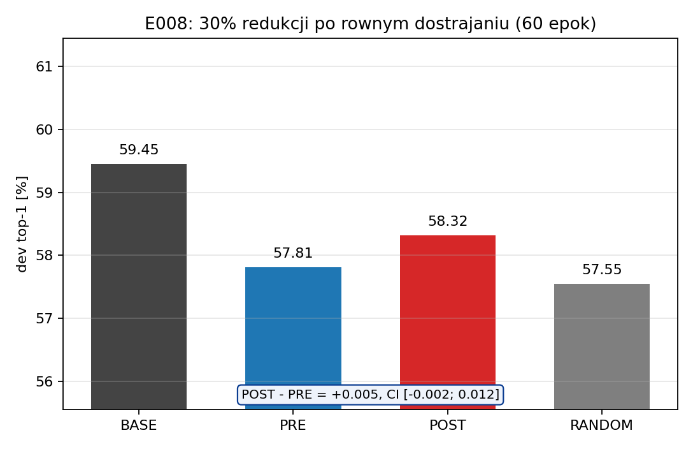
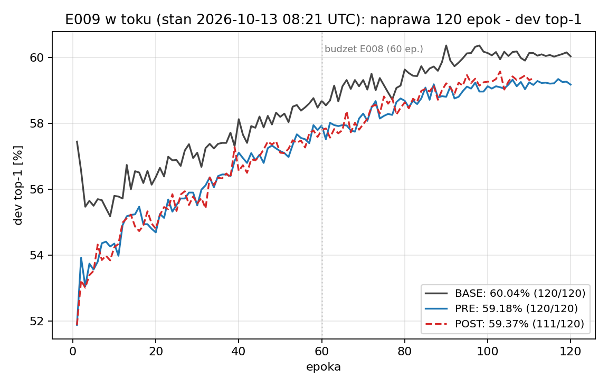
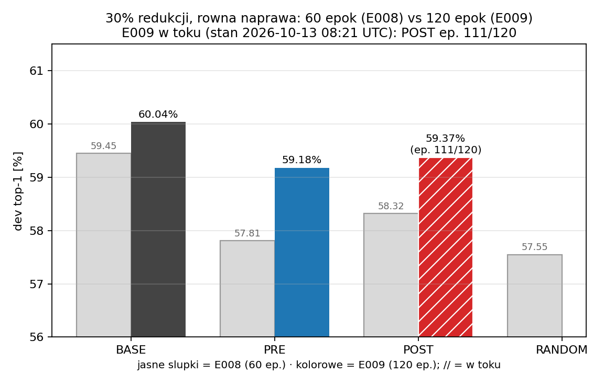

# Kompresja sieci CNN a zachowanie atencji kanałowej — podsumowanie badań

Lidia Cichońska · stan na 13.10.2026
Wersja HTML (slajdy, druk do PDF: Ctrl+P, poziomo): [prezentacja.html](prezentacja.html)
Wykresy: `wykresy/` (odtwarzalne skryptem [generuj_wykresy.py](generuj_wykresy.py)); skrypt
odświeżający wyniki E009: [odswiez_e009.py](odswiez_e009.py).

<!-- E009:NAGLOWEK:BEGIN -->
Trwa E009: naprawa 120 epok (stan 2026-10-13 08:21 UTC) — BASE 60,04% (120/120), PRE 59,18% (120/120), POST w toku (ep. 111/120). Wyniki E008 na slajdach „Etap 2"; po zakończeniu biegu uruchom `odswiez_e009.py`.
<!-- E009:NAGLOWEK:END -->

---

## 1. Tytułem wstępu

- **Obiekt badań:** EfficientNet-B0 (popularna architektura sieci konwolucyjnej) z blokami
  Squeeze-and-Excitation (SE — wyjaśnione najprościej na slajdzie 4), trenowany **od
  losowych wag** — bez publicznych, gotowych wag.
- **Dane:** CIFAR-100 (100 klas) oraz Tiny ImageNet (200 klas), rozdzielczości 96×96 i 224×224.
- **Środowisko:** 4×RTX 2080 Ti, trening równoległy na 4 kartach (DDP), w pełni deterministyczny,
  Conda `attention` (Python 3.11, PyTorch 2.12). Ocena wyłącznie na **dev**, czyli zbiorze
  sprawdzającym; zbiory rezerwy i testu **nietknięte**.
- **Repozytorium:** github.com/Lidka99/attention-aware-compression — kod, protokoły, raporty;
  duże artefakty lokalnie, z hashami.
- **Pytanie w jednym zdaniu:** czy **zachowanie bramek SE** pozwala lepiej wybierać kanały
  do scalenia przy kompresji niż kryterium przed SE i niż wybór losowy — przy **równym
  budżecie** kompresji i naprawy?

## 2. W skrócie — co chciałam osiągnąć i co z tego wyszło

- **Chciałam sprawdzić:** czy sposób, w jaki sieć sama ocenia ważność swoich kanałów cech
  (bramki **SE** — patrz następny slajd), da się wykorzystać do **lepszej kompresji**: które
  kanały można scalać, żeby sieć po zmniejszeniu zachowała jak najwięcej jakości.
- **Jak to sprawdziłam:** 9 eksperymentów od zera (E001–E009), zawsze to samo porównanie:
  wybór **po SE** (POST) vs wybór **przed SE** (PRE) vs **losowo** (RANDOM) — przy **równym
  budżecie** kompresji i naprawy, z przedziałami ufności.
- **Co wyszło:** selekcja oparta na podobieństwie kanałów działa (wyraźnie lepiej niż losowanie),
  ale **bramki SE nie dodają przewagi** nad wyborem przed SE — w żadnym z badanych budżetów.
  Ostatni eksperyment (E009, 120 epok naprawy) domyka ten wątek dziś.
- **Co z tego mam:** solidne baseline'y i pipeline kompresji, rzetelnie zamknięty wątek
  negatywny oraz jasne kryteria wyboru dalszych dróg (zamiast zgadywania). Szczegóły dalej.
- **Nieznane skróty** (POST, PRE, RANDOM, CI, pp, dev, baseline) wyjaśnia słowniczek
  na ostatnim slajdzie (24).

## 3. Cel i pytania badawcze (z zaznaczoną potencjalną nowością)

- **Cel nadrzędny:** sprawdzić, czy zależna od obrazu atencja kanałowa (bramki SE) pozwala
  **lepiej wybierać kanały do scalenia** niż kryterium przed SE i wybór losowy — przy **równym
  budżecie** kompresji i naprawy.
- **Droga:** rzetelne baseline'y od zera → pomiar realnej szkody → porównanie **po równym
  dostrojeniu** (ono rozstrzyga). Metodologia: protokoły zamrażane, CI, wynik negatywny
  pełnoprawny (szczegóły: sekcja 8).
- **Pytania badawcze:**
  1. **RQ1 ★ (rdzeń potencjalnej nowości):** czy kryterium po SE (POST) bije przed SE (PRE)
     i wybór losowy po równym dostrojeniu przy 30% redukcji? (E008, E009)
  2. **RQ2:** czy bramki SE przewidują szkodę scalenia ponad podobieństwo po SE? (E006)
  3. **RQ3:** czy dłuższy budżet naprawy (120 vs 60 epok) zmienia obraz różnic? (E009)
  4. **RQ4:** jaki baseline i jaka głębokość kompresji są potrzebne, by selekcja w ogóle
     zaczęła decydować? (E003/E004 → E008)
- **Potencjalna nowość (kandydat — do domknięcia audytem macierzy nowości):**
  kontrolowany test, czy **istniejące** (nietrenowane pod kompresję) bramki SE poprawiają
  dobór kanałów do scalenia po równym budżecie naprawy — z rozdzieleniem „przewidywania
  szkody" (E006) od „jakości po naprawie" (E008/E009) i kontrolami PRE/RANDOM.
  Uzupełnienie literatury: SE sugeruje użytek wag ważności w kompresji, ale metody
  scalania/foldingu używają podobieństwa, wag lub **uczonych** scorerów (np. ADSC);
  nie znaleźliśmy pracy testującej wprost tę hipotezę przy równym budżecie. **To kandydat,
  nie potwierdzona luka** — pełny audyt (macierz nowości) w toku.

## 4. Czym jest SE (Squeeze-and-Excitation) — najprościej

- **Najprościej:** SE to mały moduł doklejony do warstwy splotowej, który **dla każdego obrazu
  osobno** ocenia, które kanały cech są teraz ważne, i przemnaża je przez wagi 0–1.
  Analogia: automatyczny **korektor dźwięku** — dla każdego utworu (obrazu) sam ustawia
  głośność pasm (kanałów).
- **Krok po kroku:** (1) *Squeeze* — z każdego kanału robimy jedną liczbę (średnia po całej
  mapie cech), czyli „ile ten kanał mówi na tym obrazie"; (2) *Excitation* — mała sieć
  (dwie warstwy FC + sigmoid) zamienia te liczby na wagi 0–1; (3) *Scale* — każdy kanał
  mnożony przez swoją wagę.
- **Dlaczego się to stosuje:** to tania „uwaga" (kilka procent parametrów), pozwala sieci
  wzmacniać przydatne kanały i wyciszać nieprzydatne — standard m.in. w EfficientNetach.
- **Dlaczego to dla nas ważne:** skoro wagi SE mówią „co jest ważne dla *tego* obrazu", to
  **hipoteza pracy**: użyć ich jako wskazówki, które kanały scalać przy kompresji. Właśnie
  tę hipotezę testujemy — i jak dotąd nie znajdujemy dla niej potwierdzenia.

## 5. Literatura (1): atencja kanałowa

- **SE — Squeeze-and-Excitation Networks** (Hu, Shen, Albanie, Sun, Wu; CVPR 2018,
  [arXiv:1709.01507](https://arxiv.org/abs/1709.01507)): bramki mówią, które kanały są ważne
  *dla danego obrazu*; to dynamiczna, zależna od wejścia rekablizacja kanałów. Autorzy
  **wprost piszą w zakończeniu**, że wagi ważności z SE „mogą być użyteczne m.in. w przycinaniu
  sieci do kompresji" — to źródło naszej hipotezy.
- **ECA-Net** (Wang i in.; CVPR 2020, [arXiv:1910.03151](https://arxiv.org/abs/1910.03151)):
  wydajna atencja kanałowa bez redukcji wymiarowości (1D conv po sąsiednich kanałach); na
  ResNet-50 +2,28 pp top-1 przy znikomym koszcie (80 parametrów). Warianty te pokazują, że
  sposobów liczenia atencji jest wiele.

## 6. Literatura (2): scalanie, przycinanie, folding — i nasze miejsce

| Praca | Mechanizm | Co z tego bierzemy |
|---|---|---|
| **Neuron Merging** (Kim i in., NeurIPS 2020, [arXiv:2010.13160](https://arxiv.org/abs/2010.13160)) | scala „przycinane" neurony z najbardziej podobnymi (cosinus + skalowanie), data-free, z kompensacją | to, **co i jak** się scala, ma znaczenie; kryterium podobieństwa to realny punkt odniesienia |
| **Pick-or-Mix** (Kumar i in., 2024, [arXiv:2406.10935](https://arxiv.org/abs/2406.10935)) | dynamiczne próbkowanie kanałów per-piksel, zależne od aktywacji | selekcja kanałów może być zależna od wejścia — pytanie, czy da się to robić lepiej niż losowo |
| **Cut Less, Fold More** (Saukh i in., 2026, [arXiv:2602.18116](https://arxiv.org/abs/2602.18116)) | folding = grupowanie podobnych wag/kanałów jako rzut ortogonalny; teoretycznie bliżej oryginału niż pruning | folding zwykle bije pruning przy średniej–dużej kompresji (ponad 1000 checkpointów) |
| **GRAIL** (Tang i in., CoPL 2026, [arXiv:2602.23795](https://arxiv.org/abs/2602.23795) · [PMLR 328](https://proceedings.mlr.press/v328/tang26a.html)) | kompensacja po foldingu/pruningu: Gram + ridge least-squares na małym zbiorze kalibracyjnym | naprawa „po fakcie" bez gradientów to silny baseline dla naszego etapu 2 |
| **ADSC** (Iqbal, Silva, [Sci. Rep. 2026](https://www.nature.com/articles/s41598-026-49893-2)) | lekki MLP uczy się ocen ważności filtrów | najbliższa praca „atencja → kompresja"; my pytamy o **istniejące** bramki SE, nie uczymy nowego scorera |
| **Shahriar 2026** ([arXiv:2607.01984](https://arxiv.org/abs/2607.01984)) | kontrolowane badanie lekkich CNN; EfficientNet-B0 od zera na Tiny ImageNet 224 | kotwica naszych baseline'ów: 20 ep = 57,43%, **100 ep = 60,54%**; stąd receptura E007 |

- Uczciwa uwaga: pełna **macierz nowości** (`literature/MATRIX.md`) ma status „lista startowa,
  nie ukończony audyt" — przed publikacją trzeba przypisać różnice do wersji i sekcji prac.
  Brak rozstrzygnięcia nie oznacza zidentyfikowanej luki.

## 7. Hipoteza i warunek weryfikacji

- **Hipoteza:** kanały podobne *przed* SE mogą być różnie ważone *dla różnych obrazów*, więc
  zachowanie bramek SE może poprawiać dobór par do scalenia **ponad** zwykłe podobieństwo aktywacji.
- **Trzy kryteria, wspólny operator scalenia i równy budżet naprawy:**
  - **POST** — kryterium liczone po SE (z bramkami),
  - **PRE** — kryterium liczone przed SE (samo podobieństwo aktywacji),
  - **RANDOM** — pary/scalenia losowe.
- **Test główny:** POST − PRE po równym dostrojeniu; sukces = **dolna granica 95% przedziału
  ufności (CI) > 0**. CI liczymy bootstrapem (10 000 losowań obrazów z próby) — to sposób,
  żeby powiedzieć „na ile ten wynik może być przypadkiem"; jeśli przedział obejmuje 0,
  różnicy nie uznajemy za dowiedzioną. Kontrola RANDOM mówi, czy selekcja w ogóle coś daje.
- **Interpretacja:** brak przewagi POST nad PRE to **zaprzeczenie hipotezy „attention-aware"**
  w badanym zakresie — nie „słaby wynik" (wynik negatywny + uczciwa kontrola = wiedza).

## 8. Metodologia i odtwarzalność

- **Protokoły zamrażane przed biegiem** (wersjonowane, z hashami); wynik = **ostatnia epoka**,
  bez early stoppingu i wyboru epoki po fakcie.
- **Fizyczna redukcja parametrów** (modele są naprawdę mniejsze), ten sam operator scalenia
  we wszystkich wariantach, kalibracja dwóch współczynników (α/β) na 1000 obrazach;
  wybór kanałów ustalany **przed** pomiarem szkody.
- **Sparowane porównania po obrazach** (te same 10 000 obrazów dev dla wszystkich wariantów),
  bootstrap 10 000, stratyfikacja po klasach, progi ustalone z góry.
- **4 GPU = jeden bieg dzielony na 4 rangi**, nie 4 niezależne powtórzenia; ograniczenie:
  **jeden seed** na eksperyment (do rozstrzygnięcia przed publikacją).
- Nieudane biegi i wyniki negatywne **zostają w dokumentacji** (np. nieudany bieg 1.0 E006);
  każdy raport ma pytanie, konfigurację, niepewność, koszt i hashe artefaktów.

## 9. Plan badań — co, po co i z jakim wynikiem

| Badanie | Po co | Wynik | Status |
|---|---|---|---|
| **Baseline CIFAR-100** (E001, od zera, 200 ep.) | punkt odniesienia do pierwszych testów kompresji | dev 66,84%; silne przeuczenie (train ≈99,9%) | ukończone |
| **Obserwacja bloków SE** (E002, 1000 obr., wagi stałe) | czy jest na czym budować: podobieństwo i zmienność bramek | podobieństwo utrzymuje się po SE; średnia/szablon go nie tłumaczą | ukończone |
| **Pierwsza kompresja 10%** (E003, CIFAR-100, bez naprawy) | czy kryterium po atencji bije przed atencją i losowe | POST≈PRE; obie selekcje > losowa surowo | ukończone |
| **Równe dostrajanie** (E004, 120 ep.) | czy różnice przetrwają naprawę | różnice zniknęły; RANDOM dorównał | ukończone |
| **Baseline Tiny ImageNet 96×96** (E005) | mniej przeuczony punkt odniesienia | dev 51,53% | ukończone |
| **Predykcja szkody z bramek SE** (E006, 150 par) | czy bramki przewidują szkodę scalenia ponad podobieństwo | brak wartości predykcyjnej — wątek zamknięty | ukończone |
| **Baseline Tiny ImageNet 224×224** (E007, receptura literaturowa) | jakość porównywalna z literaturą pod publikację | dev 58,49% (kotwica: 60,54%) | ukończone |
| **Kompresja 30% na baseline 224** (E008, 60 ep. naprawy) | czy przy głębszej szkodzie selekcja decyduje po naprawie | etap 1: selekcja > losowa surowo, ale POST < PRE; etap 2: POST−PRE nieistotne | ukończone |
| **Dłuższa naprawa 120 epok** (E009) | czy dłuższy budżet zmienia obraz różnic | w toku — rozstrzyga 13.10 | **w toku** |

## 10. Baseline CIFAR-100 (E001) — punkt wyjścia i jego ograniczenie

- dev 66,84% (best, ep. 177; ostatnia epoka 66,54%), train ≈99,9% — **silne przeuczenie**:
  nadmiarowe kanały łatwo usuwać. Stąd decyzja o dalszych badaniach na Tiny ImageNet.
- Wniosek metodologiczny: baseline musi być mocny i mało przeuczony, inaczej testy kompresji
  mierzą głównie nadmiarowość przeuczonego modelu.

## 11. E002: obserwacja bloków SE — czy jest na czym budować?

- 1000 obrazów, 100 par najbardziej podobnych przed SE (blok `features.4.1`), wagi stałe.
- Pary bardzo podobne przed SE pozostają bardzo podobne po SE (mediana cosinusa 0,946 → 0,958).
- Wagi bramek zmieniają się między obrazami, ale zmiana cosinusa jest **typowo dodatnia**;
  nie ma prostego dowodu, że „podobne przed atencją stają się przez nią różne".
- Wniosek: sam sygnał podobieństwa nie wystarcza za projekt kryterium — trzeba zmierzyć
  **rzeczywistą szkodę** scalenia i porównać wybory po równym dostrojeniu.

## 12. Pierwsza kompresja: redukcja 10% bez naprawy (E003)

*Kolory na wykresach: BASE — czarny, PRE — niebieski, POST — czerwony, RANDOM — szary.*

- 4 135 648 → 3 721 424 parametry (**−10,02%** w całej sieci; 1016 kanałów w 15 blokach),
  wspólny operator, kalibracja α/β; **bez** treningu gradientowego.
- BASE 66,84 · PRE 54,94 · POST 55,24 · RANDOM 49,48.
- Test główny POST−PRE: **+0,30 pp (punktów procentowych), CI [−0,60; +1,22]** — przedział
  obejmuje zero, więc **brak dowodu przewagi „po SE"**. **Po ludzku:** obie mądre selekcje
  biją losowanie o ~5,5–6 pp, ale „po SE" nie bije „przed SE".
- Na tle literatury: Neuron Merging i pokrewne metody też dobierają kanały po
  podobieństwie/wadze; nasz wynik mówi, że informacja **po SE nie dodaje przewagi** przy tym budżecie.

## 13. Równe dostrajanie po kompresji (E004) — kluczowy wynik negatywny

- Po 120 epokach identycznego dostrajania: BASE 67,62 · PRE 66,96 · POST 67,32 · RANDOM 67,30.
- POST−PRE **+0,36 pp, CI [−0,30; +1,02]** (przedział znowu obejmuje zero). **Po ludzku:**
  po dobrym doszkoleniu różnice między sposobami wyboru znikają — nawet losowy dorównał.
- Duże spadki z E003 okazały się **odwracalne** (brakowało naprawy), ale przy 10% o wyniku
  decyduje naprawa, a nie sposób wyboru kanałów.
- Konsekwencja: szukać dalej przy **większej kompresji** (tam selekcja trudniejsza) i na
  **mocniejszym baseline** — to stało się programem E008/E009.

## 14. Czy bramki SE przewidują szkodę scalenia? (E006)

- 150 rozłącznych par (300/480 kanałów), pomiar realnej szkody scalenia na 1000 obrazach.
- Kontrola dodatnia działa: ρ(s_post, szkoda) = −0,155 (podobniejsze kanały → mniejsza szkoda;
  ρ to korelacja: 0 = brak związku, ±1 = silny związek).
- Sygnał z bramek ≈ zero: ρ(g_pert) = +0,044; Δρ = +0,199, **CI [−0,020; +0,411]** (obejmuje 0)
  — kryterium nieprzekroczone; korelacja cząstkowa +0,047; poprawka na wielokrotne testy p = 0,081.
- **Po ludzku: bramki SE nie mówią, które połączenie zaszkodzi — wątek zamknięty zgodnie
  z protokołem.**

## 15. Nowe baseline'y Tiny ImageNet (E005, E007) — zgodność z literaturą

- E005 (96×96, 100 ep.): dev 51,53% (train 98,5%); E007 (224×224, 100 ep.): dev **58,49%**
  (5849/10000; best 58,58%), train 99,5%; czas: 4 h 37 min na 4 GPU.
- Receptura E007 wg kotwicy ([Shahriar 2026](https://arxiv.org/abs/2607.01984): AdamW 3e-4,
  wd 0,01, LS 0,1, RRC 0,80–1,00 + color jitter); naprawiony błąd kolejności seedowania z E005.
- **Porównanie jakościowe:** literatura 60,54% (100 ep., ich oficjalny val); nasze 58,49%
  na dev — ten sam rejon; różnice wynikają z innego zbioru oceny, batcha i warmupu.
- Baseline 224 jest wystarczający jako punkt odniesienia do badań kompresji pod publikację.

## 16. Kompresja 10% i 30% na baseline 224 — etap 1 bez naprawy (E008)

- 10%: PRE **47,42** · POST 47,07 · RANDOM 40,79 (BASE 58,49 odtworzony co do obrazu: 5849/10000).
- 30%: PRE **9,67** · POST 6,65 · RANDOM 0,99 — bez naprawy model praktycznie się rozpada.
- Selekcja (PRE/POST) > losowa o **+5,7 do +8,7 pp**, ale **POST < PRE** przy obu budżetach
  (odwrotnie niż na CIFAR-100). Sygnał wyboru jest, ale nie „po atencji".

## 17. Etap 2: wynik po 60 epokach równego dostrajania (E008)

- Po naprawie: BASE **59,45** · POST **58,32** · PRE 57,81 · RANDOM 57,55.
- Test główny POST−PRE: **+0,51 pp, CI [−0,18; +1,19]** — próg (dolna granica > 0)
  **nieprzekroczony**; przedział obejmuje zero. **Po ludzku: różnica „po SE" vs „przed SE"
  jest mniejsza niż niepewność pomiaru — SE nie daje przewagi.** Hipoteza niepotwierdzona.
- POST−RANDOM: **+0,77 pp, CI [+0,03; +1,50]** — jedyna (o włos) istotna przewaga nad
  losowaniem; PRE−RANDOM: +0,26 pp, CI [−0,49; +0,99] — brak różnicy.
- Wszystkie skompresowane modele **poniżej BASE o 1,13–1,90 pp** (istotnie) — kompresja 30%
  nadal kosztuje nawet po naprawie 60 epok.
- Pytanie otwarte: czy 60 epok wystarczyło? Adresuje to E009 (120 epok, jeden ciągły cosine).

## 18. E009 — dłuższy budżet naprawy: 120 epok

- Osobny, zamrożony eksperyment: **120 epok, jeden ciągły cosine**, te same modele startowe
  (identyczna kompresja 30% i selekcja co E008) — izoluje **efekt budżetu naprawy**.
- Start: 2026-10-12 15:59 UTC (automatycznie po E008); przewidywany koniec: 13.10 ~14:30 UTC.

<!-- E009:BEGIN -->
- Status biegu: **w toku** (stan 2026-10-13 08:21 UTC); BASE i PRE po pełnych 120 epokach, POST w toku (ep. 111/120), RANDOM w kolejce.
- dev top-1: BASE **60,04%** (120/120) · PRE **59,18%** (120/120) · POST 59,37% (ep. 111/120) · RANDOM (w kolejce).
- Dla porównania E008 (60 epok): BASE 59,45 · PRE 57,81 · POST 58,32 · RANDOM 57,55.
- Wniosek z części danych: ukończone warianty poprawiły się względem 60 epok (BASE +0,59 pp, PRE +1,37 pp) — dłuższa naprawa realnie podnosi jakość.
<!-- E009:END -->

- Kryterium rozstrzygające (ustalone przed biegiem): **POST−PRE po 120 epokach**, sukces =
  dolna granica 95% przedziału ufności > 0 (te same zasady co w E008). Po zakończeniu
  launcher sam zapisuje podsumowanie; skrypt `odswiez_e009.py` podmienia wyniki i wykresy.

## 19. Co wyszło — konkretnie

**W jednym zdaniu:** selekcja kanałów działa, a warsztat i baseline'y są solidne.

| Co | Konkretny wynik |
|---|---|
| Baseline'y od zera, zgodne z literaturą | CIFAR-100 **66,84%** · Tiny 96×96 **51,53%** · Tiny 224×224 **58,49%** (kotwica literaturowa: 60,54%) |
| Mądry wybór kanałów **bije losowy** | **+5,5–8,7 pp** bez naprawy (E003, E008 etap 1); **+0,77 pp, CI [+0,03; +1,50]** po naprawie 60 ep (E008) |
| Fizyczna kompresja pod kontrolą | modele naprawdę mniejsze o **10,02%** (CIFAR) i **30%** (Tiny 224); wspólny operator i kalibracja |
| Rzetelne zamknięcie wątku bramek SE | E006: bramki nie przewidują szkody — wątek zamknięty zgodnie z protokołem (poprawka na wielokrotne testy) |
| Naprawa realnie podnosi jakość | E008: baseline 58,49 → **59,45%**; E009 (120 ep): baseline **60,04%**, PRE **59,18%** (oba wyżej niż po 60 epokach) |
| Odtwarzalność | protokoły zamrażane przed biegiem, hashe artefaktów, zachowane wyniki negatywne i nieudane biegi |

## 20. Co nie wyszło — konkretnie

**W jednym zdaniu:** hipoteza „SE pomaga w wyborze kanałów" nie znalazła potwierdzenia;
nowości publikacyjnej w obecnej formie jeszcze nie ma.

| Pytanie | Konkretny wynik | Odpowiedź |
|---|---|---|
| Czy POST bije PRE? (test główny) | E003: +0,30 pp, CI [−0,60; +1,22] · E004: +0,36 pp, CI [−0,30; +1,02] · E008 etap 1: **−0,35 i −3,02 pp** (POST gorszy) · E008 etap 2: +0,51 pp, CI [−0,18; +1,19] | **NIE** — przedziały obejmują 0 albo wynik jest ujemny |
| Czy bramki przewidują szkodę scalenia? | ρ(g_pert) = +0,044 ≈ 0; Δρ = +0,199, CI [−0,020; +0,411] (E006) | **NIE** |
| Czy wybór ma znaczenie po naprawie przy 10%? | RANDOM 67,30% ≈ PRE 66,96% ≈ POST 67,32% (E004) | **NIE** — wybór przestaje mieć znaczenie |
| Czy 30% kompresji nic nie kosztuje po naprawie? | BASE wyżej od wszystkich wariantów o **1,13–1,90 pp**, przedziały bez zera (E008) | **NIE** — kompresja kosztuje |
| Czy jest nowość publikacyjna? | brak potwierdzonego wyniku w obecnej formie; audyt nowości (macierz) nieukończony | **jeszcze NIE** |
| E009 (120 epok) | rozstrzyga dokładnie ten sam test dziś po południu | **w toku** |

**Zamykające zdanie:** to nie jest „nic nie wyszło" — to **dokładna mapa tego, co działa,
a co nie**, i podstawa decyzji o dalszych drogach (slajd 21).

## 21. Wnioski i plan dalszy

<!-- E009:WNIOSEK:BEGIN -->
- E009 (120 epok, w toku) rozstrzyga dziś po południu: trwała przewaga POST−PRE (ścieżka publikacyjna) albo brak różnic (zamknięcie wątku selekcji przy badanych budżetach).
<!-- E009:WNIOSEK:END -->

- **Scenariusz A (różnice znikają):** zamknięcie wątku przy badanych budżetach; decyzja między
  pracą negatywno-analityczną a zmianą pytania (większe kompresje, kwantyzacja, inne mechanizmy uwagi).
- **Scenariusz B (różnice zostają):** ścieżka publikacyjna na baseline 224 (pełna kompresja,
  więcej kryteriów, dodatkowe seedy).

**Pytania do omówienia:**

1. Czy praca **negatywno-analityczna** („kiedy atencja *nie* pomaga w kompresji") jest
   akceptowalna jako rdzeń doktoratu?
2. Priorytet dalszych badań: większe budżety kompresji, kwantyzacja, czy inne mechanizmy uwagi?
3. Wymagania co do liczby seedów i powtórzeń przed publikacją (obecnie 1 seed/eksperyment)?
4. Czy budować na foldingu (Cut Less/Fold More, GRAIL) jako głównym operatorze scalenia?

---

## 22. Wcześniejsze etapy doktoratu: attention_v2 — bramkowanie kanałów

Uwaga: bieżąca linia E001–E009 jest od tych etapów **niezależna** (decyzja z 2026-09-26: kod,
eksperymenty i wyniki od zera, bez importu z attention_v2/attentionv3). Poniżej kontekst
historyczny — wcześniejsze podejścia do pytania „jak dynamicznie oszczędzać obliczenia w CNN".

- **Cel:** czy uczenie bramek kanałów/filtrów w ResNet-18 (static L1/SCA, SE, Gumbel) daje
  kontrolę kompromisu jakość–kompresja na CIFAR-10/100 i realny zysk czasu. Równolegle warstwa
  metodologiczna: 6 markerów M1–M6 i **audyt wiarygodności danych** (duplikaty, przecieki train–test).
- **Kluczowe wyniki (CIFAR-10, 10 000 testu, seed 42):** standard 93,48% [92,98; 93,91];
  static L1 β=0,2 **91,58%** (−1,90 pp, CI różnicy [−2,43; −1,42]); β=0,5 91,28%;
  SE 91,49%; Gumbel 92,60%. Proxy sparsity 84,3%/90,2% (β=0,2/0,5, próg 0,001;
  β=0,5 usuwa 1731/1920 kanałów). **Czas: standard 12,19 ms/partia, warianty bramkowane
  12,69–13,17 ms — brak zysku.**
- **Audyt danych:** CIFAR-100: 14 duplikatów w train, 2 w teście, **10 par train–test**;
  pilot CIFAR-100: 71,83/71,25/71,59% vs baseline 72,20%.
- **Status:** etap zamknięty **negatywnie** (brak przewagi jakościowej i brak zysku czasu);
  wycofana teza o strukturalnym przycięciu Gumbela.
- **Ograniczenia:** jeden seed; soft gating nie omija operatorów (proxy sparsity ≠ przyspieszenie);
  M6 to symulacja FP32→INT8; progi decyzyjne robocze.
- **Wniosek:** audytowalny pipeline i framework M1–M6, ale **brak podstaw do tezy o przewadze
  bramkowania kanałów**. Źródła: `attention_v2/raport_badania.md`,
  `raport_dla_prowadzacego_2026-07-21_PL.md`, `sprawozdanie_wiarygodnosc_danych_PL.md`.

## 23. Wcześniejsze etapy doktoratu: attentionv3 — routing budżetu i early exit

- **Cel:** czy polityka zależna od obrazu rozdzieli **stały budżet** (40/64 grup kanałów, 62,5%)
  lepiej niż static pruning i utility-only (ResNet-50; CIFAR-100/Tiny ImageNet). Po negatywach
  **pivot (19.08.2026)** na **adaptive depth / early exit**.
- **Negatywy routingu kanałów:** globalny UCLA 69,82 vs utility 71,58 (**−1,76 pp**, CI
  [−2,58; −0,93]); korelacja uncertainty–błąd 0,054 (próg 0,25), ECE 22,5%; value-of-compute:
  średnia **−0,28 pp** (seedy +0,03 / −0,59); klonowanie decyzji oracle'a poniżej majority;
  semantic feedback 49,83 vs static 55,19 (−5,36 pp).
- **Oracle (górna granica):** +10,94 pp (60,16→71,09%) i +11,91 pp (60,74→72,66%) — potencjał
  routingu istnieje, ale nie dał się sklonować z dostępnych sygnałów.
- **Early exit (3 seedy, Tiny ImageNet, 20 epok):** 54,18 ± 0,75% vs full-depth 54,25 ± 0,62%
  (**−0,07 ± 0,21 pp** przy koszcie 84,92% obliczeń); latency batch-1: mediana **4,82 vs 5,65 ms
  (−14,6%)**. Kontrola static depth vs adaptive: seed 42 +1,41 pp, seed 123 −0,21 pp
  (seed 2026 w toku).
- **Status:** zamknięte negatywnie: UCLA, value-of-compute, oracle action cloning, routing po
  layer1/2, semantic feedback; **w toku:** static-depth seed 2026, ECE/risk–coverage,
  end-to-end latency (batch >1).
- **Ograniczenia:** maski zerują aktywacje, ale nie omijają konwolucji (brak realnego speedupu);
  oracle używa etykiet (tylko górna granica); pilot 20 epok; latency tylko batch-1, 1 seed; brak ImageNet.
- **Wniosek:** rzetelny wynik negatywny dla dynamicznego routingu kanałów + **obiecujący,
  wieloseedowy pilot adaptive depth** do domknięcia przed publikacją. Źródła:
  `attentionv3/RAPORT_DLA_PROMOTORA_CALOSC_BADAN_ATTENTION_2026-08-24.md`,
  `EARLY_EXIT_REPLICATION_REPORT_2026-08-21.md`, `SEMANTIC_FEEDBACK_NEGATIVE_RESULT_2026-08-24.md`.
